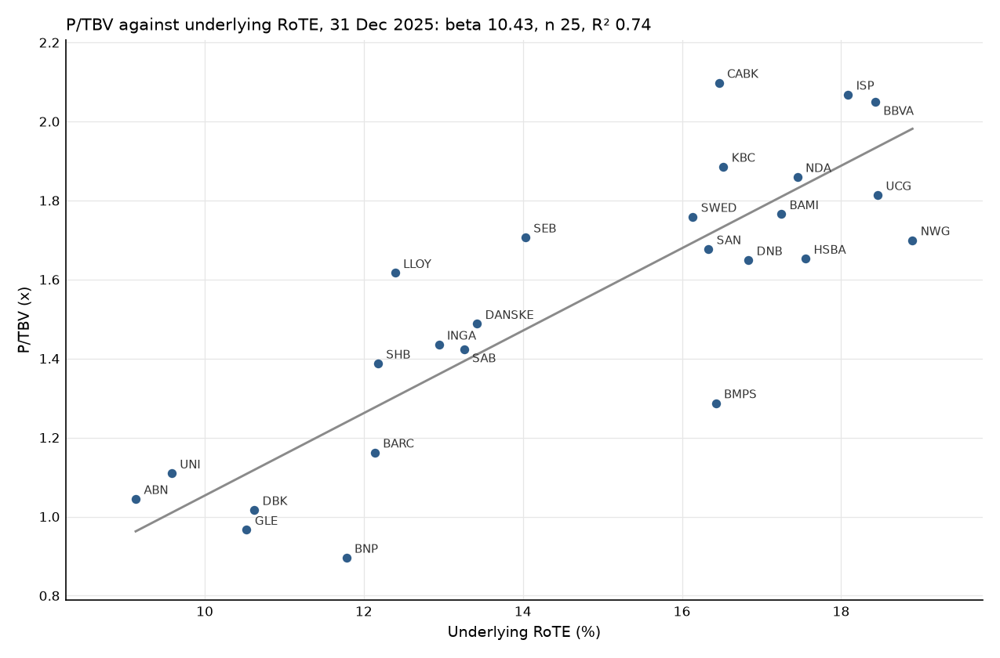

# Bank Performance Benchmarking

[](https://github.com/uty101/Bank-Performance-Benchmarking/actions/workflows/ci.yml)   

<!-- table:headline start -->
**At 30 June 2026, ING Groep has the largest gap to the best quartile of its peers: 10.20 RoTE points, or EUR 6,926m of annual pre tax profit.** Each RoTE point was worth 0.104x of price to tangible book at the end of 2025, against 0.045x at the end of 2022, so the market now pays about 2.3 times as much for the same gap. Banks whose accounting scope differs between the 2 sources, mainly bank insurers, are left out of the headline (see Caveats).
<!-- table:headline end -->

This project benchmarks 31 European banks against peers with a similar business model, sizes each gap in euros and RoTE points, and explains it with 7 drivers.

See `outputs/reports/` for the 31 bank profiles, `outputs/tables/` for every table, and run `streamlit run bpb/dashboard.py` for the dashboard.

Data: the EBA transparency exercise, the banks' annual, half year and Pillar 3 reports, ECB exchange rates and Yahoo Finance prices.

## What it does

It joins EBA transparency data, used to 2025-06-30, to figures hand entered from each bank's own reports, each checked against the cached page it came from. It computes 20 KPIs from FY2021 to H1 2026, forms peer groups by business model, and says which gaps to the best quartile are larger than the noise, what they are worth, which drivers explain RoTE, and how the market prices RoTE.

## How to run it

```
uv venv --python 3.12
uv pip install -r requirements-lock.txt
uv pip install -e . --no-deps
bpb build
streamlit run bpb/dashboard.py
bpb trace <lineage_id>
```

`bpb build` rebuilds every output from `data/raw/` and `data/manual/` offline in about 6 minutes. `bpb trace` prints the chain behind a figure, down to the EBA item or the report page.

## Results

All results are at 2026-06-30, on the cluster group and the underlying basis, unless they say otherwise.

### Q1: where does each bank sit?

<!-- table:q1 start -->
NatWest Group leads on RoTE at 19.91% and Bankinter on cost to income at 35.30%. On RoTE, 3 banks are leading their peers and 10 are lagging. The table below ranks 22 banks on RoTE and 31 on cost to income, the rest being blank at this date. Each verdict is against the bank's own cluster, named beside it, so the ranks and verdicts need not agree.

| Rank | RoTE: bank | Cluster | RoTE | Verdict | Cost to income: bank | Cluster | Cost to income | Verdict |
|---|---|---|---|---|---|---|---|---|
| 1 | NatWest Group | 2 | 19.91% | leading | Bankinter | 2 | 35.30% | leading |
| 2 | BBVA | 2 | 19.08% | leading | KBC Group | 2 | 37.32% | leading |
| 3 | Banca Monte dei Paschi di Siena | 2 | 18.71% | in_line | BBVA | 2 | 38.81% | leading |
| 4 | HSBC Holdings | 1 | 18.04% | leading | DNB Bank | 2 | 39.04% | leading |
| 5 | Intesa Sanpaolo | 2 | 17.99% | in_line | Intesa Sanpaolo | 2 | 39.44% | leading |
| 6 | Nordea Bank | 2 | 17.55% | in_line | CaixaBank | 2 | 39.58% | in_line |
| 7 | Banco Santander | 2 | 17.41% | in_line | Banco Santander | 2 | 41.26% | in_line |
| 8 | CaixaBank | 2 | 17.01% | in_line | Swedbank | 2 | 41.66% | in_line |
| 9 | Banco BPM | 2 | 16.98% | in_line | Danske Bank | 2 | 44.96% | in_line |
| 10 | KBC Group | 2 | 16.85% | in_line | UniCredit | 2 | 45.74% | in_line |
| 11 | Skandinaviska Enskilda Banken | 2 | 14.66% | lagging | Skandinaviska Enskilda Banken | 2 | 45.98% | in_line |
| 12 | Danske Bank | 2 | 14.51% | lagging | Unicaja Banco | 2 | 46.05% | in_line |
| 13 | Banco Sabadell | 2 | 14.32% | lagging | Nordea Bank | 2 | 46.24% | in_line |
| 14 | ING Groep | 2 | 13.80% | lagging | HSBC Holdings | 1 | 46.43% | leading |
| 15 | Lloyds Banking Group | 2 | 13.45% | lagging | Svenska Handelsbanken | 2 | 47.22% | lagging |
| 16 | Barclays | 1 | 12.99% | in_line | Banco BPM | 2 | 47.82% | lagging |
| 17 | BNP Paribas | 1 | 12.87% | in_line | NatWest Group | 2 | 48.34% | lagging |
| 18 | Société Générale | 1 | 11.30% | lagging | Banco Sabadell | 2 | 49.01% | lagging |
| 19 | Deutsche Bank | 1 | 11.12% | lagging | Santander UK Group Holdings | 2 | 53.05% | lagging |
| 20 | ABN AMRO Bank | 2 | 9.80% | lagging | ING Groep | 2 | 53.17% | lagging |
| 21 | Rabobank | 2 | 8.98% | lagging | Rabobank | 2 | 54.02% | lagging |
| 22 | Santander UK Group Holdings | 2 | 6.43% | lagging | BPER Banca | 2 | 54.55% | lagging |
| 23 |  |  |  |  | Commerzbank | 2 | 55.51% | lagging |
| 24 |  |  |  |  | Barclays | 1 | 57.92% | in_line |
| 25 |  |  |  |  | Crédit Agricole Group | 2 | 58.84% | lagging |
| 26 |  |  |  |  | Lloyds Banking Group | 2 | 59.03% | lagging |
| 27 |  |  |  |  | BNP Paribas | 1 | 59.75% | in_line |
| 28 |  |  |  |  | Banca Monte dei Paschi di Siena | 2 | 59.81% | lagging |
| 29 |  |  |  |  | Société Générale | 1 | 60.07% | lagging |
| 30 |  |  |  |  | ABN AMRO Bank | 2 | 60.71% | lagging |
| 31 |  |  |  |  | Deutsche Bank | 1 | 62.68% | lagging |
<!-- table:q1 end -->

### Q2: which gaps are larger than the noise, and what are they worth?

<!-- table:q2 start -->
10 banks have the largest joint gaps, led by CAG at EUR 16,690m. Min and max run over the 3 peer groups and 2 bases, and the joint figure closes every sized gap at once, so it can be less than the sum of the bank's rows. Amounts are EUR m of annual pre tax profit. NIM and cost of risk are sized together as a risk adjusted margin, because a high cost of risk is the price of a high margin.

| Bank | Gap | Headline | Min | Max | Joint | Joint RoTE pts | Scope |
|---|---|---|---|---|---|---|---|
| CAG | Risk adjusted NIM | 16,221 | 14,536 | 16,221 | 16,690 |  | yes |
| CAG | Cost to income | 7,154 | 6,525 | 7,154 | 16,690 |  | yes |
| INGA | Risk adjusted NIM | 6,943 | 5,920 | 6,943 | 6,926 | 10.20 |  |
| INGA | Cost to income | 2,845 | 2,476 | 2,845 | 6,926 | 10.20 |  |
| BARC | Risk adjusted NIM | 4,723 | 4,723 | 11,782 | 4,723 | 5.88 |  |
| LLOY | Cost to income | 4,189 | 2,324 | 4,244 | 4,189 | 7.62 |  |
| DBK | Cost to income | 3,658 | 3,043 | 6,869 | 3,658 | 4.72 |  |
| GLE | Cost to income | 2,339 | 1,882 | 5,093 | 3,411 | 5.01 | yes |
| GLE | Risk adjusted NIM | 2,214 | 2,214 | 5,790 | 3,411 | 5.01 | yes |
| ABN | Risk adjusted NIM | 2,260 | 1,817 | 2,260 | 3,105 | 9.77 |  |
| ABN | Cost to income | 1,776 | 1,653 | 1,778 | 3,105 | 9.77 |  |
| DANSKE | Risk adjusted NIM | 2,209 | 1,866 | 2,209 | 2,209 | 7.71 | yes |
| RABO | Cost to income | 2,139 | 1,829 | 2,139 | 2,139 | 3.09 |  |
| NDA | Risk adjusted NIM | 2,226 | 1,779 | 2,226 | 1,900 | 5.31 | yes |
| NDA | Cost to income | 592 | 437 | 760 | 1,900 | 5.31 | yes |
<!-- table:q2 end -->

### Q3: which drivers explain the RoTE gap?

Decomposition explains where a RoTE gap comes from, and business mix is a legitimate part of that, while sizing in Q2 is where mix must not count as opportunity.

<!-- table:q3 start -->
Of the banks with a decomposition at 2026-06-30, RABO sits furthest from its peer median, -7.31 points, and its largest step is assets / tangible equity at -5.66 points. Each row runs from the reference RoTE, every driver at the peer median, to the bank's RoTE, in points.

| Bank | Gap to median | Reference | NII / assets | Fees / assets | Other income / assets | Costs / assets | Credit losses / assets | Tax rate | Assets / tangible equity | Other below the line | Minorities and AT1 | Bank RoTE |
|---|---|---|---|---|---|---|---|---|---|---|---|---|
| RABO | -7.31 | 15.86 | +4.12 | -2.81 | +0.38 | -2.36 | -0.60 | +0.17 | -5.66 | +0.29 | -0.40 | 8.98 |
| ABN | -6.49 | 16.23 | -1.75 | -0.88 | -2.65 | -1.02 | +1.71 | -0.16 | -1.04 | +0.29 | -0.92 | 9.80 |
| HSBA | +5.97 | 14.38 | +4.58 | -1.01 | +3.26 | +1.63 | -0.12 | +0.60 | -5.81 | +1.66 | -1.13 | 18.04 |
| NWG | +4.20 | 14.94 | +4.25 | -4.38 | -1.82 | +1.73 | +0.83 | +0.36 | +4.82 | +0.28 | -1.09 | 19.91 |
| BBVA | +3.37 | 15.40 | +21.73 | +5.52 | +0.78 | -7.53 | -8.20 | -1.41 | -4.92 | -0.34 | -1.94 | 19.08 |
<!-- table:q3 end -->

### Q4: what is a point of RoTE worth?

<!-- table:q4 start -->
β rose from 4.50 in 2022 to 10.43 in 2025, the first and last years with a significant β, and the implied cost of equity went from 24.22% to 11.58%. The cost of equity is blank in 2021, where the 90% interval of β contains 0. The test that the year slopes are equal is rejected: F(4, 26) = 10.00, p = 0.00005, over 120 bank years. So 1 pooled slope is the wrong model for anything but the significance gate, and the choice of slope matters: LLOY's uplift at the end of 2025 is +0.84x on that year's β and +0.28x on the pooled β. The figure below shows 2025, the tightest fit.

| Year | β | R² | n | Implied CoE |
|---|---|---|---|---|
| 2021 | 1.05 | 0.09 | 22 | blank |
| 2022 | 4.50 | 0.48 | 23 | 24.22% |
| 2023 | 4.53 | 0.40 | 25 | 24.09% |
| 2024 | 6.63 | 0.55 | 25 | 17.08% |
| 2025 | 10.43 | 0.74 | 25 | 11.58% |


<!-- table:q4 end -->

### Q5: how far apart are the 2 sources?

<!-- table:q5 start -->
Fields the 2 sources define alike agree closely: the median absolute difference is 0.00% for loans and 0.02% for profit after tax. Total assets differ by a median of 8.54%, because the supervisory scope leaves out entities such as insurers. Small residual lines differ the most, since each source draws them differently. The table covers 2025-06-30, the date both sources report, and lists the 29 fields that at least 15 banks report, leaving out 6.

| Field | Banks | Median | 90th percentile |
|---|---|---|---|
| admin_expenses | 26 | 1.91% | 13.08% |
| at1_instruments | 23 | 0.99% | 4.08% |
| cash_cb | 25 | 2.94% | 12.21% |
| debt_securities | 24 | 0.00% | 0.00% |
| deposits_customers | 23 | 2.04% | 9.15% |
| depreciation | 21 | 1.14% | 6.75% |
| dividend_income | 15 | 0.70% | 62.13% |
| gains_derecognition_not_fvtpl | 18 | 36.35% | 149.02% |
| gains_held_for_trading | 26 | 33.47% | 305.20% |
| impairments_fin | 26 | 3.34% | 87.21% |
| intangibles_deduction | 22 | 0.00% | 0.05% |
| interest_expense | 26 | 0.97% | 23.33% |
| interest_income | 26 | 1.33% | 12.30% |
| loans_all | 24 | 0.00% | 0.00% |
| loans_customers_allowance | 24 | 0.00% | 0.03% |
| loans_customers_gross | 24 | 0.00% | 0.00% |
| loans_households_gross | 24 | 0.00% | 0.00% |
| net_fees | 26 | 0.80% | 14.41% |
| npl_allowance | 24 | 0.00% | 0.02% |
| npl_gross | 24 | 0.00% | 0.01% |
| other_operating_net | 26 | 127.58% | 1093.47% |
| pat | 26 | 0.02% | 2.81% |
| pbt | 26 | 0.46% | 5.00% |
| profit_owners | 26 | 0.01% | 2.29% |
| total_assets | 25 | 8.54% | 16.65% |
| total_equity | 24 | 0.02% | 1.41% |
| total_liabilities | 19 | 9.89% | 17.47% |
| total_operating_income | 26 | 3.12% | 7.86% |
| trading_assets | 17 | 0.40% | 59.54% |

**Bank insurer scope.** NDA, DANSKE, SWED, SEB, SHB, KBC, BNP, GLE, CAG, BAMI, CABK, DNB, ISP, UCG carry a scope difference between the 2 sources, as bank insurers or with a total assets seam above 5%. For ISP and KBC, the income statement lines were read line by line and every one sits in the right field, so the size of other below the line is the insurance effect: -7.85 points of RoTE for ISP and -10.11 for KBC at 2026-06-30. The same treatment flatters their cost to income.
<!-- table:q5 end -->

## Peer groups

<!-- table:peers start -->
The clustering splits the 31 banks into 5 and 26. The 5 are BARC, BNP, DBK, GLE, HSBA: global banks, far larger than the rest, with a much higher share of trading assets and a lower share of loans. Everyone else, from Lloyds to Unicaja, is 1 broad group of retail and commercial banks, so the cluster says more about what the global banks are than about how the others differ. That is why every sized gap is shown with its range across the 3 groups. The silhouette is 0.29, and mean stability is 0.57 for the 5 bank cluster and 0.78 for the other.
<!-- table:peers end -->

## Caveats

- **Accounting scope.** Bank insurers report insurance lines that the supervisory scope leaves out, so their cost and income ratios are not like for like.
- **FX inside averages.** Averages and rolling figures of EBA balances for the 5 non EUR banks carry the currency move between their 2 ends.
- **The 2 seams.** Seam 1 sets EBA capital against Pillar 3, and seam 2 sets EBA against the banks' reports. No time comparison crosses from 1 source to the other, so such a cell is blank with status `family_switch`.
- **One offs.** Underlying figures adjust only for what each bank discloses, never for judgement.
- **Broad cluster 2.** The cluster group for most banks is broad, so read every sized gap with its range across the 3 groups.
- **Small peer groups.** Market groups hold few banks, intervals are wide, and a group that is too small gives no benchmark.
- **Valuation slope.** The slope changes every year, so an uplift holds only at the date of its fit.
- **BMPS prices.** Prices before BMPS's rights issue may keep an adjustment that `Stock Splits` does not undo; no P/TBV uses them.
<!-- table:headcount start -->
- **Headcount.** 9 banks publish only headcount, which stands in for FTE.
<!-- table:headcount end -->
<!-- table:coverage start -->
- **Coverage.** 97 of 620 KPI cells are blank at 2026-06-30 on the underlying basis, because an input is not published or not comparable. The largest causes are customers (27), fte (24), mixed_family (8).
<!-- table:coverage end -->

## What it does not do

- It does not forecast. Every figure is historical, and a sized gap says what a bank would earn at peer levels on today's balance sheet.
- It does not say a gap can be closed. Some gaps are structural, and the peer grouping reduces that without removing it.
- It does not harmonise accounting beyond what FINREP and Pillar 3 already standardise; Q5 shows what remains.
- It does not cover banks outside the 7 markets, or smaller banks outside the EBA sample.
- It does not give investment advice. The valuation describes a cross sectional relationship with its uncertainty, not a target price.

## Repository map

- `bpb/`: the package, from ingestion to the dashboard.
- `config/`: field, KPI and source maps. `config.toml` holds every parameter.
- `data/raw/`: pulled data, the cached report pages and their hashes.
- `data/manual/`: hand entered figures, one offs, mergers and the universe.
- `docs/`: `METHODS.md` and the resolved conventions.
- `outputs/`: profiles, figures and tables, all rebuilt by `bpb build`.
- `scripts/`: data pulls and the README table writer.
- `tests/`: the test suite, which runs offline.
- `project_outline/`, `instructions/`, `review/`, `decisions/` and `PLAN.md`: the outline and the build record.
