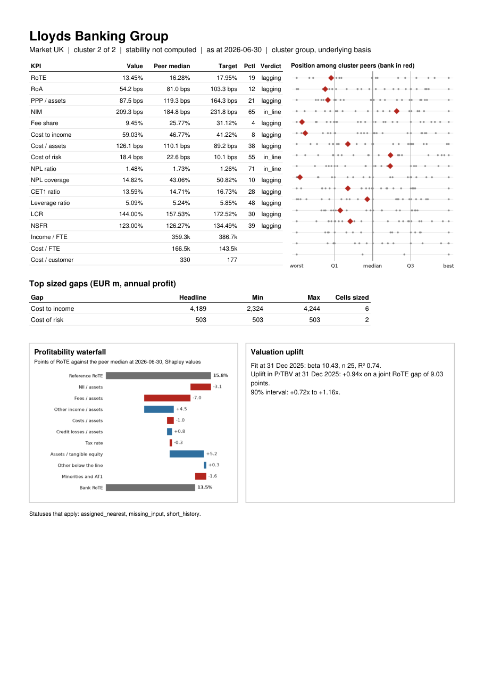
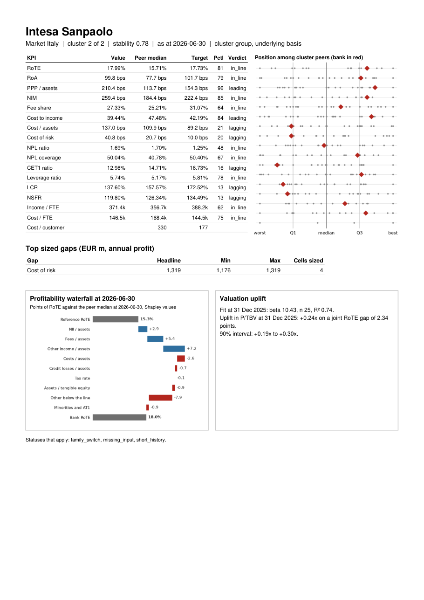
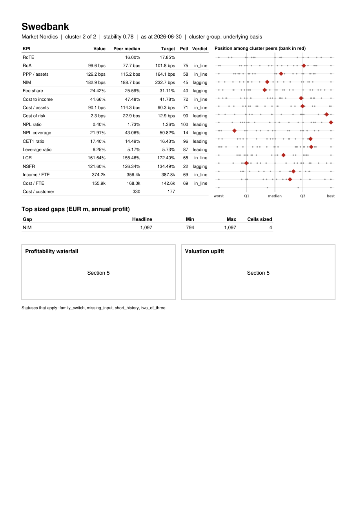

# Section 4

Section 4 is complete. This file covers the whole section, including the stop at step 4.1 under instruction 04 (Deviation 1), and replaces the earlier version.

## Steps completed

3.8 section 3 review decisions (da5d6e6)
4.0b apply section 4 stop decisions (f94e098)
4.1 peer groups (606dcb0 before the stop, 19dd997 after it)
4.2 benchmarks (5b1c2ab)
4.3 gap sizing and the hand check (09a87e0)
4.4 first profiles for LLOY, ISP and SWED (d90f7eb)

## Evidence

### E3.8a The 31 entries added in step 3.8 (value 0 in every row)

```
   bank_id    ref_date               field value_as_printed                   doc page   decision_status                                                                                                                  snippet
0     BMPS  2020-12-31         at1_coupons            blank     annual:2020-12-31  339     no_at1_coupon                                                            As at 31 December 2020, the Group held no equity instruments.
1     BMPS  2021-06-30         at1_coupons            blank     annual:2021-12-31  353     no_at1_coupon                                                            As at 31 December 2021, the Group held no equity instruments.
2     BMPS  2021-12-31         at1_coupons            blank     annual:2021-12-31  353     no_at1_coupon                                                            As at 31 December 2021, the Group held no equity instruments.
3     BMPS  2022-06-30         at1_coupons            blank     annual:2022-12-31  348     no_at1_coupon                                                            As at 31 December 2022, the Group held no equity instruments.
4     BMPS  2022-12-31         at1_coupons            blank     annual:2022-12-31  348     no_at1_coupon                                                            As at 31 December 2022, the Group held no equity instruments.
5     BMPS  2023-06-30         at1_coupons            blank     annual:2023-12-31  310     no_at1_coupon              As at 31 December 2023, as in the financial year used for comparison, the Group held no equity instruments.
6     BMPS  2023-12-31         at1_coupons            blank     annual:2023-12-31  310     no_at1_coupon              As at 31 December 2023, as in the financial year used for comparison, the Group held no equity instruments.
7     BMPS  2024-06-30         at1_coupons            blank     annual:2024-12-31  471     no_at1_coupon              As at 31 December 2024, as in the financial year used for comparison, the Group held no equity instruments.
8     BMPS  2024-12-31         at1_coupons            blank     annual:2024-12-31  471     no_at1_coupon              As at 31 December 2024, as in the financial year used for comparison, the Group held no equity instruments.
9     BMPS  2025-06-30         at1_coupons            blank     annual:2025-12-31  524     no_at1_coupon       As at 31 December 2025, as in the (cid:470)nancial year used for comparison, the Group held no equity instruments.
10    BMPS  2025-12-31         at1_coupons            blank     annual:2025-12-31  524     no_at1_coupon       As at 31 December 2025, as in the (cid:470)nancial year used for comparison, the Group held no equity instruments.
11    BMPS  2026-06-30         at1_coupons            blank     annual:2025-12-31  524     no_at1_coupon       As at 31 December 2025, as in the (cid:470)nancial year used for comparison, the Group held no equity instruments.
12     NDA  2026-06-30         at1_coupons                -  half_year:2026-06-30   37     no_at1_coupon                                                                     Paid interest on Additional Tier 1 capital - -26 -26
13   SANUK  2022-06-30  minority_interests                —  half_year:2023-06-30   59  from_comparative                                                             At 30 June 2022 7,060 2,196 21 (669) 2 7,339 15,949 — 15,949
14   SANUK  2022-12-31  minority_interests                —     annual:2023-12-31  186  from_comparative                                                        At 31 December 2022 7,060 2,196 6 (1,116) 2 6,563 14,711 — 14,711
15   SANUK  2023-06-30  minority_interests            blank  half_year:2024-06-30   55  from_comparative                                                                     At 30 June 2023 7,060 2,196 3 (1,168) 2 6,820 14,913
16   SANUK  2023-12-31  minority_interests                —     annual:2024-12-31  171  from_comparative                                                        At 31 December 2023 7,060 2,196 (5) (334) 2 6,047 14,966 — 14,966
17   SANUK  2024-12-31  minority_interests            blank     annual:2025-12-31  163  from_comparative                                                              At 31 December 2024 7,060 2,100 (16) (311) — 2 5,258 14,093
18  DANSKE  2022-06-30  minority_interests                -  half_year:2023-06-30   38  from_comparative                                          Total equity as at 30 June 2022 8,622 -1,801 -1,270 165,224 - 170,775 - 170,775
19  DANSKE  2022-12-31  minority_interests                -     annual:2023-12-31   70  from_comparative                                      Total equity as at 31 December 2022 8,622 -2,630 -1,526 155,812 - 160,278 - 160,278
20  DANSKE  2023-06-30  minority_interests            blank  half_year:2024-06-30   32  from_comparative                                                    Total equity as at 30 June 2023 8,622 -4,903 -1,600 166,529 - 168,648
21  DANSKE  2023-12-31  minority_interests            blank     annual:2024-12-31  126  from_comparative                                              Total equity as at 31 December 2023 8,622 -2,639 -306 163,596 6,466 175,739
22     ABN  2020-12-31  minority_interests            blank     annual:2021-12-31  267  from_comparative                                              Balance at 31 December 2020 940 12,970 6,870 -1,733 -45 1,987 20,989 20,989
23     BKT  2020-12-31  minority_interests                -     annual:2020-12-31   17       no_nci_line                                                                       Minority interests [Non-controlling interests] - -
24     BKT  2021-12-31  minority_interests                -     annual:2021-12-31   15       no_nci_line                                                                       Minority interests [Non-controlling interests] - -
25     BKT  2022-12-31  minority_interests                -     annual:2022-12-31   13       no_nci_line                                                                       Minority interests [non-controlling interests] - -
26     BKT  2023-12-31  minority_interests                —     annual:2023-12-31   13       no_nci_line                                                                       Minority interests (non-controlling interests) — —
27     BKT  2024-12-31  minority_interests                —     annual:2025-12-31   14       no_nci_line                                                                       Minority interests (non-controlling interests) — —
28     BKT  2025-12-31  minority_interests                —     annual:2025-12-31   14       no_nci_line                                                                       Minority interests (non-controlling interests) — —
29     BKT  2026-06-30  minority_interests                —  half_year:2026-06-30   13       no_nci_line                                                                       MINORITY INTERESTS (non-controlling interests) — —
30     BKT  2025-06-30  minority_interests                —  half_year:2026-06-30   17  from_comparative  Closing balance at 30/06/2025 (*) 269,660 — — 17,238 5,504,166 — (9,168) (2,246) 541,693 (135,068) 25,128 — — 6,211,403
```

### E3.8b BMPS EU CC1 row 30, every entered date (OPEN-34)

```
         ref_date value_as_printed doc_type page                                                          snippet
10781  2024-12-31                -  pillar3   34  30 Capital instruments and the related share premium accounts -
10783  2025-06-30                -  pillar3   16  30 Capital instruments and the related share premium accounts -
10785  2025-12-31                -  pillar3   41  30 Capital instruments and the related share premium accounts -
10787  2026-06-30                -  pillar3   15  30 Capital instruments and the related share premium accounts -
```

### E3.8c rote, reported basis, after step 3.8 (pct)

```
bank_id      BMPS    NDA  SANUK  DANSKE    ABN    BKT
date                                                 
2021-12-31   5.28  13.60   9.85     NaN   5.88  28.33
2022-06-30   2.31    NaN  11.28     NaN   7.90    NaN
2022-12-31  -2.98    NaN  10.68     NaN   8.75  11.64
2023-06-30   5.49    NaN  11.80    0.34  11.60    NaN
2023-12-31  23.41    NaN  13.11   13.04  12.17  16.70
2024-06-30  27.19    NaN  10.80   13.40  11.74    NaN
2024-12-31  18.26    NaN   7.43   13.88  10.27  17.14
2025-06-30  15.28  18.60   6.97   13.75   9.49    NaN
2025-12-31  16.42  17.45   8.64   13.42   8.88    NaN
2026-06-30  18.71  16.87   6.43   14.51   9.79    NaN
```

### E3.8d rote status, reported basis, after step 3.8

```
bank_id                            BMPS                                      NDA                         SANUK                                  DANSKE               ABN                                       BKT
date                                                                                                                                                                                                              
2021-12-31  at1_liability;no_at1_coupon                                       ok                            ok           missing_input:tangible_equity  from_comparative  at1_liability;at1_net_of_tax;no_nci_line
2022-06-30  at1_liability;no_at1_coupon            missing_input:tangible_equity              from_comparative           missing_input:tangible_equity                ok          missing_input:profit_to_ordinary
2022-12-31  at1_liability;no_at1_coupon            missing_input:tangible_equity              from_comparative           missing_input:tangible_equity                ok  at1_liability;at1_net_of_tax;no_nci_line
2023-06-30  at1_liability;no_at1_coupon            missing_input:tangible_equity              from_comparative                             fx_combined                ok          missing_input:profit_to_ordinary
2023-12-31  at1_liability;no_at1_coupon            missing_input:tangible_equity              from_comparative                             fx_combined                ok  at1_liability;at1_net_of_tax;no_nci_line
2024-06-30  at1_liability;no_at1_coupon            missing_input:tangible_equity  from_comparative;no_nci_line                             fx_combined                ok          missing_input:profit_to_ordinary
2024-12-31  at1_liability;no_at1_coupon            missing_input:tangible_equity              from_comparative                             fx_combined                ok  at1_liability;at1_net_of_tax;no_nci_line
2025-06-30  at1_liability;no_at1_coupon                at1_liability;no_nci_line                   no_nci_line                             fx_combined                ok          missing_input:profit_to_ordinary
2025-12-31  at1_liability;no_at1_coupon                at1_liability;no_nci_line  from_comparative;no_nci_line  at1_liability;no_nci_line;coupon_in_pl                ok       missing_input:intangibles_deduction
2026-06-30  at1_liability;no_at1_coupon  at1_liability;no_nci_line;no_at1_coupon                   no_nci_line  at1_liability;no_nci_line;coupon_in_pl                ok                              mixed_family
```

### E3.8e rote, reported basis, before step 3.8 (pct)

```
bank_id     BMPS    NDA  SANUK  DANSKE    ABN  BKT
date                                              
2021-12-31   NaN  13.60   9.85     NaN    NaN  NaN
2022-06-30   NaN    NaN    NaN     NaN   7.90  NaN
2022-12-31   NaN    NaN    NaN     NaN   8.75  NaN
2023-06-30   NaN    NaN    NaN     NaN  11.60  NaN
2023-12-31   NaN    NaN    NaN     NaN  12.17  NaN
2024-06-30   NaN    NaN    NaN     NaN  11.74  NaN
2024-12-31   NaN    NaN    NaN     NaN  10.27  NaN
2025-06-30   NaN  18.60   6.97   13.75   9.49  NaN
2025-12-31   NaN  17.45    NaN   13.42   8.88  NaN
2026-06-30   NaN    NaN   6.43   14.51   9.79  NaN
```

### E3.8c rote, underlying basis, after step 3.8 (pct)

```
bank_id      BMPS    NDA  SANUK  DANSKE    ABN    BKT
date                                                 
2021-12-31   5.28  13.60  12.55     NaN   8.45  28.33
2022-06-30   2.31    NaN  12.86     NaN   7.19    NaN
2022-12-31  -2.98    NaN  13.28     NaN  10.35  11.64
2023-06-30   5.49    NaN  14.38    9.70  13.18    NaN
2023-12-31  23.41    NaN  14.71   13.04  12.71  16.70
2024-06-30  27.19    NaN  11.54   13.40  12.25    NaN
2024-12-31  18.26    NaN   7.43   13.88  10.69  17.14
2025-06-30  15.28  18.60   6.97   13.75  10.07    NaN
2025-12-31  16.42  17.45   8.64   13.42   9.13    NaN
2026-06-30  18.71  17.55   6.43   14.51   9.80    NaN
```

### E3.8d rote status, underlying basis, after step 3.8

```
bank_id                            BMPS                                      NDA                         SANUK                                  DANSKE               ABN                                       BKT
date                                                                                                                                                                                                              
2021-12-31  at1_liability;no_at1_coupon                                       ok                            ok           missing_input:tangible_equity  from_comparative  at1_liability;at1_net_of_tax;no_nci_line
2022-06-30  at1_liability;no_at1_coupon            missing_input:tangible_equity              from_comparative           missing_input:tangible_equity                ok          missing_input:profit_to_ordinary
2022-12-31  at1_liability;no_at1_coupon            missing_input:tangible_equity              from_comparative           missing_input:tangible_equity                ok  at1_liability;at1_net_of_tax;no_nci_line
2023-06-30  at1_liability;no_at1_coupon            missing_input:tangible_equity              from_comparative                             fx_combined                ok          missing_input:profit_to_ordinary
2023-12-31  at1_liability;no_at1_coupon            missing_input:tangible_equity              from_comparative                             fx_combined                ok  at1_liability;at1_net_of_tax;no_nci_line
2024-06-30  at1_liability;no_at1_coupon            missing_input:tangible_equity  from_comparative;no_nci_line                             fx_combined                ok          missing_input:profit_to_ordinary
2024-12-31  at1_liability;no_at1_coupon            missing_input:tangible_equity              from_comparative                             fx_combined                ok  at1_liability;at1_net_of_tax;no_nci_line
2025-06-30  at1_liability;no_at1_coupon                at1_liability;no_nci_line                   no_nci_line                             fx_combined                ok          missing_input:profit_to_ordinary
2025-12-31  at1_liability;no_at1_coupon                at1_liability;no_nci_line  from_comparative;no_nci_line  at1_liability;no_nci_line;coupon_in_pl                ok       missing_input:intangibles_deduction
2026-06-30  at1_liability;no_at1_coupon  at1_liability;no_nci_line;no_at1_coupon                   no_nci_line  at1_liability;no_nci_line;coupon_in_pl                ok                              mixed_family
```

### E3.8e rote, underlying basis, before step 3.8 (pct)

```
bank_id     BMPS    NDA  SANUK  DANSKE    ABN  BKT
date                                              
2021-12-31   NaN  13.60  12.55     NaN    NaN  NaN
2022-06-30   NaN    NaN    NaN     NaN   7.19  NaN
2022-12-31   NaN    NaN    NaN     NaN  10.35  NaN
2023-06-30   NaN    NaN    NaN     NaN  13.18  NaN
2023-12-31   NaN    NaN    NaN     NaN  12.71  NaN
2024-06-30   NaN    NaN    NaN     NaN  12.25  NaN
2024-12-31   NaN    NaN    NaN     NaN  10.69  NaN
2025-06-30   NaN  18.60   6.97   13.75  10.07  NaN
2025-12-31   NaN  17.45    NaN   13.42   9.13  NaN
2026-06-30   NaN    NaN   6.43   14.51   9.80  NaN
```

### E3.8f rote coverage, every bank (filled bank-dates)

```
            before  after   of
basis                         
reported       218    245  310
underlying     218    245  310
```

### E4.0b Decision 5: the 5 rows of Deviation 3 (none removed)

```
  bank_id    ref_date                           statement of changes in equity                                  balance sheet     rule met outcome
0   SANUK  2023-06-30                               H1 2024 p55: no NCI column                       H1 2023 p57: no NCI line  no NCI rule    kept
1   SANUK  2024-12-31                               FY2025 p163: no NCI column       FY2025 p161 and FY2024 p169: no NCI line  no NCI rule    kept
2  DANSKE  2023-06-30                               H1 2024 p32: no NCI column                H1 2023 p37: no NCI or AT1 line  no NCI rule    kept
3  DANSKE  2023-12-31                               FY2024 p126: no NCI column                FY2024 p125: no NCI or AT1 line  no NCI rule    kept
4     ABN  2020-12-31  FY2021 p267: NCI cell blank in the 31 December 2020 row  FY2021 p266: NCI row printed, 2020 cell blank    dash rule    kept
```

### E4.1a PEERS in full

```
    year bank_id  cluster  k  silhouette  stability  borderline  override_reason            status
0   2023     ABN        3  3    0.246949   0.766886       False              NaN                ok
1   2023    BAMI        2  3    0.246949   0.670299       False              NaN                ok
2   2023    BARC        1  3    0.246949   0.740909       False              NaN                ok
3   2023    BBVA        2  3    0.246949   0.670299       False              NaN                ok
4   2023     BKT        3  3    0.246949   0.766886       False              NaN                ok
5   2023    BMPS        2  3    0.246949   0.670299       False              NaN                ok
6   2023     BNP        1  3    0.246949   0.740909       False              NaN                ok
7   2023     BPE        2  3    0.246949   0.670299       False              NaN                ok
8   2023    CABK        2  3    0.246949   0.670299       False              NaN                ok
9   2023     CAG        2  3    0.246949   0.670299       False              NaN                ok
10  2023     CBK        2  3    0.246949   0.670299       False              NaN                ok
11  2023  DANSKE        3  3    0.246949   0.766886       False              NaN                ok
12  2023     DBK        1  3    0.246949   0.740909       False              NaN                ok
13  2023     DNB        3  3    0.246949   0.766886       False              NaN      two_of_three
14  2023     GLE        1  3    0.246949   0.740909       False              NaN                ok
15  2023    HSBA        1  3    0.246949   0.740909       False              NaN                ok
16  2023    INGA        3  3    0.246949   0.766886       False              NaN                ok
17  2023     ISP        2  3    0.246949   0.670299       False              NaN                ok
18  2023     KBC        2  3    0.246949   0.670299       False              NaN                ok
19  2023    LLOY        3  3    0.246949        NaN       False              NaN  assigned_nearest
20  2023     NDA        3  3    0.246949   0.766886       False              NaN                ok
21  2023     NWG        3  3    0.246949   0.766886       False              NaN                ok
22  2023    RABO        3  3    0.246949   0.766886       False              NaN                ok
23  2023     SAB        3  3    0.246949   0.766886       False              NaN                ok
24  2023     SAN        3  3    0.246949   0.766886       False              NaN                ok
25  2023   SANUK        3  3    0.246949        NaN       False              NaN  assigned_nearest
26  2023     SEB        2  3    0.246949   0.670299       False              NaN                ok
27  2023     SHB        3  3    0.246949   0.766886       False              NaN                ok
28  2023    SWED        3  3    0.246949   0.766886       False              NaN                ok
29  2023     UCG        2  3    0.246949   0.670299       False              NaN                ok
30  2023     UNI        3  3    0.246949   0.766886       False              NaN                ok
31  2024     ABN        2  2    0.308452   0.795538       False              NaN                ok
32  2024    BAMI        2  2    0.308452   0.795538       False              NaN                ok
33  2024    BARC        1  2    0.308452   0.603891       False              NaN                ok
34  2024    BBVA        2  2    0.308452   0.795538       False              NaN                ok
35  2024     BKT        2  2    0.308452   0.795538       False              NaN                ok
36  2024    BMPS        2  2    0.308452   0.795538       False              NaN                ok
37  2024     BNP        1  2    0.308452   0.603891       False              NaN                ok
38  2024     BPE        2  2    0.308452   0.795538       False              NaN                ok
39  2024    CABK        2  2    0.308452   0.795538       False              NaN                ok
40  2024     CAG        2  2    0.308452   0.795538       False              NaN                ok
41  2024     CBK        2  2    0.308452   0.795538       False              NaN                ok
42  2024  DANSKE        2  2    0.308452   0.795538       False              NaN                ok
43  2024     DBK        1  2    0.308452   0.603891       False              NaN                ok
44  2024     DNB        2  2    0.308452   0.795538       False              NaN                ok
45  2024     GLE        1  2    0.308452   0.603891       False              NaN                ok
46  2024    HSBA        1  2    0.308452   0.603891       False              NaN                ok
47  2024    INGA        2  2    0.308452   0.795538       False              NaN                ok
48  2024     ISP        2  2    0.308452   0.795538       False              NaN                ok
49  2024     KBC        2  2    0.308452   0.795538       False              NaN                ok
50  2024    LLOY        2  2    0.308452        NaN       False              NaN  assigned_nearest
51  2024     NDA        2  2    0.308452   0.795538       False              NaN                ok
52  2024     NWG        2  2    0.308452   0.795538       False              NaN                ok
53  2024    RABO        2  2    0.308452   0.795538       False              NaN                ok
54  2024     SAB        2  2    0.308452   0.795538       False              NaN                ok
55  2024     SAN        2  2    0.308452   0.795538       False              NaN                ok
56  2024   SANUK        2  2    0.308452        NaN       False              NaN  assigned_nearest
57  2024     SEB        2  2    0.308452   0.795538       False              NaN                ok
58  2024     SHB        2  2    0.308452   0.795538       False              NaN                ok
59  2024    SWED        2  2    0.308452   0.795538       False              NaN                ok
60  2024     UCG        2  2    0.308452   0.795538       False              NaN                ok
61  2024     UNI        2  2    0.308452   0.795538       False              NaN                ok
62  2025     ABN        2  2    0.293158   0.780666       False              NaN                ok
63  2025    BAMI        2  2    0.293158   0.780666       False              NaN                ok
64  2025    BARC        1  2    0.293158   0.565571        True              NaN                ok
65  2025    BBVA        2  2    0.293158   0.780666       False              NaN                ok
66  2025     BKT        2  2    0.293158   0.780666       False              NaN      two_of_three
67  2025    BMPS        2  2    0.293158   0.780666       False              NaN                ok
68  2025     BNP        1  2    0.293158   0.565571        True              NaN      two_of_three
69  2025     BPE        2  2    0.293158   0.780666       False              NaN                ok
70  2025    CABK        2  2    0.293158   0.780666       False              NaN                ok
71  2025     CAG        2  2    0.293158   0.780666       False              NaN                ok
72  2025     CBK        2  2    0.293158   0.780666       False              NaN      two_of_three
73  2025  DANSKE        2  2    0.293158   0.780666       False              NaN                ok
74  2025     DBK        1  2    0.293158   0.565571        True              NaN                ok
75  2025     DNB        2  2    0.293158   0.780666       False              NaN      two_of_three
76  2025     GLE        1  2    0.293158   0.565571        True              NaN      two_of_three
77  2025    HSBA        1  2    0.293158   0.565571        True              NaN                ok
78  2025    INGA        2  2    0.293158   0.780666       False              NaN                ok
79  2025     ISP        2  2    0.293158   0.780666       False              NaN                ok
80  2025     KBC        2  2    0.293158   0.780666       False              NaN                ok
81  2025    LLOY        2  2    0.293158        NaN       False              NaN  assigned_nearest
82  2025     NDA        2  2    0.293158   0.780666       False              NaN      two_of_three
83  2025     NWG        2  2    0.293158   0.780666       False              NaN                ok
84  2025    RABO        2  2    0.293158   0.780666       False              NaN                ok
85  2025     SAB        2  2    0.293158   0.780666       False              NaN                ok
86  2025     SAN        2  2    0.293158   0.780666       False              NaN                ok
87  2025   SANUK        2  2    0.293158        NaN       False              NaN  assigned_nearest
88  2025     SEB        2  2    0.293158   0.780666       False              NaN      two_of_three
89  2025     SHB        2  2    0.293158   0.780666       False              NaN      two_of_three
90  2025    SWED        2  2    0.293158   0.780666       False              NaN      two_of_three
91  2025     UCG        2  2    0.293158   0.780666       False              NaN                ok
92  2025     UNI        2  2    0.293158   0.780666       False              NaN                ok
```

### E4.1b Cluster membership, 2023 to 2025

```
year     2023  2024  2025
bank_id                  
ABN         3     2     2
BAMI        2     2     2
BARC        1     1     1
BBVA        2     2     2
BKT         3     2     2
BMPS        2     2     2
BNP         1     1     1
BPE         2     2     2
CABK        2     2     2
CAG         2     2     2
CBK         2     2     2
DANSKE      3     2     2
DBK         1     1     1
DNB         3     2     2
GLE         1     1     1
HSBA        1     1     1
INGA        3     2     2
ISP         2     2     2
KBC         2     2     2
LLOY        3     2     2
NDA         3     2     2
NWG         3     2     2
RABO        3     2     2
SAB         3     2     2
SAN         3     2     2
SANUK       3     2     2
SEB         2     2     2
SHB         3     2     2
SWED        3     2     2
UCG         2     2     2
UNI         3     2     2
```

### E4.1c Feature table, 2023

```
         ln_assets  loans_assets  fee_share  household_share  trading_assets  loan_deposit
bank_id                                                                                   
ABN        26.6785        0.7005     0.2165           0.5997          0.0141        1.0246
BAMI       25.9720        0.5617     0.4157           0.3164          0.0234        0.9662
BARC       28.1525        0.3804     0.2905           0.4014          0.1043        1.0472
BBVA       27.2622        0.5068     0.2345           0.4554          0.1817        0.8815
BKT        25.4177        0.6465     0.2723           0.5253          0.0384        0.9330
BMPS       25.5648        0.6122     0.4128           0.4468          0.0557        1.0007
BNP        28.4962        0.3697     0.2685           0.3756          0.2900        0.7411
BPE        25.6892        0.6003     0.4132           0.4473          0.0039        0.8387
CABK       27.0459        0.6252     0.3524           0.5162          0.0271        0.8799
CAG        28.3152        0.5617     0.4440           0.5404          0.1298        0.9496
CBK        26.9353        0.5245     0.3629           0.4899          0.0665        0.8455
DANSKE     26.8224        0.5998     0.2659           0.4424          0.1722        1.5816
DBK        27.9133        0.4603     0.3754           0.3451          0.2932        1.0333
DNB        26.3475        0.6650     0.1454           0.5346          0.0696        1.3853
GLE        27.9273        0.3887     0.2506           0.3991          0.2543        0.8536
HSBA       28.6292        0.3887     0.2217           0.3844          0.0843        0.7118
INGA       27.5952        0.6931     0.1811           0.5319          0.0595        0.9915
ISP        27.4303        0.5426     0.4196           0.3991          0.0520        0.9806
KBC        26.4786        0.5501     0.3161           0.4841          0.0270        0.8042
LLOY       27.6502        0.5596     0.0893           0.7256             NaN        1.0404
NDA        26.9699        0.6350     0.2971           0.5575          0.1321        1.5223
NWG        27.4620        0.5123     0.1781           0.5909          0.0682        0.8252
RABO       27.1645        0.7054     0.1614           0.4598          0.0413        1.1839
SAB        26.2287        0.6347     0.2657           0.5709          0.0118        0.9625
SAN        28.1573        0.5972     0.2173           0.5796          0.0879        1.0276
SANUK      26.5355        0.7854     0.0612           0.8465             NaN        1.1645
SEB        26.3671        0.6215     0.3041           0.3764          0.1391        1.1529
SHB        26.4155        0.7054     0.1915           0.5452          0.0114        1.7322
SWED       26.1661        0.7194     0.2555           0.6441          0.0595        1.4055
UCG        27.4703        0.5192     0.3245           0.2936          0.0785        0.8735
UNI        25.3584        0.5203     0.3173           0.6717          0.0029        0.6942
```

### E4.1c Feature table, 2024

```
         ln_assets  loans_assets  fee_share  household_share  trading_assets  loan_deposit
bank_id                                                                                   
ABN        26.6667        0.7150     0.2158           0.6034          0.0163        1.0275
BAMI       25.9400        0.5671     0.3748           0.3183          0.0268        0.9608
BARC       28.1877        0.3821     0.2641           0.3914          0.1054        1.0654
BBVA       27.3116        0.5261     0.2341           0.4473          0.1663        0.8857
BKT        25.4596        0.6519     0.2481           0.5301          0.0351        0.9198
BMPS       25.5257        0.6298     0.3707           0.4467          0.0500        0.9782
BNP        28.5050        0.3757     0.2576           0.3722          0.3054        0.7462
BPE        25.6994        0.6210     0.3748           0.4632          0.0047        0.8511
CABK       27.0144        0.6481     0.3193           0.5059          0.0248        0.8641
CAG        28.3590        0.5576     0.4429           0.5393          0.1452        0.9373
CBK        26.9986        0.5140     0.3309           0.4743          0.0583        0.7971
DANSKE     26.8026        0.6060     0.2548           0.4087          0.1778        1.6241
DBK        27.9290        0.4677     0.3452           0.3282          0.2949        1.0204
DNB        26.3467        0.6763     0.1456           0.5156          0.0645        1.4236
GLE        27.9538        0.3651     0.2602           0.3820          0.2645        0.7950
HSBA       28.6646        0.3773     0.1958           0.3850          0.0910        0.7040
INGA       27.6187        0.7006     0.1768           0.5308          0.0655        0.9907
ISP        27.3879        0.5483     0.3805           0.4113          0.0520        0.9602
KBC        26.5127        0.5653     0.3109           0.4791          0.0277        0.8170
LLOY       27.6621        0.5562     0.0928           0.7350             NaN        1.0371
NDA        26.9879        0.6244     0.2680           0.5559          0.1450        1.4576
NWG        27.4333        0.5480     0.1667           0.5844          0.0661        0.8840
RABO       27.1591        0.7255     0.1532           0.4494          0.0419        1.1639
SAB        26.2120        0.6475     0.2452           0.5699          0.0139        0.9512
SAN        28.2039        0.5816     0.2126           0.5774          0.1055        0.9955
SANUK      26.5083        0.7932     0.0581           0.8502             NaN        1.1540
SEB        26.3763        0.6182     0.2790           0.3661          0.1658        1.1798
SHB        26.3941        0.7083     0.1711           0.5413          0.0119        1.7497
SWED       26.1513        0.7186     0.2290           0.6395          0.0701        1.4268
UCG        27.4181        0.5381     0.2935           0.3043          0.0727        0.8664
UNI        25.3016        0.5224     0.2993           0.6922          0.0063        0.6834
```

### E4.1c Feature table, 2025

```
         ln_assets  loans_assets  fee_share  household_share  trading_assets  loan_deposit
bank_id                                                                                   
ABN        26.6946        0.7079     0.2214           0.6036          0.0126        1.0270
BAMI       25.9780        0.5339     0.3599           0.3186          0.0378        0.9346
BARC       28.1998        0.3887     0.2617           0.3850          0.1170        1.0783
BBVA       27.3854        0.5321     0.2305           0.4411          0.1601        0.8947
BKT        25.5256        0.6443     0.2417           0.5310          0.0338        0.8963
BMPS       25.7585        0.6150     0.3639           0.4573          0.0653        1.0257
BNP        28.5523        0.3615     0.2454           0.3691          0.3192        0.7751
BPE        25.7979        0.6311     0.3557           0.4615          0.0048        0.8520
CABK       27.0876        0.6158     0.2749           0.4996          0.0191        0.8445
CAG        28.4607        0.5178     0.4026           0.5370          0.1531        0.9533
CBK        27.0602        0.5060     0.3187           0.4639          0.0579        0.7804
DANSKE     26.8437        0.5878     0.2515           0.3822          0.1520        1.6516
DBK        27.9520        0.4762     0.3357           0.3108          0.2332        1.0075
DNB        26.3862        0.6689     0.1541           0.4904          0.0599        1.4949
GLE        28.0017        0.3342     0.2463           0.3831          0.2771        0.7999
HSBA       28.6610        0.3784     0.1872           0.3907          0.1043        0.6960
INGA       27.6472        0.7142     0.1794           0.5314          0.0628        1.0197
ISP        27.4476        0.5093     0.3331           0.4191          0.0504        0.9352
KBC        26.5791        0.5569     0.2860           0.4779          0.0290        0.8460
LLOY       27.6918        0.5526     0.0959           0.7409             NaN        1.0407
NDA        27.0585        0.5943     0.2555           0.5633          0.1489        1.4426
NWG        27.4361        0.5733     0.1589           0.5718          0.0667        0.9271
RABO       27.1646        0.7432     0.1439           0.4419          0.0281        1.1517
SAB        26.2040        0.6012     0.2392           0.5213          0.0130        0.9283
SAN        28.2312        0.5619     0.2119           0.5733          0.1203        0.9778
SANUK      26.4921        0.7946     0.0597           0.8364             NaN        1.1408
SEB        26.4372        0.5931     0.2903           0.3664          0.1786        1.1932
SHB        26.4185        0.6915     0.1774           0.5427          0.0131        1.7420
SWED       26.2197        0.6830     0.2215           0.6428          0.0796        1.4420
UCG        27.4229        0.5271     0.2765           0.3153          0.0717        0.8389
UNI        25.3014        0.5025     0.2738           0.7000          0.0092        0.6540
```

### E4.1d k and silhouette for each candidate k, 2023 (29 banks with all 6 features)

```
   k             sizes  silhouette  qualifies
0  2          [16, 13]    0.246478       True
1  3       [13, 11, 5]    0.246949       True
2  4     [11, 8, 5, 5]    0.239615       True
3  5  [11, 5, 5, 4, 4]    0.233485      False
```

### E4.1d k and silhouette for each candidate k, 2024 (29 banks with all 6 features)

```
   k            sizes  silhouette  qualifies
0  2          [24, 5]    0.308452       True
1  3       [15, 9, 5]    0.251105       True
2  4     [9, 8, 7, 5]    0.236474       True
3  5  [9, 8, 5, 4, 3]    0.238293      False
```

### E4.1d k and silhouette for each candidate k, 2025 (29 banks with all 6 features)

```
   k            sizes  silhouette  qualifies
0  2          [24, 5]    0.293158       True
1  3       [15, 9, 5]    0.220608       True
2  4     [9, 9, 6, 5]    0.222573       True
3  5  [9, 6, 5, 5, 4]    0.225380      False
```

### E4.1e Feature means per cluster, 2023

```
         ln_assets  loans_assets  fee_share  household_share  trading_assets  loan_deposit  banks
cluster                                                                                          
1          28.2237        0.3976     0.2813           0.3811          0.2052        0.8774      5
2          26.7755        0.5660     0.3636           0.4332          0.0714        0.9248     11
3          26.7313        0.6453     0.2077           0.5884          0.0591        1.1650     15
```

**2023:** cluster 1 is far larger, with the lowest loans to assets and the highest trading assets. Cluster 2 has the highest fee share, and cluster 3 the highest loans to assets, household share and loan to deposit ratio.

### E4.1e Feature means per cluster, 2024

```
         ln_assets  loans_assets  fee_share  household_share  trading_assets  loan_deposit  banks
cluster                                                                                          
1          28.2480        0.3936     0.2646           0.3717          0.2123        0.8662      5
2          26.7481        0.6196     0.2557           0.5208          0.0673        1.0610     26
```

**2024:** cluster 1 is far larger, with low loans to assets (0.39 against 0.62) and trading assets 3 times as high (0.21 against 0.07). Fee share barely differs.

### E4.1e Feature means per cluster, 2025

```
         ln_assets  loans_assets  fee_share  household_share  trading_assets  loan_deposit  banks
cluster                                                                                          
1          28.2734        0.3878     0.2553           0.3677          0.2101        0.8714      5
2          26.7973        0.6061     0.2453           0.5166          0.0678        1.0629     26
```

**2025:** the same split as 2024: size, loans to assets and trading assets separate the clusters, and fee share barely differs.

### E4.1f ARI between years

```
   from    to   n       ari
0  2023  2024  31  0.365516
1  2024  2025  31  1.000000
```

### E4.1g Every assigned_nearest, two_of_three and borderline bank

```
    year bank_id  cluster  stability  borderline            status
13  2023     DNB        3   0.766886       False      two_of_three
19  2023    LLOY        3        NaN       False  assigned_nearest
25  2023   SANUK        3        NaN       False  assigned_nearest
50  2024    LLOY        2        NaN       False  assigned_nearest
56  2024   SANUK        2        NaN       False  assigned_nearest
64  2025    BARC        1   0.565571        True                ok
66  2025     BKT        2   0.780666       False      two_of_three
68  2025     BNP        1   0.565571        True      two_of_three
72  2025     CBK        2   0.780666       False      two_of_three
74  2025     DBK        1   0.565571        True                ok
75  2025     DNB        2   0.780666       False      two_of_three
76  2025     GLE        1   0.565571        True      two_of_three
77  2025    HSBA        1   0.565571        True                ok
81  2025    LLOY        2        NaN       False  assigned_nearest
82  2025     NDA        2   0.780666       False      two_of_three
87  2025   SANUK        2        NaN       False  assigned_nearest
88  2025     SEB        2   0.780666       False      two_of_three
89  2025     SHB        2   0.780666       False      two_of_three
90  2025    SWED        2   0.780666       False      two_of_three
```

### E4.2a BENCH rote, 2025-12-31, cluster group, underlying basis

```
bank_id  n_peers   value  median  target  target_lo  target_hi  pct_rank  robust_z  trend_kpi  trend_gap inside_noise verdict                                            status
    ABN       21 0.09132 0.15704 0.17359    0.16530    0.18126   0.04762  -2.08377        NaN        NaN        False lagging                                     family_switch
   BAMI       21 0.17248 0.15184 0.17216    0.16161    0.18108   0.76190   0.59919        NaN        NaN         True in_line                                     family_switch
   BARC        4 0.12137 0.11920 0.14948    0.10621    0.16977   0.75000   0.23422    0.00665        NaN         True in_line                                     short_history
   BBVA       21 0.18428 0.15182 0.17039    0.16158    0.17853   0.90476   0.94210        NaN        NaN        False leading                                     family_switch
    BKT       22     NaN 0.15443 0.17279    0.16386    0.18074       NaN       NaN        NaN        NaN          NaN     NaN missing_input:intangibles_deduction;short_history
   BMPS       21 0.16424 0.15210 0.17349    0.16235    0.18157   0.57143   0.35247        NaN        NaN         True in_line                                     family_switch
    BNP        4 0.11780 0.12053 0.15064    0.10621    0.16987   0.50000  -0.22886        NaN        NaN         True in_line                                     family_switch
    BPE       22     NaN 0.15443 0.17279    0.16366    0.18085       NaN       NaN        NaN        NaN          NaN     NaN           missing_input:at1_coupons;short_history
   CABK       21 0.16464 0.15205 0.17347    0.16249    0.18163   0.61905   0.36544        NaN        NaN         True in_line                                     family_switch
    CAG       22     NaN 0.15443 0.17279    0.16419    0.18078       NaN       NaN        NaN        NaN          NaN     NaN       missing_input:at1_instruments;short_history
    CBK       22     NaN 0.15443 0.17279    0.16386    0.18087       NaN       NaN        NaN        NaN          NaN     NaN       missing_input:at1_instruments;short_history
 DANSKE       21 0.13423 0.15670 0.17359    0.16486    0.18164   0.38095  -0.71246        NaN        NaN        False lagging                                     family_switch
    DBK        4 0.10622 0.12486 0.15176    0.11649    0.16987   0.25000  -1.56095        NaN        NaN        False lagging                                     family_switch
    DNB       21 0.16834 0.15189 0.17296    0.16190    0.18104   0.71429   0.47742        NaN        NaN         True in_line                                     family_switch
    GLE        4 0.10527 0.12498 0.15176    0.11659    0.16987   0.00000  -1.75448        NaN        NaN        False lagging                                     short_history
   HSBA        4 0.17553 0.11234 0.11862    0.11241    0.12124   1.00000   6.80234    0.00616        NaN        False leading                                     short_history
   INGA       21 0.12943 0.15694 0.17359    0.16479    0.18164   0.28571  -0.87221        NaN        NaN        False lagging                                     family_switch
    ISP       21 0.18087 0.15182 0.17069    0.16117    0.17955   0.85714   0.84309        NaN        NaN        False leading                                     family_switch
    KBC       21 0.16521 0.15201 0.17342    0.16213    0.18114   0.66667   0.38305        NaN        NaN         True in_line                                     family_switch
   LLOY       21 0.12392 0.15701 0.17359    0.16476    0.18167   0.23810  -1.04925   -0.01127    0.01751        False lagging                                                ok
    NDA       21 0.17451 0.15183 0.17174    0.16191    0.18070   0.80952   0.65828        NaN        NaN         True in_line                                     short_history
    NWG       21 0.18897 0.15182 0.17038    0.16197    0.17817   1.00000   1.09317    0.00974   -0.00235        False leading                                                ok
   RABO       21 0.09340 0.15704 0.17359    0.16450    0.18144   0.09524  -2.01765        NaN        NaN        False lagging                                     family_switch
    SAB       21 0.13259 0.15682 0.17359    0.16502    0.18173   0.33333  -0.76809        NaN        NaN        False lagging                                     family_switch
    SAN       21 0.16332 0.15225 0.17351    0.16229    0.18163   0.52381   0.32149        NaN        NaN         True in_line                                     family_switch
  SANUK       21 0.08642 0.15704 0.17359    0.16460    0.18135   0.00000  -2.23894   -0.03034    0.03663        False lagging                                                ok
    SEB       21 0.14031 0.15596 0.17359    0.16456    0.18152   0.42857  -0.49609        NaN        NaN        False lagging                                     family_switch
    SHB       21 0.12177 0.15702 0.17359    0.16505    0.18153   0.19048  -1.11762        NaN        NaN        False lagging                                     family_switch
   SWED       21 0.16136 0.15259 0.17353    0.16272    0.18147   0.47619   0.25699        NaN        NaN        False in_line                                     family_switch
    UCG       21 0.18460 0.15182 0.17038    0.16154    0.17860   0.95238   0.96449        NaN        NaN        False leading                                     family_switch
    UNI       21 0.09584 0.15704 0.17359    0.16490    0.18159   0.14286  -1.94029        NaN        NaN        False lagging                                     family_switch
```

### E4.2a BENCH cost_income, 2025-12-31, cluster group, underlying basis

```
bank_id  n_peers   value  median  target  target_lo  target_hi  pct_rank  robust_z  trend_kpi  trend_gap inside_noise verdict        status
    ABN       25 0.63590 0.46853 0.41655    0.39020    0.44997      0.00  -1.78595        NaN        NaN        False lagging family_switch
   BAMI       25 0.50314 0.46987 0.41655    0.39084    0.45078      0.36  -0.32423        NaN        NaN        False lagging family_switch
   BARC        4 0.59550 0.59668 0.52932    0.47254    0.62293      0.75   0.04935   -0.01683    0.00041         True in_line            ok
   BBVA       25 0.38808 0.47606 0.42754    0.39651    0.45726      0.88   0.88413        NaN        NaN        False leading family_switch
    BKT       25 0.36086 0.47606 0.42784    0.39930    0.45735      1.00   1.15764        NaN        NaN        False leading family_switch
   BMPS       25 0.61108 0.46853 0.41655    0.39044    0.45166      0.08  -1.52107        NaN        NaN        False lagging family_switch
    BNP        4 0.60078 0.59471 0.52760    0.47254    0.62293      0.50  -0.21952        NaN        NaN         True in_line family_switch
    BPE       25 0.57237 0.46853 0.41655    0.39034    0.45131      0.16  -1.10799        NaN        NaN        False lagging family_switch
   CABK       25 0.39428 0.47606 0.42694    0.39544    0.45794      0.84   0.82173        NaN        NaN        False leading family_switch
    CAG       25 0.59578 0.46853 0.41655    0.39054    0.45185      0.12  -1.35786        NaN        NaN        False lagging family_switch
    CBK       25 0.57021 0.46853 0.41655    0.39022    0.45180      0.20  -1.08495        NaN        NaN        False lagging family_switch
 DANSKE       25 0.45475 0.47547 0.41696    0.39056    0.45459      0.68   0.19112        NaN        NaN        False in_line family_switch
    DBK        4 0.63286 0.58520 0.52540    0.47246    0.60309      0.00  -2.35154        NaN        NaN        False lagging family_switch
    DNB       25 0.38031 0.47606 0.42782    0.39868    0.45791      0.92   0.96212        NaN        NaN        False leading family_switch
    GLE        4 0.62284 0.58647 0.52548    0.48418    0.60414      0.25  -1.31361        NaN        NaN        False lagging family_switch
   HSBA        4 0.47119 0.61241 0.60016    0.59582    0.62293      1.00   6.96809   -0.00698   -0.01506        False leading            ok
   INGA       25 0.54630 0.46858 0.41655    0.39038    0.45201      0.28  -0.82924        NaN        NaN        False lagging family_switch
    ISP       25 0.43171 0.47594 0.42020    0.39099    0.45714      0.72   0.40800        NaN        NaN         True in_line family_switch
    KBC       25 0.37746 0.47606 0.42784    0.39786    0.45839      0.96   0.99077        NaN        NaN        False leading family_switch
   LLOY       25 0.61158 0.46853 0.41655    0.39075    0.45024      0.04  -1.52637    0.02105   -0.02490        False lagging            ok
    NDA       25 0.46027 0.47505 0.41663    0.39030    0.45322      0.56   0.13628        NaN        NaN        False in_line family_switch
    NWG       25 0.49360 0.47063 0.41655    0.39145    0.45147      0.40  -0.22384   -0.01964    0.01578        False lagging            ok
   RABO       25 0.54801 0.46857 0.41655    0.39087    0.45193      0.24  -0.84767        NaN        NaN        False lagging family_switch
    SAB       25 0.46741 0.47394 0.41657    0.39179    0.45419      0.48   0.06371        NaN        NaN        False in_line family_switch
    SAN       25 0.42119 0.47602 0.42207    0.39169    0.45644      0.76   0.50575        NaN        NaN         True in_line family_switch
  SANUK       25 0.52002 0.46912 0.41655    0.39097    0.45112      0.32  -0.49600    0.03200   -0.03706        False lagging            ok
    SEB       25 0.46350 0.47457 0.41659    0.39142    0.45445      0.52   0.10214        NaN        NaN        False in_line family_switch
    SHB       25 0.46009 0.47507 0.41664    0.39046    0.45486      0.60   0.13823        NaN        NaN        False in_line family_switch
   SWED       25 0.40029 0.47606 0.42600    0.39348    0.45821      0.80   0.69892        NaN        NaN         True in_line family_switch
    UCG       25 0.47499 0.47282 0.41656    0.39107    0.45292      0.44  -0.02111        NaN        NaN        False lagging family_switch
    UNI       25 0.45544 0.47544 0.41689    0.39059    0.45283      0.64   0.18446        NaN        NaN        False in_line family_switch
```

### E4.2a BENCH nim, 2025-12-31, cluster group, underlying basis

```
bank_id  n_peers   value  median  target  target_lo  target_hi  pct_rank  robust_z  trend_kpi  trend_gap inside_noise verdict                                      status
    ABN       22 0.01608 0.01917 0.02224    0.02032    0.02630   0.18182  -0.77699        NaN        NaN        False lagging                               family_switch
   BAMI       22 0.02141 0.01862 0.02205    0.02000    0.02586   0.77273   0.78821        NaN        NaN         True in_line                               family_switch
   BARC        4 0.01398 0.01555 0.01615    0.01520    0.01629   0.25000  -2.41670    0.00076   -0.00087        False lagging                                          ok
   BBVA       22 0.04109 0.01861 0.02139    0.01985    0.02394   1.00000   6.34193        NaN        NaN        False leading                               family_switch
    BKT       23     NaN 0.01889 0.02202    0.02027    0.02579       NaN       NaN        NaN        NaN          NaN     NaN missing_input:debt_securities;short_history
   BMPS       22 0.01696 0.01915 0.02224    0.02044    0.02588   0.36364  -0.52747        NaN        NaN        False lagging                               family_switch
    BNP        4 0.01542 0.01501 0.01601    0.01398    0.01628   0.50000   0.24099        NaN        NaN         True in_line                               family_switch
    BPE       22 0.02423 0.01861 0.02160    0.01991    0.02569   0.86364   1.58293        NaN        NaN         True in_line                               family_switch
   CABK       22 0.02041 0.01865 0.02221    0.02012    0.02614   0.59091   0.46234        NaN        NaN         True in_line                               family_switch
    CAG       22 0.01238 0.01917 0.02224    0.02034    0.02598   0.00000  -1.70784        NaN        NaN        False lagging                               family_switch
    CBK       23     NaN 0.01889 0.02202    0.02021    0.02599       NaN       NaN        NaN        NaN          NaN     NaN missing_input:debt_securities;short_history
 DANSKE       22 0.01417 0.01917 0.02224    0.02040    0.02590   0.04545  -1.25790        NaN        NaN        False lagging                               family_switch
    DBK        4 0.01630 0.01471 0.01570    0.01398    0.01610   1.00000   1.01027        NaN        NaN        False leading                               family_switch
    DNB       22 0.02123 0.01862 0.02209    0.01995    0.02602   0.72727   0.73808        NaN        NaN         True in_line                               family_switch
    GLE        4 0.01331 0.01563 0.01616    0.01527    0.01629   0.00000  -3.58953        NaN        NaN        False lagging                               family_switch
   HSBA        4 0.01618 0.01473 0.01577    0.01398    0.01627   0.75000   0.92443   -0.00079    0.00151         True in_line                                          ok
   INGA       22 0.01527 0.01917 0.02224    0.02041    0.02596   0.13636  -0.98032        NaN        NaN        False lagging                               family_switch
    ISP       22 0.02666 0.01861 0.02143    0.01981    0.02455   0.90909   2.27101        NaN        NaN        False leading                               family_switch
    KBC       22 0.01824 0.01899 0.02224    0.02032    0.02588   0.45455  -0.18124        NaN        NaN        False lagging                               family_switch
   LLOY       22 0.02058 0.01863 0.02219    0.01999    0.02587   0.68182   0.51018   -0.00023    0.00059         True in_line                                          ok
    NDA       22 0.01620 0.01917 0.02224    0.02039    0.02622   0.22727  -0.74651        NaN        NaN        False lagging                               family_switch
    NWG       22 0.02218 0.01861 0.02190    0.01998    0.02573   0.81818   1.00601    0.00105   -0.00089         True in_line                                          ok
   RABO       22 0.01986 0.01872 0.02222    0.02024    0.02636   0.54545   0.29790        NaN        NaN        False in_line                               family_switch
    SAB       22 0.01747 0.01910 0.02224    0.02031    0.02614   0.40909  -0.39374        NaN        NaN        False lagging                               family_switch
    SAN       22 0.02869 0.01861 0.02140    0.01997    0.02463   0.95455   2.84375        NaN        NaN        False leading                               family_switch
  SANUK       22 0.01674 0.01917 0.02224    0.02038    0.02609   0.31818  -0.58263    0.00009    0.00020        False lagging                                          ok
    SEB       22 0.01657 0.01917 0.02224    0.02042    0.02628   0.27273  -0.64463        NaN        NaN        False lagging                               family_switch
    SHB       22 0.01417 0.01917 0.02224    0.02036    0.02597   0.09091  -1.25735        NaN        NaN        False lagging                               family_switch
   SWED       22 0.01882 0.01890 0.02224    0.02033    0.02613   0.50000  -0.01877        NaN        NaN        False lagging                               family_switch
    UCG       22 0.02046 0.01864 0.02220    0.02008    0.02601   0.63636   0.47542        NaN        NaN         True in_line                               family_switch
    UNI       23     NaN 0.01889 0.02202    0.02023    0.02545       NaN       NaN        NaN        NaN          NaN     NaN                  mixed_family;short_history
```

### E4.2a BENCH rote, 2026-06-30, cluster group, underlying basis

```
bank_id  n_peers   value  median  target  target_lo  target_hi  pct_rank  robust_z  trend_kpi  trend_gap inside_noise verdict                                            status
    ABN       16 0.09798 0.16292 0.17950    0.16946    0.18887    0.1250  -1.98308        NaN        NaN        False lagging                                     family_switch
   BAMI       16 0.16979 0.15765 0.17920    0.16514    0.18865    0.5625   0.39113        NaN        NaN         True in_line                                     family_switch
   BARC        4 0.12994 0.12716 0.15652    0.11299    0.17527    0.7500   0.21345    0.00665        NaN         True in_line                                     short_history
   BBVA       16 0.19079 0.15709 0.17554    0.16390    0.18457    0.9375   1.21230        NaN        NaN        False leading                                     family_switch
    BKT       17     NaN 0.16000 0.17849    0.16727    0.18755       NaN       NaN        NaN        NaN          NaN     NaN                        mixed_family;short_history
   BMPS       16 0.18705 0.15709 0.17588    0.16435    0.18710    0.8750   1.07771        NaN        NaN         True in_line                                     family_switch
    BNP        4 0.12868 0.12763 0.15693    0.11299    0.17986    0.5000   0.07566        NaN        NaN         True in_line                                     family_switch
    BPE       17     NaN 0.16000 0.17849    0.16791    0.18793       NaN       NaN        NaN        NaN          NaN     NaN           missing_input:at1_coupons;short_history
   CABK       16 0.17013 0.15760 0.17918    0.16524    0.18840    0.6250   0.40366        NaN        NaN         True in_line                                     family_switch
    CAG       17     NaN 0.16000 0.17849    0.16743    0.18752       NaN       NaN        NaN        NaN          NaN     NaN       missing_input:at1_instruments;short_history
    CBK       17     NaN 0.16000 0.17849    0.16746    0.18724       NaN       NaN        NaN        NaN          NaN     NaN       missing_input:at1_instruments;short_history
 DANSKE       16 0.14510 0.16240 0.17950    0.16971    0.18878    0.3750  -0.52843        NaN        NaN        False lagging                                     family_switch
    DBK        4 0.11117 0.13372 0.15845    0.12705    0.17516    0.0000  -1.79699        NaN        NaN        False lagging                                     family_switch
    DNB       17     NaN 0.16000 0.17849    0.16781    0.18759       NaN       NaN        NaN        NaN          NaN     NaN       missing_input:at1_instruments;family_switch
    GLE        4 0.11301 0.13349 0.15844    0.12685    0.17516    0.2500  -1.47190        NaN        NaN        False lagging                                     short_history
   HSBA        4 0.18044 0.12077 0.12774    0.11299    0.12980    1.0000   4.75466    0.00616        NaN        False leading                                     short_history
   INGA       16 0.13802 0.16280 0.17950    0.16976    0.18908    0.2500  -0.75680        NaN        NaN        False lagging                                     family_switch
    ISP       16 0.17991 0.15711 0.17729    0.16423    0.18825    0.8125   0.82038        NaN        NaN         True in_line                                     family_switch
    KBC       16 0.16853 0.15789 0.17925    0.16573    0.18827    0.5000   0.34262        NaN        NaN         True in_line                                     family_switch
   LLOY       16 0.13450 0.16284 0.17950    0.16981    0.18859    0.1875  -0.86553   -0.01127    0.01751        False lagging                                                ok
    NDA       16 0.17552 0.15716 0.17835    0.16378    0.18850    0.7500   0.59105        NaN        NaN         True in_line                                     short_history
    NWG       16 0.19909 0.15709 0.17546    0.16386    0.18330    1.0000   1.51086    0.00974   -0.00235        False leading                                                ok
   RABO       16 0.08978 0.16292 0.17950    0.16955    0.18855    0.0625  -2.23355        NaN        NaN        False lagging                                     family_switch
    SAB       16 0.14317 0.16258 0.17950    0.16884    0.18822    0.3125  -0.59292        NaN        NaN        False lagging                                     family_switch
    SAN       16 0.17413 0.15722 0.17863    0.16492    0.18821    0.6875   0.54448        NaN        NaN         True in_line                                     family_switch
  SANUK       16 0.06433 0.16292 0.17950    0.16930    0.18825    0.0000  -3.01068   -0.03034    0.03663        False lagging                                                ok
    SEB       16 0.14662 0.16217 0.17949    0.16888    0.18867    0.4375  -0.45900        NaN        NaN        False lagging                                     family_switch
    SHB       17     NaN 0.16000 0.17849    0.16834    0.18802       NaN       NaN        NaN        NaN          NaN     NaN missing_input:intangibles_deduction;family_switch
   SWED       17     NaN 0.16000 0.17849    0.16844    0.18780       NaN       NaN        NaN        NaN          NaN     NaN    missing_input:minority_interests;family_switch
    UCG       17     NaN 0.16000 0.17849    0.16781    0.18791       NaN       NaN        NaN        NaN          NaN     NaN       missing_input:at1_instruments;family_switch
    UNI       17     NaN 0.16000 0.17849    0.16816    0.18793       NaN       NaN        NaN        NaN          NaN     NaN                        mixed_family;family_switch
```

### E4.2a BENCH cost_income, 2026-06-30, cluster group, underlying basis

```
bank_id  n_peers   value  median  target  target_lo  target_hi  pct_rank  robust_z  trend_kpi  trend_gap inside_noise verdict        status
    ABN       25 0.60711 0.46768 0.41215    0.39077    0.44899      0.00  -1.38288        NaN        NaN        False lagging family_switch
   BAMI       25 0.47816 0.47073 0.41216    0.39108    0.45008      0.44  -0.07352        NaN        NaN        False lagging family_switch
   BARC        4 0.57918 0.58556 0.52218    0.47825    0.60344      0.75   0.29387   -0.01683    0.00041         True in_line            ok
   BBVA       25 0.38808 0.47482 0.42233    0.39541    0.45658      0.92   0.98063        NaN        NaN        False leading family_switch
    BKT       25 0.35299 0.47482 0.42242    0.39715    0.45733      1.00   1.37734        NaN        NaN        False leading family_switch
   BMPS       25 0.59808 0.46768 0.41215    0.39167    0.44930      0.04  -1.29333        NaN        NaN        False lagging family_switch
    BNP        4 0.59752 0.57872 0.51621    0.46569    0.60094      0.50  -0.53270        NaN        NaN         True in_line family_switch
    BPE       25 0.54553 0.46769 0.41215    0.39135    0.44834      0.20  -0.77204        NaN        NaN        False lagging family_switch
   CABK       25 0.39576 0.47482 0.42165    0.39414    0.45761      0.80   0.89378        NaN        NaN         True in_line family_switch
    CAG       25 0.58844 0.46768 0.41215    0.39165    0.45109      0.12  -1.19768        NaN        NaN        False lagging family_switch
    CBK       25 0.55513 0.46768 0.41215    0.39190    0.45156      0.16  -0.86733        NaN        NaN        False lagging family_switch
 DANSKE       25 0.44962 0.47409 0.41313    0.39178    0.45437      0.68   0.24269        NaN        NaN         True in_line family_switch
    DBK        4 0.62681 0.57422 0.51568    0.47634    0.59755      0.00  -3.29430        NaN        NaN        False lagging family_switch
    DNB       25 0.39035 0.47482 0.42225    0.39523    0.45683      0.88   0.95496        NaN        NaN        False leading family_switch
    GLE        4 0.60072 0.57752 0.51590    0.47580    0.59777      0.25  -0.65703        NaN        NaN        False lagging family_switch
   HSBA        4 0.46434 0.60010 0.58762    0.57958    0.60344      1.00   8.50465   -0.00698   -0.01506        False leading            ok
   INGA       25 0.53166 0.46776 0.41215    0.39195    0.44890      0.28  -0.63374        NaN        NaN        False lagging family_switch
    ISP       25 0.39437 0.47482 0.42186    0.39530    0.45554      0.84   0.90956        NaN        NaN        False leading family_switch
    KBC       25 0.37320 0.47482 0.42242    0.39720    0.45669      0.96   1.14890        NaN        NaN        False leading family_switch
   LLOY       25 0.59033 0.46768 0.41215    0.39137    0.44783      0.08  -1.21643    0.02105   -0.02490        False lagging            ok
    NDA       25 0.46237 0.47319 0.41221    0.39158    0.45200      0.52   0.10728        NaN        NaN        False in_line family_switch
    NWG       25 0.48340 0.47011 0.41215    0.39126    0.44978      0.40  -0.13157   -0.01964    0.01578        False lagging            ok
   RABO       25 0.54024 0.46770 0.41215    0.39187    0.45036      0.24  -0.71949        NaN        NaN        False lagging family_switch
    SAB       25 0.49012 0.46958 0.41215    0.39184    0.45079      0.36  -0.20332        NaN        NaN        False lagging family_switch
    SAN       25 0.41257 0.47479 0.41849    0.39283    0.45579      0.76   0.61707        NaN        NaN         True in_line family_switch
  SANUK       25 0.53049 0.46778 0.41215    0.39151    0.44801      0.32  -0.62194    0.03200   -0.03706        False lagging            ok
    SEB       25 0.45983 0.47355 0.41226    0.39204    0.45162      0.60   0.13601        NaN        NaN        False in_line family_switch
    SHB       25 0.47223 0.47161 0.41217    0.39095    0.44899      0.48  -0.00612        NaN        NaN        False lagging family_switch
   SWED       25 0.41663 0.47476 0.41777    0.39211    0.45668      0.72   0.57650        NaN        NaN         True in_line family_switch
    UCG       25 0.45737 0.47374 0.41239    0.39156    0.45055      0.64   0.16239        NaN        NaN        False in_line family_switch
    UNI       25 0.46052 0.47347 0.41224    0.39129    0.45102      0.56   0.12843        NaN        NaN        False in_line family_switch
```

### E4.2a BENCH nim, 2026-06-30, cluster group, underlying basis

```
bank_id  n_peers   value  median  target  target_lo  target_hi  pct_rank  robust_z  trend_kpi  trend_gap inside_noise verdict                                      status
    ABN       20 0.01539 0.01917 0.02327    0.02056    0.02776      0.25  -0.70160        NaN        NaN        False lagging                               family_switch
   BAMI       20 0.02093 0.01848 0.02318    0.01990    0.02769      0.70   0.47043        NaN        NaN         True in_line                               family_switch
   BARC        4 0.01332 0.01577 0.01659    0.01563    0.01712      0.00  -2.54508    0.00076   -0.00087        False lagging                                          ok
   BBVA       20 0.04260 0.01844 0.02205    0.01989    0.02499      1.00   4.86825        NaN        NaN        False leading                               family_switch
    BKT       21     NaN 0.01881 0.02296    0.02024    0.02730       NaN       NaN        NaN        NaN          NaN     NaN                  mixed_family;short_history
   BMPS       20 0.02208 0.01845 0.02297    0.01993    0.02779      0.75   0.69687        NaN        NaN         True in_line                               family_switch
    BNP        4 0.01592 0.01491 0.01637    0.01375    0.01701      0.75   0.53866        NaN        NaN         True in_line                               family_switch
    BPE       20 0.02686 0.01844 0.02214    0.01992    0.02671      0.90   1.69616        NaN        NaN        False leading                               family_switch
   CABK       20 0.01967 0.01863 0.02326    0.02019    0.02811      0.55   0.20060        NaN        NaN        False in_line                               family_switch
    CAG       20 0.01315 0.01918 0.02327    0.02059    0.02787      0.00  -1.11613        NaN        NaN        False lagging                               family_switch
    CBK       21     NaN 0.01881 0.02296    0.02038    0.02712       NaN       NaN        NaN        NaN          NaN     NaN missing_input:debt_securities;short_history
 DANSKE       20 0.01423 0.01918 0.02327    0.02058    0.02757      0.10  -0.91636        NaN        NaN        False lagging                               family_switch
    DBK        4 0.01715 0.01476 0.01567    0.01375    0.01590      1.00   1.48953        NaN        NaN        False leading                               family_switch
    DNB       21     NaN 0.01881 0.02296    0.02016    0.02736       NaN       NaN        NaN        NaN          NaN     NaN missing_input:debt_securities;family_switch
    GLE        4 0.01375 0.01572 0.01659    0.01550    0.01712      0.25  -2.04340        NaN        NaN        False lagging                               family_switch
   HSBA        4 0.01585 0.01494 0.01639    0.01375    0.01702      0.50   0.47393   -0.00079    0.00151         True in_line                                          ok
   INGA       20 0.01504 0.01918 0.02327    0.02054    0.02790      0.20  -0.76603        NaN        NaN        False lagging                               family_switch
    ISP       20 0.02594 0.01844 0.02224    0.01991    0.02699      0.85   1.51160        NaN        NaN         True in_line                               family_switch
    KBC       20 0.01915 0.01872 0.02327    0.02033    0.02777      0.50   0.08161        NaN        NaN        False in_line                               family_switch
   LLOY       20 0.02093 0.01848 0.02318    0.02000    0.02774      0.65   0.47019   -0.00023    0.00059         True in_line                                          ok
    NDA       20 0.01553 0.01917 0.02327    0.02049    0.02761      0.30  -0.66189        NaN        NaN        False lagging                               family_switch
    NWG       20 0.02260 0.01845 0.02285    0.01991    0.02737      0.80   0.83756    0.00105   -0.00089         True in_line                                          ok
   RABO       20 0.02028 0.01854 0.02323    0.02025    0.02763      0.60   0.33377        NaN        NaN         True in_line                               family_switch
    SAB       20 0.01359 0.01918 0.02327    0.02057    0.02736      0.05  -1.03385        NaN        NaN        False lagging                               family_switch
    SAN       20 0.02941 0.01844 0.02207    0.01991    0.02620      0.95   2.21053        NaN        NaN        False leading                               family_switch
  SANUK       20 0.01602 0.01914 0.02327    0.02065    0.02770      0.35  -0.53301    0.00009    0.00020        False lagging                                          ok
    SEB       20 0.01474 0.01918 0.02327    0.02049    0.02805      0.15  -0.82138        NaN        NaN        False lagging                               family_switch
    SHB       21     NaN 0.01881 0.02296    0.02027    0.02720       NaN       NaN        NaN        NaN          NaN     NaN missing_input:debt_securities;family_switch
   SWED       20 0.01829 0.01887 0.02327    0.02048    0.02773      0.45  -0.09807        NaN        NaN        False lagging                               family_switch
    UCG       21     NaN 0.01881 0.02296    0.02024    0.02699       NaN       NaN        NaN        NaN          NaN     NaN missing_input:debt_securities;family_switch
    UNI       20 0.01716 0.01903 0.02327    0.02054    0.02793      0.40  -0.31914        NaN        NaN        False lagging                               short_history
```

### E4.2b Counts of status by group (a row with 2 statuses counts in both)

```
group          cluster  market  universe
status                                  
family_switch     1188    1188      1188
missing_input      390     172      1566
mixed_family        16      16        16
ok                3020    2196      3208
short_history     6320    7092      6080
too_few_peers     2608    5112      1132
```

### E4.2c inside_noise rows by group and KPI at 2026-06-30 (both bases; true of rows with a verdict)

```
                inside                  judged                
group          cluster market universe cluster market universe
kpi                                                           
cet1_ratio          14     21       11      62     44       62
cost_assets         19     17       14      60     42       60
cost_customer        0      0        0       0      0        0
cost_fte             8      8       10      34     20       38
cost_income         12     18       12      62     44       62
cost_of_risk        14      8       10      52     20       52
fee_share           16     18       14      62     44       62
income_fte          14      8       12      34     20       38
lcr                 14     14       12      58     32       58
leverage_ratio      18     16       14      58     32       58
nim                 16      9       14      52     20       52
npl_coverage        17     10       15      54     22       54
npl_ratio           14      8       12      54     22       54
nsfr                18     14       16      58     34       58
ppp_assets          13     15       12      60     42       60
roa                 16     17       16      60     42       60
rote                17      4       13      44     10       44
```

### E4.2d Median interval width relative to the target at 2026-06-30, by group and n_peers

```
group     n_peers
cluster   4          0.279
          16         0.134
          17         0.126
          20         0.665
          21         0.344
          22         0.304
          23         0.137
          24         0.280
          25         0.144
market    4          0.257
          5          0.192
universe  4          2.045
          18         0.146
          19         0.146
          21         0.148
          22         0.134
          25         0.578
          26         0.326
          27         0.280
          28         0.121
          29         0.273
          30         0.147
```

### E4.3a GAPS at 2026-06-30, every bank, sized rows (319 of 744; the other 425 rows are not_sized and blank)

```
bank_id    group      basis          gap      lc_m     eur_m  delta_rote_pts  tax_rate   tax_status                              status
    ABN  cluster   reported  cost_income  1777.663  1777.663           5.543     0.272           ok                                  ok
    ABN  cluster   reported    fee_share   703.870   703.870           2.195     0.272           ok                                  ok
    ABN  cluster   reported          nim  3333.265  3333.265          10.394     0.272           ok                                  ok
    ABN  cluster underlying  cost_income  1776.465  1776.465           5.587     0.266           ok                                  ok
    ABN  cluster underlying    fee_share   692.125   692.125           2.177     0.266           ok                                  ok
    ABN  cluster underlying          nim  3360.800  3360.800          10.570     0.266           ok                                  ok
    ABN universe   reported  cost_income  1653.222  1653.222           5.155     0.272           ok                                  ok
    ABN universe   reported    fee_share   642.990   642.990           2.005     0.272           ok                                  ok
    ABN universe   reported          nim  2754.559  2754.559           8.590     0.272           ok                                  ok
    ABN universe underlying  cost_income  1658.004  1658.004           5.215     0.266           ok                                  ok
    ABN universe underlying    fee_share   631.481   631.481           1.986     0.266           ok                                  ok
    ABN universe underlying          nim  2783.268  2783.268           8.754     0.266           ok                                  ok
   BAMI  cluster   reported  cost_income   456.114   456.114           3.043     0.277           ok                                  ok
   BAMI  cluster   reported cost_of_risk   250.960   250.960           1.674     0.277           ok                                  ok
   BAMI  cluster underlying  cost_income   427.200   427.200           2.899     0.265           ok                                  ok
   BAMI  cluster underlying cost_of_risk   250.960   250.960           1.703     0.265           ok                                  ok
   BAMI universe   reported  cost_income   367.854   367.854           2.454     0.277           ok                                  ok
   BAMI universe   reported cost_of_risk   216.542   216.542           1.445     0.277           ok                                  ok
   BAMI universe underlying  cost_income   342.982   342.982           2.328     0.265           ok                                  ok
   BAMI universe underlying cost_of_risk   216.542   216.542           1.470     0.265           ok                                  ok
   BARC  cluster   reported cost_of_risk   678.596   780.890           0.957     0.212           ok                                  ok
   BARC  cluster   reported          nim  3717.512  4277.902           5.245     0.212           ok                                  ok
   BARC  cluster underlying cost_of_risk   678.596   780.890           0.972     0.200           ok                                  ok
   BARC  cluster underlying          nim  3717.512  4277.902           5.327     0.200           ok                                  ok
   BARC   market   reported  cost_income  2591.442  2982.084           3.656     0.212           ok                                  ok
   BARC   market   reported cost_of_risk  1473.870  1696.047           2.080     0.212           ok                                  ok
   BARC   market   reported          nim  9124.450 10499.900          12.874     0.212           ok                                  ok
   BARC   market underlying  cost_income  3112.205  3581.349           4.460     0.200           ok                                  ok
   BARC   market underlying cost_of_risk  1473.870  1696.047           2.112     0.200           ok                                  ok
   BARC   market underlying          nim  9141.179 10519.151          13.100     0.200           ok                                  ok
   BARC universe   reported  cost_income  4659.197  5361.539           6.574     0.212           ok                                  ok
   BARC universe   reported cost_of_risk  1669.790  1921.500           2.356     0.212           ok                                  ok
   BARC universe   reported    fee_share  2397.258  2758.628           3.382     0.212           ok                                  ok
   BARC universe   reported          nim  9758.024 11228.981          13.768     0.212           ok                                  ok
   BARC universe underlying  cost_income  4735.666  5449.536           6.786     0.200           ok                                  ok
   BARC universe underlying cost_of_risk  1669.790  1921.500           2.393     0.200           ok                                  ok
   BARC universe underlying    fee_share  2397.580  2758.999           3.436     0.200           ok                                  ok
   BARC universe underlying          nim  9765.249 11237.295          13.994     0.200           ok                                  ok
   BBVA  cluster   reported cost_of_risk  6326.275  6326.275           7.719     0.315           ok                                  ok
   BBVA  cluster   reported    fee_share  5354.362  5354.362           6.533     0.315           ok                                  ok
   BBVA  cluster underlying cost_of_risk  6326.275  6326.275           7.719     0.315           ok                                  ok
   BBVA  cluster underlying    fee_share  5354.593  5354.593           6.533     0.315           ok                                  ok
   BBVA   market   reported cost_of_risk  5632.134  5632.134           6.872     0.315           ok                                  ok
   BBVA   market   reported    fee_share  3466.497  3466.497           4.229     0.315           ok                                  ok
   BBVA   market underlying cost_of_risk  5632.134  5632.134           6.872     0.315           ok                                  ok
   BBVA   market underlying    fee_share  3466.497  3466.497           4.229     0.315           ok                                  ok
   BBVA universe   reported cost_of_risk  6166.148  6166.148           7.523     0.315           ok                                  ok
   BBVA universe   reported    fee_share  5074.744  5074.744           6.192     0.315           ok                                  ok
   BBVA universe underlying cost_of_risk  6166.148  6166.148           7.523     0.315           ok                                  ok
   BBVA universe underlying    fee_share  5075.185  5075.185           6.192     0.315           ok                                  ok
    BKT  cluster   reported    fee_share   181.947   181.947             NaN     0.293           ok                        mixed_family
    BKT  cluster underlying    fee_share   181.990   181.990             NaN     0.293           ok                        mixed_family
   BMPS  cluster   reported  cost_income  1113.473  1113.473           5.099     0.280 tax_fallback                                  ok
   BMPS  cluster   reported cost_of_risk   846.632   846.632           3.877     0.280 tax_fallback                                  ok
   BMPS  cluster underlying  cost_income  1124.785  1124.785           5.150     0.280 tax_fallback                                  ok
   BMPS  cluster underlying cost_of_risk   846.632   846.632           3.877     0.280 tax_fallback                                  ok
   BMPS   market   reported  cost_income  1048.216  1048.216           4.800     0.280 tax_fallback                                  ok
   BMPS   market underlying  cost_income  1051.900  1051.900           4.817     0.280 tax_fallback                                  ok
   BMPS universe   reported  cost_income  1031.091  1031.091           4.721     0.280 tax_fallback                                  ok
   BMPS universe   reported cost_of_risk   807.813   807.813           3.699     0.280 tax_fallback                                  ok
   BMPS universe underlying  cost_income  1046.138  1046.138           4.790     0.280 tax_fallback                                  ok
   BMPS universe underlying cost_of_risk   807.813   807.813           3.699     0.280 tax_fallback                                  ok
    BNP  cluster   reported cost_of_risk   904.890   904.890           0.671     0.242           ok                                  ok
    BNP  cluster underlying cost_of_risk   904.890   904.890           0.685     0.227           ok                                  ok
    BNP universe   reported  cost_income  9561.546  9561.546           7.095     0.242           ok                                  ok
    BNP universe   reported cost_of_risk  2308.970  2308.970           1.713     0.242           ok                                  ok
    BNP universe   reported    fee_share  5693.183  5693.183           4.225     0.242           ok                                  ok
    BNP universe   reported          nim  8594.815  8594.815           6.378     0.242           ok                                  ok
    BNP universe underlying  cost_income  9278.431  9278.431           7.020     0.227           ok                                  ok
    BNP universe underlying cost_of_risk  2308.970  2308.970           1.747     0.227           ok                                  ok
    BNP universe underlying    fee_share  5693.761  5693.761           4.308     0.227           ok                                  ok
    BNP universe underlying          nim  8603.936  8603.936           6.510     0.227           ok                                  ok
    BPE  cluster   reported  cost_income   976.912   976.912             NaN     0.281           ok           missing_input:at1_coupons
    BPE  cluster   reported cost_of_risk   361.668   361.668             NaN     0.281           ok           missing_input:at1_coupons
    BPE  cluster underlying  cost_income   990.802   990.802             NaN     0.281           ok           missing_input:at1_coupons
    BPE  cluster underlying cost_of_risk   361.668   361.668             NaN     0.281           ok           missing_input:at1_coupons
    BPE   market   reported  cost_income   893.520   893.520             NaN     0.281           ok           missing_input:at1_coupons
    BPE   market underlying  cost_income   898.043   898.043             NaN     0.281           ok           missing_input:at1_coupons
    BPE universe   reported  cost_income   875.749   875.749             NaN     0.281           ok           missing_input:at1_coupons
    BPE universe   reported cost_of_risk   323.883   323.883             NaN     0.281           ok           missing_input:at1_coupons
    BPE universe underlying  cost_income   894.226   894.226             NaN     0.281           ok           missing_input:at1_coupons
    BPE universe underlying cost_of_risk   323.883   323.883             NaN     0.281           ok           missing_input:at1_coupons
   CABK  cluster   reported cost_of_risk   560.824   560.824           1.173     0.280           ok                                  ok
   CABK  cluster   reported    fee_share  1541.767  1541.767           3.224     0.280           ok                                  ok
   CABK  cluster   reported          nim  1961.108  1961.108           4.100     0.280           ok                                  ok
   CABK  cluster underlying cost_of_risk   560.824   560.824           1.173     0.280           ok                                  ok
   CABK  cluster underlying    fee_share  1541.854  1541.854           3.224     0.280           ok                                  ok
   CABK  cluster underlying          nim  1963.080  1963.080           4.105     0.280           ok                                  ok
   CABK universe   reported cost_of_risk   430.721   430.721           0.901     0.280           ok                                  ok
   CABK universe   reported    fee_share  1430.270  1430.270           2.990     0.280           ok                                  ok
   CABK universe underlying cost_of_risk   430.721   430.721           0.901     0.280           ok                                  ok
   CABK universe underlying    fee_share  1430.444  1430.444           2.991     0.280           ok                                  ok
    CAG  cluster   reported  cost_income  7078.142  7078.142             NaN     0.216           ok       missing_input:at1_instruments
    CAG  cluster   reported cost_of_risk  2458.412  2458.412             NaN     0.216           ok       missing_input:at1_instruments
    CAG  cluster   reported          nim 17412.521 17412.521             NaN     0.216           ok       missing_input:at1_instruments
    CAG  cluster underlying  cost_income  7154.022  7154.022             NaN     0.215           ok       missing_input:at1_instruments
    CAG  cluster underlying cost_of_risk  2458.412  2458.412             NaN     0.215           ok       missing_input:at1_instruments
    CAG  cluster underlying          nim 17418.717 17418.717             NaN     0.215           ok       missing_input:at1_instruments
    CAG universe   reported  cost_income  6525.498  6525.498             NaN     0.216           ok       missing_input:at1_instruments
    CAG universe   reported cost_of_risk  2046.818  2046.818             NaN     0.216           ok       missing_input:at1_instruments
    CAG universe   reported          nim 15075.544 15075.544             NaN     0.216           ok       missing_input:at1_instruments
    CAG universe underlying  cost_income  6626.435  6626.435             NaN     0.215           ok       missing_input:at1_instruments
    CAG universe underlying cost_of_risk  2046.818  2046.818             NaN     0.215           ok       missing_input:at1_instruments
    CAG universe underlying          nim 15086.485 15086.485             NaN     0.215           ok       missing_input:at1_instruments
    CBK  cluster   reported  cost_income  1777.560  1777.560             NaN     0.280           ok       missing_input:at1_instruments
    CBK  cluster underlying  cost_income  1801.113  1801.113             NaN     0.280           ok       missing_input:at1_instruments
    CBK universe   reported  cost_income  1606.014  1606.014             NaN     0.280           ok       missing_input:at1_instruments
    CBK universe underlying  cost_income  1637.346  1637.346             NaN     0.280           ok       missing_input:at1_instruments
 DANSKE  cluster   reported          nim 23639.719  3165.060          11.040     0.237           ok                                  ok
 DANSKE  cluster underlying          nim 23649.134  3166.321          11.045     0.237           ok                                  ok
 DANSKE universe   reported          nim 20088.435  2689.588           9.382     0.237           ok                                  ok
 DANSKE universe underlying          nim 20105.061  2691.814           9.389     0.237           ok                                  ok
    DBK  cluster   reported  cost_income  3043.345  3043.345           3.763     0.252           ok                                  ok
    DBK  cluster underlying  cost_income  3657.854  3657.854           4.716     0.220           ok                                  ok
    DBK universe   reported  cost_income  6868.789  6868.789           8.494     0.252           ok                                  ok
    DBK universe   reported cost_of_risk   840.896   840.896           1.040     0.252           ok                                  ok
    DBK universe   reported          nim  4702.797  4702.797           5.815     0.252           ok                                  ok
    DBK universe underlying  cost_income  6637.659  6637.659           8.558     0.220           ok                                  ok
    DBK universe underlying cost_of_risk   840.896   840.896           1.084     0.220           ok                                  ok
    DBK universe underlying          nim  4709.078  4709.078           6.071     0.220           ok                                  ok
    DNB  cluster   reported    fee_share 15808.911  1377.435             NaN     0.186           ok       missing_input:at1_instruments
    DNB  cluster underlying    fee_share 15809.450  1377.482             NaN     0.186           ok       missing_input:at1_instruments
    DNB   market   reported    fee_share 16186.062  1410.296             NaN     0.186           ok       missing_input:at1_instruments
    DNB   market underlying    fee_share 16187.222  1410.397             NaN     0.186           ok       missing_input:at1_instruments
    DNB universe   reported    fee_share 15155.154  1320.473             NaN     0.186           ok       missing_input:at1_instruments
    DNB universe underlying    fee_share 15156.186  1320.563             NaN     0.186           ok       missing_input:at1_instruments
    GLE  cluster   reported  cost_income  1881.755  1881.755           2.724     0.226           ok                                  ok
    GLE  cluster   reported    fee_share  4058.722  4058.722           5.874     0.226           ok                                  ok
    GLE  cluster   reported          nim  2123.864  2123.864           3.074     0.226           ok                                  ok
    GLE  cluster underlying  cost_income  2339.489  2339.489           3.434     0.215           ok                                  ok
    GLE  cluster underlying    fee_share  4056.839  4056.839           5.956     0.215           ok                                  ok
    GLE  cluster underlying          nim  2123.864  2123.864           3.118     0.215           ok                                  ok
    GLE universe   reported  cost_income  5092.823  5092.823           7.371     0.226           ok                                  ok
    GLE universe   reported cost_of_risk   880.745   880.745           1.275     0.226           ok                                  ok
    GLE universe   reported    fee_share  4413.924  4413.924           6.389     0.226           ok                                  ok
    GLE universe   reported          nim  6103.207  6103.207           8.834     0.226           ok                                  ok
    GLE universe underlying  cost_income  4842.426  4842.426           7.109     0.215           ok                                  ok
    GLE universe underlying cost_of_risk   880.745   880.745           1.293     0.215           ok                                  ok
    GLE universe underlying    fee_share  4414.237  4414.237           6.480     0.215           ok                                  ok
    GLE universe underlying          nim  6107.963  6107.963           8.967     0.215           ok                                  ok
   HSBA  cluster   reported    fee_share 10739.788  9209.319           5.225     0.227           ok                                  ok
   HSBA  cluster underlying    fee_share 11549.356  9903.519           5.860     0.193           ok                                  ok
   HSBA   market   reported cost_of_risk  2191.169  1878.917           1.066     0.227           ok                                  ok
   HSBA   market underlying cost_of_risk  2191.169  1878.917           1.112     0.193           ok                                  ok
   HSBA   market underlying          nim 12560.695 10770.738           6.373     0.193           ok                                  ok
   HSBA universe   reported  cost_income  6087.067  5219.632           2.962     0.227           ok                                  ok
   HSBA universe   reported cost_of_risk  2568.502  2202.479           1.250     0.227           ok                                  ok
   HSBA universe   reported    fee_share 11665.902 10003.457           5.676     0.227           ok                                  ok
   HSBA universe   reported          nim 13849.095 11875.535           6.738     0.227           ok                                  ok
   HSBA universe underlying  cost_income  2883.433  2472.530           1.463     0.193           ok                                  ok
   HSBA universe underlying cost_of_risk  2568.502  2202.479           1.303     0.193           ok                                  ok
   HSBA universe underlying    fee_share 12506.648 10724.393           6.346     0.193           ok                                  ok
   HSBA universe underlying          nim 13863.622 11887.991           7.035     0.193           ok                                  ok
   INGA  cluster   reported  cost_income  2800.024  2800.024           4.125     0.285           ok                                  ok
   INGA  cluster   reported    fee_share  3638.325  3638.325           5.360     0.285           ok                                  ok
   INGA  cluster   reported          nim  8593.315  8593.315          12.659     0.285           ok                                  ok
   INGA  cluster underlying  cost_income  2844.531  2844.531           4.190     0.285           ok                                  ok
   INGA  cluster underlying    fee_share  3638.464  3638.464           5.360     0.285           ok                                  ok
   INGA  cluster underlying          nim  8597.075  8597.075          12.664     0.285           ok                                  ok
   INGA universe   reported  cost_income  2475.875  2475.875           3.647     0.285           ok                                  ok
   INGA universe   reported    fee_share  3469.352  3469.352           5.111     0.285           ok                                  ok
   INGA universe   reported          nim  7175.111  7175.111          10.569     0.285           ok                                  ok
   INGA universe underlying  cost_income  2535.078  2535.078           3.734     0.285           ok                                  ok
   INGA universe underlying    fee_share  3469.619  3469.619           5.111     0.285           ok                                  ok
   INGA universe underlying          nim  7181.751  7181.751          10.579     0.285           ok                                  ok
    ISP  cluster   reported cost_of_risk  1318.705  1318.705           1.871     0.271           ok                                  ok
    ISP  cluster underlying cost_of_risk  1318.705  1318.705           1.871     0.271           ok                                  ok
    ISP   market   reported    fee_share  5871.985  5871.985           8.332     0.271           ok                                  ok
    ISP   market underlying    fee_share  5871.985  5871.985           8.332     0.271           ok                                  ok
    ISP universe   reported cost_of_risk  1175.969  1175.969           1.669     0.271           ok                                  ok
    ISP universe underlying cost_of_risk  1175.969  1175.969           1.669     0.271           ok                                  ok
    KBC  cluster   reported    fee_share  1589.783  1589.783           5.844     0.178           ok                                  ok
    KBC  cluster   reported          nim  1417.848  1417.848           5.212     0.178           ok                                  ok
    KBC  cluster underlying    fee_share  1650.837  1650.837           6.111     0.173           ok                                  ok
    KBC  cluster underlying          nim  1419.091  1419.091           5.253     0.173           ok                                  ok
    KBC universe   reported    fee_share  1500.556  1500.556           5.516     0.178           ok                                  ok
    KBC universe underlying    fee_share  1560.471  1560.471           5.776     0.173           ok                                  ok
   LLOY  cluster   reported  cost_income  3688.469  4244.481           7.644     0.270           ok                                  ok
   LLOY  cluster   reported cost_of_risk   437.230   503.140           0.906     0.270           ok                                  ok
   LLOY  cluster   reported    fee_share  6531.085  7515.603          13.535     0.270           ok                                  ok
   LLOY  cluster underlying  cost_income  3640.310  4189.062           7.616     0.263           ok                                  ok
   LLOY  cluster underlying cost_of_risk   437.230   503.140           0.915     0.263           ok                                  ok
   LLOY  cluster underlying    fee_share  6426.881  7395.691          13.446     0.263           ok                                  ok
   LLOY   market   reported  cost_income  2019.774  2324.242           4.186     0.270           ok                                  ok
   LLOY   market   reported    fee_share  3422.111  3937.972           7.092     0.270           ok                                  ok
   LLOY   market underlying  cost_income  2297.756  2644.128           4.807     0.263           ok                                  ok
   LLOY   market underlying    fee_share  3316.765  3816.745           6.939     0.263           ok                                  ok
   LLOY universe   reported  cost_income  3407.095  3920.691           7.061     0.270           ok                                  ok
   LLOY universe   reported    fee_share  6363.642  7322.918          13.188     0.270           ok                                  ok
   LLOY universe underlying  cost_income  3374.696  3883.409           7.060     0.263           ok                                  ok
   LLOY universe underlying    fee_share  6261.627  7205.525          13.100     0.263           ok                                  ok
    NDA  cluster   reported  cost_income   760.488   760.488           2.118     0.221           ok                                  ok
    NDA  cluster   reported          nim  3529.528  3529.528           9.829     0.221           ok                                  ok
    NDA  cluster underlying  cost_income   591.883   591.883           1.653     0.219           ok                                  ok
    NDA  cluster underlying          nim  3531.169  3531.169           9.862     0.219           ok                                  ok
    NDA   market   reported  cost_income   738.610   738.610           2.057     0.221           ok                                  ok
    NDA   market underlying  cost_income   603.279   603.279           1.685     0.219           ok                                  ok
    NDA universe   reported  cost_income   599.351   599.351           1.669     0.221           ok                                  ok
    NDA universe   reported          nim  2910.354  2910.354           8.105     0.221           ok                                  ok
    NDA universe underlying  cost_income   437.431   437.431           1.222     0.219           ok                                  ok
    NDA universe underlying          nim  2913.253  2913.253           8.136     0.219           ok                                  ok
    NWG  cluster   reported  cost_income  1112.057  1279.692           2.973     0.233           ok                                  ok
    NWG  cluster   reported    fee_share  4151.399  4777.195          11.097     0.233           ok                                  ok
    NWG  cluster underlying  cost_income  1219.043  1402.806           3.268     0.231           ok                                  ok
    NWG  cluster underlying    fee_share  3967.216  4565.247          10.635     0.231           ok                                  ok
    NWG universe   reported  cost_income   872.709  1004.264           2.333     0.233           ok                                  ok
    NWG universe   reported    fee_share  4017.968  4623.650          10.741     0.233           ok                                  ok
    NWG universe underlying  cost_income   996.499  1146.715           2.671     0.231           ok                                  ok
    NWG universe underlying    fee_share  3837.530  4416.012          10.288     0.231           ok                                  ok
   RABO  cluster   reported  cost_income  2059.225  2059.225           2.994     0.259           ok                                  ok
   RABO  cluster   reported cost_of_risk   696.236   696.236           1.012     0.259           ok                                  ok
   RABO  cluster   reported    fee_share  4033.909  4033.909           5.865     0.259           ok                                  ok
   RABO  cluster underlying  cost_income  2139.051  2139.051           3.091     0.263           ok                                  ok
   RABO  cluster underlying cost_of_risk   696.236   696.236           1.006     0.263           ok                                  ok
   RABO  cluster underlying    fee_share  3937.351  3937.351           5.689     0.263           ok                                  ok
   RABO universe   reported  cost_income  1828.891  1828.891           2.659     0.259           ok                                  ok
   RABO universe   reported cost_of_risk   531.895   531.895           0.773     0.259           ok                                  ok
   RABO universe   reported    fee_share  3904.920  3904.920           5.678     0.259           ok                                  ok
   RABO universe underlying  cost_income  1921.942  1921.942           2.777     0.263           ok                                  ok
   RABO universe underlying cost_of_risk   531.895   531.895           0.769     0.263           ok                                  ok
   RABO universe underlying    fee_share  3810.372  3810.372           5.506     0.263           ok                                  ok
    SAB  cluster   reported  cost_income   313.010   313.010           1.948     0.305           ok                                  ok
    SAB  cluster   reported cost_of_risk   376.341   376.341           2.342     0.305           ok                                  ok
    SAB  cluster   reported          nim  2038.049  2038.049          12.681     0.305           ok                                  ok
    SAB  cluster underlying  cost_income   320.701   320.701           1.995     0.305           ok                                  ok
    SAB  cluster underlying cost_of_risk   376.341   376.341           2.342     0.305           ok                                  ok
    SAB  cluster underlying          nim  2038.807  2038.807          12.685     0.305           ok                                  ok
    SAB   market   reported  cost_income   476.239   476.239           2.963     0.305           ok                                  ok
    SAB   market   reported          nim  4695.874  4695.874          29.217     0.305           ok                                  ok
    SAB   market underlying  cost_income   476.239   476.239           2.963     0.305           ok                                  ok
    SAB   market underlying          nim  4695.874  4695.874          29.217     0.305           ok                                  ok
    SAB universe   reported  cost_income   256.947   256.947           1.599     0.305           ok                                  ok
    SAB universe   reported cost_of_risk   327.459   327.459           2.037     0.305           ok                                  ok
    SAB universe   reported          nim  1751.957  1751.957          10.901     0.305           ok                                  ok
    SAB universe underlying  cost_income   267.206   267.206           1.663     0.305           ok                                  ok
    SAB universe underlying cost_of_risk   327.459   327.459           2.037     0.305           ok                                  ok
    SAB universe underlying          nim  1753.296  1753.296          10.909     0.305           ok                                  ok
    SAN  cluster   reported cost_of_risk 11525.407 11525.407           9.568     0.256           ok                                  ok
    SAN  cluster   reported    fee_share  7665.454  7665.454           6.364     0.256           ok                                  ok
    SAN  cluster underlying cost_of_risk 11525.407 11525.407           9.595     0.254           ok                                  ok
    SAN  cluster underlying    fee_share  7665.800  7665.800           6.382     0.254           ok                                  ok
    SAN   market   reported cost_of_risk  9969.667  9969.667           8.276     0.256           ok                                  ok
    SAN   market   reported    fee_share  4838.787  4838.787           4.017     0.256           ok                                  ok
    SAN   market underlying cost_of_risk  9969.667  9969.667           8.300     0.254           ok                                  ok
    SAN   market underlying    fee_share  4838.787  4838.787           4.028     0.254           ok                                  ok
    SAN universe   reported cost_of_risk 11171.269 11171.269           9.274     0.256           ok                                  ok
    SAN universe   reported    fee_share  7246.890  7246.890           6.016     0.256           ok                                  ok
    SAN universe underlying cost_of_risk 11171.269 11171.269           9.300     0.254           ok                                  ok
    SAN universe underlying    fee_share  7247.551  7247.551           6.034     0.254           ok                                  ok
  SANUK  cluster   reported  cost_income   584.435   672.535           3.533     0.266           ok                                  ok
  SANUK  cluster   reported    fee_share  1723.655  1983.485          10.419     0.266           ok                                  ok
  SANUK  cluster   reported          nim  2082.931  2396.919          12.591     0.266           ok                                  ok
  SANUK  cluster underlying  cost_income   593.818   683.332           3.614     0.261           ok                                  ok
  SANUK  cluster underlying    fee_share  1723.690  1983.524          10.490     0.261           ok                                  ok
  SANUK  cluster underlying          nim  2083.966  2398.109          12.682     0.261           ok                                  ok
  SANUK   market   reported    fee_share   954.094  1097.918           5.767     0.266           ok                                  ok
  SANUK   market underlying    fee_share   944.282  1086.626           5.746     0.261           ok                                  ok
  SANUK universe   reported  cost_income   516.100   593.899           3.120     0.266           ok                                  ok
  SANUK universe   reported    fee_share  1682.143  1935.715          10.168     0.266           ok                                  ok
  SANUK universe   reported          nim  1692.834  1948.018          10.233     0.266           ok                                  ok
  SANUK universe underlying  cost_income   528.581   608.261           3.217     0.261           ok                                  ok
  SANUK universe underlying    fee_share  1682.209  1935.790          10.237     0.261           ok                                  ok
  SANUK universe underlying          nim  1694.661  1950.119          10.313     0.261           ok                                  ok
    SEB  cluster   reported  cost_income  3893.539   356.681           1.431     0.209           ok                                  ok
    SEB  cluster   reported          nim 23961.058  2195.032           8.809     0.209           ok                                  ok
    SEB  cluster underlying  cost_income  3616.728   331.322           1.331     0.208           ok                                  ok
    SEB  cluster underlying          nim 23971.175  2195.959           8.821     0.208           ok                                  ok
    SEB   market   reported  cost_income  3755.484   344.034           1.381     0.209           ok                                  ok
    SEB   market underlying  cost_income  3687.069   337.766           1.357     0.208           ok                                  ok
    SEB universe   reported  cost_income  2840.657   260.228           1.044     0.209           ok                                  ok
    SEB universe   reported          nim 20145.041  1845.453           7.406     0.209           ok                                  ok
    SEB universe underlying          nim 20162.907  1847.090           7.419     0.208           ok                                  ok
    SHB  cluster   reported  cost_income  2831.811   259.417             NaN     0.231           ok missing_input:intangibles_deduction
    SHB  cluster   reported    fee_share  7710.354   706.333             NaN     0.231           ok missing_input:intangibles_deduction
    SHB  cluster underlying  cost_income  3332.915   305.323             NaN     0.231           ok missing_input:intangibles_deduction
    SHB  cluster underlying    fee_share  7201.616   659.728             NaN     0.231           ok missing_input:intangibles_deduction
    SHB   market   reported  cost_income  2727.639   249.874             NaN     0.231           ok missing_input:intangibles_deduction
    SHB   market   reported    fee_share  7934.614   726.877             NaN     0.231           ok missing_input:intangibles_deduction
    SHB   market underlying  cost_income  3384.798   310.076             NaN     0.231           ok missing_input:intangibles_deduction
    SHB   market underlying    fee_share  7419.854   679.720             NaN     0.231           ok missing_input:intangibles_deduction
    SHB universe   reported    fee_share  7314.253   670.046             NaN     0.231           ok missing_input:intangibles_deduction
    SHB universe underlying  cost_income  2610.204   239.116             NaN     0.231           ok missing_input:intangibles_deduction
    SHB universe underlying    fee_share  6815.880   624.391             NaN     0.231           ok missing_input:intangibles_deduction
   SWED  cluster   reported    fee_share  6769.150   620.110             NaN     0.208           ok    missing_input:minority_interests
   SWED  cluster   reported          nim 11968.291  1096.395             NaN     0.208           ok    missing_input:minority_interests
   SWED  cluster underlying    fee_share  6769.517   620.144             NaN     0.207           ok    missing_input:minority_interests
   SWED  cluster underlying          nim 11976.955  1097.189             NaN     0.207           ok    missing_input:minority_interests
   SWED   market   reported    fee_share  6938.033   635.582             NaN     0.208           ok    missing_input:minority_interests
   SWED   market underlying    fee_share  6954.079   637.051             NaN     0.207           ok    missing_input:minority_interests
   SWED universe   reported    fee_share  6298.812   577.024             NaN     0.208           ok    missing_input:minority_interests
   SWED universe   reported          nim  8667.330   793.999             NaN     0.208           ok    missing_input:minority_interests
   SWED universe underlying    fee_share  6299.549   577.091             NaN     0.207           ok    missing_input:minority_interests
   SWED universe underlying          nim  8682.630   795.401             NaN     0.207           ok    missing_input:minority_interests
    UCG  cluster   reported  cost_income  1103.694  1103.694             NaN     0.201           ok       missing_input:at1_instruments
    UCG  cluster   reported    fee_share  1825.617  1825.617             NaN     0.201           ok       missing_input:at1_instruments
    UCG  cluster underlying  cost_income  1154.656  1154.656             NaN     0.201           ok       missing_input:at1_instruments
    UCG  cluster underlying    fee_share  1825.975  1825.975             NaN     0.201           ok       missing_input:at1_instruments
    UCG   market   reported    fee_share  4954.056  4954.056             NaN     0.201           ok       missing_input:at1_instruments
    UCG   market underlying    fee_share  4954.056  4954.056             NaN     0.201           ok       missing_input:at1_instruments
    UCG universe   reported    fee_share  1654.314  1654.314             NaN     0.201           ok       missing_input:at1_instruments
    UCG universe underlying    fee_share  1654.896  1654.896             NaN     0.201           ok       missing_input:at1_instruments
    UNI  cluster   reported  cost_income    98.227    98.227             NaN     0.285           ok                        mixed_family
    UNI  cluster   reported cost_of_risk    57.188    57.188             NaN     0.285           ok                        mixed_family
    UNI  cluster   reported    fee_share   183.720   183.720             NaN     0.285           ok                        mixed_family
    UNI  cluster   reported          nim   536.707   536.707             NaN     0.285           ok                        mixed_family
    UNI  cluster underlying  cost_income   102.398   102.398             NaN     0.285           ok                        mixed_family
    UNI  cluster underlying cost_of_risk    57.188    57.188             NaN     0.285           ok                        mixed_family
    UNI  cluster underlying    fee_share   183.731   183.731             NaN     0.285           ok                        mixed_family
    UNI  cluster underlying          nim   537.024   537.024             NaN     0.285           ok                        mixed_family
    UNI   market   reported  cost_income   182.662   182.662             NaN     0.285           ok                        mixed_family
    UNI   market   reported          nim  1642.718  1642.718             NaN     0.285           ok                        mixed_family
    UNI   market underlying  cost_income   182.662   182.662             NaN     0.285           ok                        mixed_family
    UNI   market underlying          nim  1642.718  1642.718             NaN     0.285           ok                        mixed_family
    UNI universe   reported cost_of_risk    39.740    39.740             NaN     0.285           ok                        mixed_family
    UNI universe   reported    fee_share   169.534   169.534             NaN     0.285           ok                        mixed_family
    UNI universe   reported          nim   417.254   417.254             NaN     0.285           ok                        mixed_family
    UNI universe underlying cost_of_risk    39.740    39.740             NaN     0.285           ok                        mixed_family
    UNI universe underlying    fee_share   169.557   169.557             NaN     0.285           ok                        mixed_family
    UNI universe underlying          nim   417.812   417.812             NaN     0.285           ok                        mixed_family
```

### E4.3b GAPS_JOINT at 2026-06-30, every bank (EUR m)

```
bank_id    group      basis  sum_standalone_eur  joint_eur  overlap_eur  joint_rote_pts  excess_capital_eur
    ABN  cluster   reported              5814.8     5025.4        789.4          15.671              1080.0
    ABN  cluster underlying              5829.4     5051.2        778.2          15.886              1080.0
    ABN   market   reported                 NaN        NaN          NaN             NaN                 NaN
    ABN   market underlying                 NaN        NaN          NaN             NaN                 NaN
    ABN universe   reported              5050.8     4295.7        755.1          13.396              1483.3
    ABN universe underlying              5072.8     4329.1        743.6          13.616              1483.3
   BAMI  cluster   reported               707.1      707.1          0.0           4.717                 0.0
   BAMI  cluster underlying               678.2      678.2          0.0           4.602                 0.0
   BAMI   market   reported                 NaN        NaN          NaN             NaN                 0.0
   BAMI   market underlying                 NaN        NaN          NaN             NaN                 0.0
   BAMI universe   reported               584.4      584.4          0.0           3.898                 0.0
   BAMI universe underlying               559.5      559.5         -0.0           3.797                 0.0
   BARC  cluster   reported              5058.8     5058.8         -0.0           6.203              3287.3
   BARC  cluster underlying              5058.8     5058.8         -0.0           6.300              3287.3
   BARC   market   reported             15178.0     9981.7       5196.4          12.239              2219.7
   BARC   market underlying             15796.5    10768.8       5027.7          13.411              2219.7
   BARC universe   reported             21270.6    18134.4       3136.3          22.235               123.6
   BARC universe underlying             21367.3    18276.7       3090.6          22.760               123.6
   BBVA  cluster   reported             11680.6    11680.6          0.0          14.251                 0.0
   BBVA  cluster underlying             11680.9    11680.9          0.0          14.252                 0.0
   BBVA   market   reported              9098.6     9098.6          0.0          11.101                 0.0
   BBVA   market underlying              9098.6     9098.6          0.0          11.101                 0.0
   BBVA universe   reported             11240.9    11240.9          0.0          13.715                 0.0
   BBVA universe underlying             11241.3    11241.3          0.0          13.715                 0.0
    BKT  cluster   reported               181.9        NaN          NaN             NaN                 0.0
    BKT  cluster underlying               182.0        NaN          NaN             NaN                 0.0
    BKT   market   reported                 NaN        NaN          NaN             NaN                 0.0
    BKT   market underlying                 NaN        NaN          NaN             NaN                 0.0
    BKT universe   reported                 NaN        NaN          NaN             NaN                 0.0
    BKT universe underlying                 NaN        NaN          NaN             NaN                 0.0
   BMPS  cluster   reported              1960.1     1960.1         -0.0           8.976              1691.4
   BMPS  cluster underlying              1971.4     1971.4         -0.0           9.027              1691.4
   BMPS   market   reported              1048.2     1048.2         -0.0           4.800              2059.7
   BMPS   market underlying              1051.9     1051.9          0.0           4.817              2059.7
   BMPS universe   reported              1838.9     1838.9         -0.0           8.421              1935.6
   BMPS universe underlying              1854.0     1854.0         -0.0           8.489              1935.6
    BNP  cluster   reported               904.9      904.9          0.0           0.671                 0.0
    BNP  cluster underlying               904.9      904.9          0.0           0.685                 0.0
    BNP   market   reported                 NaN        NaN          NaN             NaN                 NaN
    BNP   market underlying                 NaN        NaN          NaN             NaN                 NaN
    BNP universe   reported             26158.5    22226.4       3932.1          16.493                 0.0
    BNP universe underlying             25885.1    21996.3       3888.8          16.643                 0.0
    BPE  cluster   reported              1338.6     1338.6          0.0             NaN               303.2
    BPE  cluster underlying              1352.5     1352.5         -0.0             NaN               303.2
    BPE   market   reported               893.5      893.5         -0.0             NaN               546.9
    BPE   market underlying               898.0      898.0          0.0             NaN               546.9
    BPE universe   reported              1199.6     1199.6          0.0             NaN               563.8
    BPE universe underlying              1218.1     1218.1          0.0             NaN               563.8
   CABK  cluster   reported              4063.7     4949.5       -885.8          10.348                 0.0
   CABK  cluster underlying              4065.8     4952.5       -886.7          10.355                 0.0
   CABK   market   reported                 NaN        NaN          NaN             NaN                 0.0
   CABK   market underlying                 NaN        NaN          NaN             NaN                 0.0
   CABK universe   reported              1861.0     1861.0          0.0           3.891                 0.0
   CABK universe underlying              1861.2     1861.2          0.0           3.892                 0.0
    CAG  cluster   reported             26949.1    19739.9       7209.2             NaN             18850.5
    CAG  cluster underlying             27031.2    19852.0       7179.2             NaN             18850.5
    CAG   market   reported                 NaN        NaN          NaN             NaN                 NaN
    CAG   market underlying                 NaN        NaN          NaN             NaN                 NaN
    CAG universe   reported             23647.9    17200.9       6446.9             NaN             20650.7
    CAG universe underlying             23759.7    17345.7       6414.1             NaN             20650.7
    CBK  cluster   reported              1777.6     1777.6         -0.0             NaN                 0.0
    CBK  cluster underlying              1801.1     1801.1          0.0             NaN                 0.0
    CBK   market   reported                 NaN        NaN          NaN             NaN                 NaN
    CBK   market underlying                 NaN        NaN          NaN             NaN                 NaN
    CBK universe   reported              1606.0     1606.0         -0.0             NaN               137.7
    CBK universe underlying              1637.3     1637.3         -0.0             NaN               137.7
 DANSKE  cluster   reported              3165.1     3165.1          0.0          11.040              2873.2
 DANSKE  cluster underlying              3166.3     3166.3         -0.0          11.045              2873.2
 DANSKE   market   reported                 NaN        NaN          NaN             NaN                 0.0
 DANSKE   market underlying                 NaN        NaN          NaN             NaN                 0.0
 DANSKE universe   reported              2689.6     2689.6          0.0           9.382              3170.4
 DANSKE universe underlying              2691.8     2691.8          0.0           9.389              3170.4
    DBK  cluster   reported              3043.3     3043.3         -0.0           3.763              1022.6
    DBK  cluster underlying              3657.9     3657.9          0.0           4.716              1022.6
    DBK   market   reported                 NaN        NaN          NaN             NaN                 NaN
    DBK   market underlying                 NaN        NaN          NaN             NaN                 NaN
    DBK universe   reported             12412.5    10401.4       2011.1          12.862                 0.0
    DBK universe underlying             12187.6    10185.6       2002.1          13.132                 0.0
    DNB  cluster   reported              1377.4        NaN          NaN             NaN              3052.3
    DNB  cluster underlying              1377.5        NaN          NaN             NaN              3052.3
    DNB   market   reported              1410.3        NaN          NaN             NaN               346.0
    DNB   market underlying              1410.4        NaN          NaN             NaN               346.0
    DNB universe   reported              1320.5        NaN          NaN             NaN              3328.0
    DNB universe underlying              1320.6        NaN          NaN             NaN              3328.0
    GLE  cluster   reported              8064.3     5113.9       2950.5           7.402                 0.0
    GLE  cluster underlying              8520.2     5770.2       2749.9           8.471                 0.0
    GLE   market   reported                 NaN        NaN          NaN             NaN                 NaN
    GLE   market underlying                 NaN        NaN          NaN             NaN                 NaN
    GLE universe   reported             16490.7    13539.8       2950.9          19.597                 0.0
    GLE universe underlying             16245.4    13326.4       2918.9          19.564                 0.0
   HSBA  cluster   reported              9209.3     9209.3          0.0           5.225              4083.8
   HSBA  cluster underlying              9903.5     9903.5          0.0           5.860              4083.8
   HSBA   market   reported              1878.9     1878.9          0.0           1.066              1934.8
   HSBA   market underlying             12649.7    12649.7          0.0           7.485              1934.8
   HSBA universe   reported             29301.1    22954.1       6347.0          13.024                 0.0
   HSBA universe underlying             27287.4    20696.4       6591.0          12.247                 0.0
   INGA  cluster   reported             15031.7    12242.0       2789.7          18.033                 0.0
   INGA  cluster underlying             15080.1    12319.9       2760.1          18.148                 0.0
   INGA   market   reported                 NaN        NaN          NaN             NaN                 NaN
   INGA   market underlying                 NaN        NaN          NaN             NaN                 NaN
   INGA universe   reported             13120.3    10386.6       2733.7          15.300                 0.0
   INGA universe underlying             13186.4    10485.9       2700.5          15.447                 0.0
    ISP  cluster   reported              1318.7     1318.7          0.0           1.871                 0.0
    ISP  cluster underlying              1318.7     1318.7          0.0           1.871                 0.0
    ISP   market   reported              5872.0     5872.0          0.0           8.332                 0.0
    ISP   market underlying              5872.0     5872.0          0.0           8.332                 0.0
    ISP universe   reported              1176.0     1176.0          0.0           1.669                 0.0
    ISP universe underlying              1176.0     1176.0          0.0           1.669                 0.0
    KBC  cluster   reported              3007.6     3648.1       -640.4          13.410                 0.0
    KBC  cluster underlying              3069.9     3710.9       -641.0          13.736                 0.0
    KBC   market   reported                 NaN        NaN          NaN             NaN                 NaN
    KBC   market underlying                 NaN        NaN          NaN             NaN                 NaN
    KBC universe   reported              1500.6     1500.6          0.0           5.516                72.2
    KBC universe underlying              1560.5     1560.5          0.0           5.776                72.2
   LLOY  cluster   reported             12263.2     9151.6       3111.6          16.481                 0.0
   LLOY  cluster underlying             12087.9     9039.7       3048.2          16.435                 0.0
   LLOY   market   reported              6262.2     4313.8       1948.4           7.769                 0.0
   LLOY   market underlying              6460.9     4637.0       1823.9           8.430                 0.0
   LLOY universe   reported             11243.6     8112.0       3131.6          14.609                 0.0
   LLOY universe underlying             11088.9     8025.5       3063.5          14.591                 0.0
    NDA  cluster   reported              4290.0     2828.7       1461.3           7.878              1386.0
    NDA  cluster underlying              4123.1     2667.5       1455.6           7.450              1386.0
    NDA   market   reported               738.6      738.6         -0.0           2.057                 0.0
    NDA   market underlying               603.3      603.3          0.0           1.685                 0.0
    NDA universe   reported              3509.7     2265.0       1244.7           6.308              1860.5
    NDA universe underlying              3350.7     2111.7       1239.0           5.898              1860.5
    NWG  cluster   reported              6056.9     4079.0       1977.9           9.475                 0.0
    NWG  cluster underlying              5968.1     4086.5       1881.6           9.520                 0.0
    NWG   market   reported                 NaN        NaN          NaN             NaN                 0.0
    NWG   market underlying                 NaN        NaN          NaN             NaN                 0.0
    NWG universe   reported              5627.9     3650.4       1977.5           8.480                 0.0
    NWG universe underlying              5562.7     3685.2       1877.5           8.585                 0.0
   RABO  cluster   reported              6789.4     5119.2       1670.1           7.443             14556.0
   RABO  cluster underlying              6772.6     5149.8       1622.8           7.441             14556.0
   RABO   market   reported                 NaN        NaN          NaN             NaN                 NaN
   RABO   market underlying                 NaN        NaN          NaN             NaN                 NaN
   RABO universe   reported              6265.7     4595.8       1669.9           6.682             15220.1
   RABO universe underlying              6264.2     4644.2       1620.0           6.710             15220.1
    SAB  cluster   reported              2727.4     1883.6        843.8          11.720                 0.0
    SAB  cluster underlying              2735.8     1895.5        840.3          11.794                 0.0
    SAB   market   reported              5172.1     3414.2       1757.9          21.243                 0.0
    SAB   market underlying              5172.1     3414.2       1757.9          21.243                 0.0
    SAB universe   reported              2336.4     1587.1        749.2           9.875                 0.0
    SAB universe underlying              2348.0     1602.5        745.4           9.971                 0.0
    SAN  cluster   reported             19190.9    19190.9          0.0          15.932                 0.0
    SAN  cluster underlying             19191.2    19191.2          0.0          15.977                 0.0
    SAN   market   reported             14808.5    14808.5          0.0          12.293              6793.5
    SAN   market underlying             14808.5    14808.5          0.0          12.328              6793.5
    SAN universe   reported             18418.2    18418.2          0.0          15.290                 0.0
    SAN universe underlying             18418.8    18418.8          0.0          15.334                 0.0
  SANUK  cluster   reported              5052.9     3873.8       1179.2          20.349                 0.0
  SANUK  cluster underlying              5065.0     3895.8       1169.1          20.603                 0.0
  SANUK   market   reported              1097.9     1097.9          0.0           5.767               322.6
  SANUK   market underlying              1086.6     1086.6          0.0           5.746               322.6
  SANUK universe   reported              4477.6     3310.4       1167.2          17.390                 0.0
  SANUK universe underlying              4494.2     3338.4       1155.8          17.655                 0.0
    SEB  cluster   reported              2551.7     1642.8        908.9           6.593              2533.0
    SEB  cluster underlying              2527.3     1622.0        905.3           6.515              2533.0
    SEB   market   reported               344.0      344.0         -0.0           1.381                44.7
    SEB   market underlying               337.8      337.8         -0.0           1.357                44.7
    SEB universe   reported              2105.7     1315.9        789.7           5.281              2780.4
    SEB universe underlying              1847.1     1847.1          0.0           7.419              2780.4
    SHB  cluster   reported               965.8        NaN          NaN             NaN              2012.4
    SHB  cluster underlying               965.1        NaN          NaN             NaN              2012.4
    SHB   market   reported               976.8        NaN          NaN             NaN               102.8
    SHB   market underlying               989.8        NaN          NaN             NaN               102.8
    SHB universe   reported               670.0        NaN          NaN             NaN              2204.0
    SHB universe underlying               863.5        NaN          NaN             NaN              2204.0
   SWED  cluster   reported              1716.5     2211.7       -495.2             NaN              2560.0
   SWED  cluster underlying              1717.3     2212.9       -495.6             NaN              2560.0
   SWED   market   reported               635.6      635.6          0.0             NaN               301.1
   SWED   market underlying               637.1      637.1          0.0             NaN               301.1
   SWED universe   reported              1371.0     1722.6       -351.5             NaN              2790.2
   SWED universe underlying              1372.5     1724.7       -352.2             NaN              2790.2
    UCG  cluster   reported              2929.3        NaN          NaN             NaN                 0.0
    UCG  cluster underlying              2980.6        NaN          NaN             NaN                 0.0
    UCG   market   reported              4954.1        NaN          NaN             NaN                 0.0
    UCG   market underlying              4954.1        NaN          NaN             NaN                 0.0
    UCG universe   reported              1654.3        NaN          NaN             NaN                 0.0
    UCG universe underlying              1654.9        NaN          NaN             NaN                 0.0
    UNI  cluster   reported               875.8      719.4        156.4             NaN               399.9
    UNI  cluster underlying               880.3      725.8        154.6             NaN               399.9
    UNI   market   reported              1825.4     1210.4        615.0             NaN               921.6
    UNI   market underlying              1825.4     1210.4        615.0             NaN               921.6
    UNI universe   reported               626.5      811.3       -184.7             NaN               484.8
    UNI universe underlying               627.1      812.1       -185.0             NaN               484.8
```

### E4.3c gaps_range at 2026-06-30, every bank (EUR m)

```
bank_id          gap  min_eur  max_eur  headline_eur  n_sized
    ABN  cost_income   1653.2   1777.7        1776.5        4
    ABN cost_of_risk      NaN      NaN           NaN        0
    ABN    fee_share    631.5    703.9         692.1        4
    ABN          nim   2754.6   3360.8        3360.8        4
   BAMI  cost_income    343.0    456.1         427.2        4
   BAMI cost_of_risk    216.5    251.0         251.0        4
   BAMI    fee_share      NaN      NaN           NaN        0
   BAMI          nim      NaN      NaN           NaN        0
   BARC  cost_income   2982.1   5449.5           NaN        4
   BARC cost_of_risk    780.9   1921.5         780.9        6
   BARC    fee_share   2758.6   2759.0           NaN        2
   BARC          nim   4277.9  11237.3        4277.9        6
   BBVA  cost_income      NaN      NaN           NaN        0
   BBVA cost_of_risk   5632.1   6326.3        6326.3        6
   BBVA    fee_share   3466.5   5354.6        5354.6        6
   BBVA          nim      NaN      NaN           NaN        0
    BKT  cost_income      NaN      NaN           NaN        0
    BKT cost_of_risk      NaN      NaN           NaN        0
    BKT    fee_share    181.9    182.0         182.0        2
    BKT          nim      NaN      NaN           NaN        0
   BMPS  cost_income   1031.1   1124.8        1124.8        6
   BMPS cost_of_risk    807.8    846.6         846.6        4
   BMPS    fee_share      NaN      NaN           NaN        0
   BMPS          nim      NaN      NaN           NaN        0
    BNP  cost_income   9278.4   9561.5           NaN        2
    BNP cost_of_risk    904.9   2309.0         904.9        4
    BNP    fee_share   5693.2   5693.8           NaN        2
    BNP          nim   8594.8   8603.9           NaN        2
    BPE  cost_income    875.7    990.8         990.8        6
    BPE cost_of_risk    323.9    361.7         361.7        4
    BPE    fee_share      NaN      NaN           NaN        0
    BPE          nim      NaN      NaN           NaN        0
   CABK  cost_income      NaN      NaN           NaN        0
   CABK cost_of_risk    430.7    560.8         560.8        4
   CABK    fee_share   1430.3   1541.9        1541.9        4
   CABK          nim   1961.1   1963.1        1963.1        2
    CAG  cost_income   6525.5   7154.0        7154.0        4
    CAG cost_of_risk   2046.8   2458.4        2458.4        4
    CAG    fee_share      NaN      NaN           NaN        0
    CAG          nim  15075.5  17418.7       17418.7        4
    CBK  cost_income   1606.0   1801.1        1801.1        4
    CBK cost_of_risk      NaN      NaN           NaN        0
    CBK    fee_share      NaN      NaN           NaN        0
    CBK          nim      NaN      NaN           NaN        0
 DANSKE  cost_income      NaN      NaN           NaN        0
 DANSKE cost_of_risk      NaN      NaN           NaN        0
 DANSKE    fee_share      NaN      NaN           NaN        0
 DANSKE          nim   2689.6   3166.3        3166.3        4
    DBK  cost_income   3043.3   6868.8        3657.9        4
    DBK cost_of_risk    840.9    840.9           NaN        2
    DBK    fee_share      NaN      NaN           NaN        0
    DBK          nim   4702.8   4709.1           NaN        2
    DNB  cost_income      NaN      NaN           NaN        0
    DNB cost_of_risk      NaN      NaN           NaN        0
    DNB    fee_share   1320.5   1410.4        1377.5        6
    DNB          nim      NaN      NaN           NaN        0
    GLE  cost_income   1881.8   5092.8        2339.5        4
    GLE cost_of_risk    880.7    880.7           NaN        2
    GLE    fee_share   4056.8   4414.2        4056.8        4
    GLE          nim   2123.9   6108.0        2123.9        4
   HSBA  cost_income   2472.5   5219.6           NaN        2
   HSBA cost_of_risk   1878.9   2202.5           NaN        4
   HSBA    fee_share   9209.3  10724.4        9903.5        4
   HSBA          nim  10770.7  11888.0           NaN        3
   INGA  cost_income   2475.9   2844.5        2844.5        4
   INGA cost_of_risk      NaN      NaN           NaN        0
   INGA    fee_share   3469.4   3638.5        3638.5        4
   INGA          nim   7175.1   8597.1        8597.1        4
    ISP  cost_income      NaN      NaN           NaN        0
    ISP cost_of_risk   1176.0   1318.7        1318.7        4
    ISP    fee_share   5872.0   5872.0           NaN        2
    ISP          nim      NaN      NaN           NaN        0
    KBC  cost_income      NaN      NaN           NaN        0
    KBC cost_of_risk      NaN      NaN           NaN        0
    KBC    fee_share   1500.6   1650.8        1650.8        4
    KBC          nim   1417.8   1419.1        1419.1        2
   LLOY  cost_income   2324.2   4244.5        4189.1        6
   LLOY cost_of_risk    503.1    503.1         503.1        2
   LLOY    fee_share   3816.7   7515.6        7395.7        6
   LLOY          nim      NaN      NaN           NaN        0
    NDA  cost_income    437.4    760.5         591.9        6
    NDA cost_of_risk      NaN      NaN           NaN        0
    NDA    fee_share      NaN      NaN           NaN        0
    NDA          nim   2910.4   3531.2        3531.2        4
    NWG  cost_income   1004.3   1402.8        1402.8        4
    NWG cost_of_risk      NaN      NaN           NaN        0
    NWG    fee_share   4416.0   4777.2        4565.2        4
    NWG          nim      NaN      NaN           NaN        0
   RABO  cost_income   1828.9   2139.1        2139.1        4
   RABO cost_of_risk    531.9    696.2         696.2        4
   RABO    fee_share   3810.4   4033.9        3937.4        4
   RABO          nim      NaN      NaN           NaN        0
    SAB  cost_income    256.9    476.2         320.7        6
    SAB cost_of_risk    327.5    376.3         376.3        4
    SAB    fee_share      NaN      NaN           NaN        0
    SAB          nim   1752.0   4695.9        2038.8        6
    SAN  cost_income      NaN      NaN           NaN        0
    SAN cost_of_risk   9969.7  11525.4       11525.4        6
    SAN    fee_share   4838.8   7665.8        7665.8        6
    SAN          nim      NaN      NaN           NaN        0
  SANUK  cost_income    593.9    683.3         683.3        4
  SANUK cost_of_risk      NaN      NaN           NaN        0
  SANUK    fee_share   1086.6   1983.5        1983.5        6
  SANUK          nim   1948.0   2398.1        2398.1        4
    SEB  cost_income    260.2    356.7         331.3        5
    SEB cost_of_risk      NaN      NaN           NaN        0
    SEB    fee_share      NaN      NaN           NaN        0
    SEB          nim   1845.5   2196.0        2196.0        4
    SHB  cost_income    239.1    310.1         305.3        5
    SHB cost_of_risk      NaN      NaN           NaN        0
    SHB    fee_share    624.4    726.9         659.7        6
    SHB          nim      NaN      NaN           NaN        0
   SWED  cost_income      NaN      NaN           NaN        0
   SWED cost_of_risk      NaN      NaN           NaN        0
   SWED    fee_share    577.0    637.1         620.1        6
   SWED          nim    794.0   1097.2        1097.2        4
    UCG  cost_income   1103.7   1154.7        1154.7        2
    UCG cost_of_risk      NaN      NaN           NaN        0
    UCG    fee_share   1654.3   4954.1        1826.0        6
    UCG          nim      NaN      NaN           NaN        0
    UNI  cost_income     98.2    182.7         102.4        4
    UNI cost_of_risk     39.7     57.2          57.2        4
    UNI    fee_share    169.5    183.7         183.7        4
    UNI          nim    417.3   1642.7         537.0        6
```

### E4.3d GAPS status counts, every date

```
status
not_sized        4061
ok               2006
short_history     759
missing_input     594
mixed_family       20
```

```
tax_status
ok               2264
short_history    1019
tax_fallback       96
```

### E4.3e Negative overlap: count of cells, and the cells at 2026-06-30 in the cluster group, underlying basis

```
175
```

```
      date bank_id   group      basis  sum_standalone_eur    joint_eur  overlap_eur
2026-06-30    CABK cluster underlying        4065758673.0 4952465805.0 -886707132.0
2026-06-30     KBC cluster underlying        3069928047.0 3710929679.0 -641001632.0
2026-06-30    SWED cluster underlying        1717332683.0 2212926707.0 -495594024.0
```

### E4.3f Hand check sheet LLOY, printed as values

```
                      label               value    kind                     formula                              third_cell
                       bank                LLOY   value                                                                    
                       date          2025-12-31   value                                                                    
                      group             cluster   value                                                                    
                      basis          underlying   value                                                                    
                   currency                 GBP   value                                                                    
                      input               value   value                                                             lineage
                          I         19350000000   value                             1adc0b8aca7a;3f4c93118c09;b5e502409e...
                          F          1784000000   value                              3f4c93118c09;b1df8def77e7;b6b806847cba
                          O          4280000000   value                             0e8884d6f5cb;1adc0b8aca7a;2dfc4ac523...
                          C         11834000000   value                             1adc0b8aca7a;3f4c93118c09;b5e502409e...
                        LLP           795000000   value                              59d3f755033d;9e57fc0f6813;ac297aea5104
                          L        517263000000   value                              59d3f755033d;9e57fc0f6813;ac297aea5104
                        IEA        645456500000   value                             0e8884d6f5cb;2dfc4ac52391;3b869b740a...
                         TE         34796000000   value                             1dbeee00e4fe;3f4c93118c09;408f3c5424...
                          t            0.257203   value                             01cae40be5b2;1263fc034598;193cbfb903...
         target_cost_income            0.416551   value                             039b682e4b2b;048fce333780;0f92e679e3...
        target_cost_of_risk            0.000653   value                             0039e2433522;025c98c8ed5b;065b155996...
                 target_nim            0.022191   value                             0046f5dee6fc;00a363a5581b;00fec74d5c...
           target_fee_share            0.306867   value                             0bd6aebc1318;103a58b05407;1678572b7f...
             fx_period_mean            0.856792   value                                                        d955a92983b6
                    formula              result   value                                                           gap sized
                        NII         13286000000 formula                  =B8-B9-B10                                        
                cost_income            0.611576 formula                     =B11/B8                                        
               cost_of_risk            0.001537 formula                    =B12/B13                                        
                        nim            0.020584 formula                    =B24/B14                                        
                  fee_share            0.092196 formula                      =B9/B8                                        
    delta_pi_lc|cost_income   3773742925.998259 formula               =(B25-B17)*B8                                   sized
   delta_pi_eur|cost_income   4404501377.456728 formula                    =B29/B21                                   sized
 delta_rote_pts|cost_income            8.055883 formula        =B29*(1-B16)/B15*100                                   sized
   delta_pi_lc|cost_of_risk    457090961.086251 formula              =(B26-B18)*B13                                   sized
  delta_pi_eur|cost_of_risk    533490968.305651 formula                    =B32/B21                                   sized
delta_rote_pts|cost_of_risk            0.975761 formula        =B32*(1-B16)/B15*100                                   sized
      delta_pi_lc|fee_share   5992885076.505774 formula     =B20*(B8-B9)/(1-B20)-B9                                   sized
     delta_pi_eur|fee_share   6994559802.302158 formula                    =B35/B21                                   sized
   delta_rote_pts|fee_share            12.79313 formula        =B35*(1-B16)/B15*100                                   sized
                  NII_prime         13286000000 formula                        =B24                                        
                    F_prime   7776885076.505774 formula      =B20*(B38+B10)/(1-B20)                                        
                    I_prime  25342885076.505775 formula                =B38+B39+B10                                        
                    C_prime  10556597866.331724 formula                    =B17*B40                                        
                  LLP_prime    337909038.913749 formula                    =B18*B13                                        
          joint_delta_pi_lc   7727378171.260302 formula =(B40-B41-B42)-(B8-B11-B12)                                        
         joint_delta_pi_eur   9018962994.264318 formula                    =B43/B21                                        
```

### E4.3f Hand check sheet ISP, printed as values

```
                      label              value    kind                     formula                              third_cell
                       bank                ISP   value                                                                    
                       date         2025-12-31   value                                                                    
                      group            cluster   value                                                                    
                      basis         underlying   value                                                                    
                   currency                EUR   value                                                                    
                      input              value   value                                                             lineage
                          I        30472000000   value                              a128c277cf22;debb438b93a6;f20abad19f2f
                          F         8992000000   value                                           95e454b895e1;f20abad19f2f
                          O         4170000000   value                             0149a6d23437;06c262aa2836;06f2868ef6...
                          C        13155000000   value                              a128c277cf22;debb438b93a6;f20abad19f2f
                        LLP         1843000000   value                              18fd1726f9a3;904e827c2bca;f622e4875189
                          L       425312000000   value                              18fd1726f9a3;904e827c2bca;f622e4875189
                        IEA       649184500000   value                             0149a6d23437;06c262aa2836;06f2868ef6...
                         TE        49312000000   value                             02e38fda575e;372dbe4203fc;4b111087d6...
                          t           0.263382   value                             24eef8ea3d70;2a655b9ce203;84e935512e...
         target_cost_income             0.4202   value                             039b682e4b2b;048fce333780;0f92e679e3...
        target_cost_of_risk           0.000651   value                             0039e2433522;025c98c8ed5b;065b155996...
                 target_nim           0.021428   value                             0046f5dee6fc;00a363a5581b;00fec74d5c...
           target_fee_share             0.3023   value                             0bd6aebc1318;103a58b05407;1678572b7f...
                    formula             result   value                                                           gap sized
                        NII        17310000000 formula                  =B8-B9-B10                                        
                cost_income           0.431708 formula                     =B11/B8                                        
               cost_of_risk           0.004333 formula                    =B12/B13                                        
                        nim           0.026664 formula                    =B23/B14                                        
                  fee_share           0.295091 formula                      =B9/B8                                        
   delta_pi_lc|cost_of_risk  1565976279.999856 formula              =(B25-B18)*B13                                   sized
  delta_pi_eur|cost_of_risk  1565976279.999856 formula                        =B28                                   sized
delta_rote_pts|cost_of_risk           2.339241 formula        =B28*(1-B16)/B15*100                                   sized
                  NII_prime        17310000000 formula                        =B23                                        
                    F_prime         8992000000 formula                         =B9                                        
                    I_prime        30472000000 formula                =B31+B32+B10                                        
                    C_prime        13155000000 formula                        =B11                                        
                  LLP_prime   277023720.000144 formula                    =B18*B13                                        
          joint_delta_pi_lc  1565976279.999857 formula =(B33-B34-B35)-(B8-B11-B12)                                        
         joint_delta_pi_eur  1565976279.999857 formula                        =B36                                        
```

### E4.3f Hand check sheet SWED, printed as values

```
                   label               value    kind                     formula                              third_cell
                    bank                SWED   value                                                                    
                    date          2025-12-31   value                                                                    
                   group             cluster   value                                                                    
                   basis          underlying   value                                                                    
                currency                 SEK   value                                                                    
                   input               value   value                                                             lineage
                       I         68736000000   value                             2ebd3e822fc7;568cdb0ba6da;57839fe8b8...
                       F         16320000000   value                                           2ebd3e822fc7;321c921a021b
                       O          8416000000   value                             154b5b6c34ba;18c0c59dead2;2ebd3e822f...
                       C         27514000000   value                             2ebd3e822fc7;568cdb0ba6da;57839fe8b8...
                     LLP           -34000000   value                              7a1724b88508;d7e9bb1296bc;de0b992fe4a7
                       L       1859907000000   value                              7a1724b88508;d7e9bb1296bc;de0b992fe4a7
                     IEA       2337513000000   value                             154b5b6c34ba;18c0c59dead2;361a42c2c4...
                      TE        203035500000   value                             24dc4d732723;2c3fedca147a;48acd90a15...
                       t            0.206921   value                             11a160a8d69c;2014d5349022;33b445fe1d...
      target_cost_income            0.425999   value                             039b682e4b2b;048fce333780;0f92e679e3...
     target_cost_of_risk             0.00087   value                             0039e2433522;025c98c8ed5b;065b155996...
              target_nim            0.022237   value                             0046f5dee6fc;00a363a5581b;00fec74d5c...
        target_fee_share            0.306865   value                             0bd6aebc1318;103a58b05407;1678572b7f...
          fx_period_mean           11.066306   value                                                        4e7548fba68b
                 formula              result   value                                                           gap sized
                     NII         44000000000 formula                  =B8-B9-B10                                        
             cost_income            0.400285 formula                     =B11/B8                                        
            cost_of_risk           -0.000018 formula                    =B12/B13                                        
                     nim            0.018823 formula                    =B24/B14                                        
               fee_share             0.23743 formula                      =B9/B8                                        
         delta_pi_lc|nim   7978271683.078051 formula              =(B19-B27)*B14                                   sized
        delta_pi_eur|nim    720951667.873263 formula                    =B29/B21                                   sized
      delta_rote_pts|nim              3.1164 formula        =B29*(1-B16)/B15*100                                   sized
   delta_pi_lc|fee_share   6885670645.881908 formula     =B20*(B8-B9)/(1-B20)-B9                                   sized
  delta_pi_eur|fee_share    622219439.719469 formula                    =B32/B21                                   sized
delta_rote_pts|fee_share            2.689618 formula        =B32*(1-B16)/B15*100                                   sized
               NII_prime  51978271683.078049 formula                    =B19*B14                                        
                 F_prime  26737820085.001171 formula      =B20*(B35+B10)/(1-B20)                                        
                 I_prime  87132091768.079224 formula                =B35+B36+B10                                        
                 C_prime         27514000000 formula                        =B11                                        
               LLP_prime           -34000000 formula                        =B12                                        
       joint_delta_pi_lc  18396091768.079224 formula =(B37-B38-B39)-(B8-B11-B12)                                        
      joint_delta_pi_eur   1662351643.235783 formula                    =B40/B21                                        
```

### E4.3g pycel results next to size_gaps, 2025-12-31 (size_gaps here read from the CSV at %.10g; the test compares in memory)

```
bank                        item        pycel    size_gaps          diff
LLOY    delta_pi_eur|cost_income 4.404501e+09 4.404501e+09  4.567280e-01
LLOY  delta_rote_pts|cost_income 8.055883e+00 8.055883e+00 -3.565148e-10
LLOY   delta_pi_eur|cost_of_risk 5.334910e+08 5.334910e+08  5.651057e-03
LLOY delta_rote_pts|cost_of_risk 9.757611e-01 9.757611e-01 -3.381617e-11
LLOY      delta_pi_eur|fee_share 6.994560e+09 6.994560e+09  3.021584e-01
LLOY    delta_rote_pts|fee_share 1.279313e+01 1.279313e+01 -2.068797e-09
LLOY          joint_delta_pi_eur 9.018963e+09 9.018963e+09  2.643185e-01
 ISP   delta_pi_eur|cost_of_risk 1.565976e+09 1.565976e+09 -1.442432e-04
 ISP delta_rote_pts|cost_of_risk 2.339241e+00 2.339241e+00 -7.923617e-11
 ISP          joint_delta_pi_eur 1.565976e+09 1.565976e+09 -1.430511e-04
SWED            delta_pi_eur|nim 7.209517e+08 7.209517e+08 -2.673733e-02
SWED          delta_rote_pts|nim 3.116400e+00 3.116400e+00 -9.633050e-11
SWED      delta_pi_eur|fee_share 6.222194e+08 6.222194e+08  1.946878e-02
SWED    delta_rote_pts|fee_share 2.689618e+00 2.689618e+00 -3.208762e-10
SWED          joint_delta_pi_eur 1.662352e+09 1.662352e+09  2.357831e-01
```

### E4.4a Determinism: PDF sha256 (first 16), committed against built again

```
bank        committed      built_again
LLOY 3699520bcf7a23bd 3699520bcf7a23bd
 ISP acc4c068742f8d5e acc4c068742f8d5e
SWED 6c96c359bde347dd 6c96c359bde347dd
```

### E4.4b Profile render, LLOY



### E4.4b Profile render, ISP



### E4.4b Profile render, SWED




## Tests run

```
$ pytest -p socket --disable-socket -q
.........................................                                [100%]
============================== warnings summary ===============================
.venv\Lib\site-packages\_pytest\config\__init__.py:894
  C:\Utkarsh\10. Quant Projects\15) Bank Benchmarking Project\Bank-Performance-Benchmarking\.venv\Lib\site-packages\_pytest\config\__init__.py:894: PytestAssertRewriteWarning: Module already imported so cannot be rewritten; socket
    self.import_plugin(arg, consider_entry_points=True)

tests/test_gaps.py: 93 warnings
  C:\Utkarsh\10. Quant Projects\15) Bank Benchmarking Project\Bank-Performance-Benchmarking\.venv\Lib\site-packages\pycel\excelformula.py:995: DeprecationWarning: ast.Str is deprecated and will be removed in Python 3.14; use ast.Constant instead
    op = ast.Str(s=type(node_op).__name__)

tests/test_gaps.py: 92 warnings
  C:\Users\astha\AppData\Roaming\uv\python\cpython-3.12-windows-x86_64-none\Lib\ast.py:587: DeprecationWarning: Attribute s is deprecated and will be removed in Python 3.14; use value instead
    return Constant(*args, **kwargs)

-- Docs: https://docs.pytest.org/en/stable/how-to/capture-warnings.html
41 passed, 186 warnings in 485.29s (0:08:05)
```

`ruff check .`: All checks passed!

Determinism: `python scripts/run_all.py` was run again on the committed tree. Output, then `git status --short` (nothing listed means every committed output came back byte identical):

```
facts 27488 rows, kpi 11780 rows, checks 40742 rows
peers 93 rows, bench 31620 rows
gaps 7440 rows
--- status after rerun
```

## Fresh-clone check

Clone path `C:/bpbs4b`, at:

```
d90f7eb step 4.4: first profiles for LLOY, ISP and SWED
```

```
$ git clone https://github.com/uty101/Bank-Performance-Benchmarking.git C:/bpbs4b
$ uv venv --python 3.12
$ uv pip install -r requirements-lock.txt
$ uv pip install -e . --no-deps
$ pytest -p socket --disable-socket -q
.........................................                                [100%]
============================== warnings summary ===============================
.venv\Lib\site-packages\_pytest\config\__init__.py:894
  C:\bpbs4b\.venv\Lib\site-packages\_pytest\config\__init__.py:894: PytestAssertRewriteWarning: Module already imported so cannot be rewritten; socket
    self.import_plugin(arg, consider_entry_points=True)

tests/test_gaps.py: 93 warnings
  C:\bpbs4b\.venv\Lib\site-packages\pycel\excelformula.py:995: DeprecationWarning: ast.Str is deprecated and will be removed in Python 3.14; use ast.Constant instead
    op = ast.Str(s=type(node_op).__name__)

tests/test_gaps.py: 92 warnings
  C:\Users\astha\AppData\Roaming\uv\python\cpython-3.12-windows-x86_64-none\Lib\ast.py:587: DeprecationWarning: Attribute s is deprecated and will be removed in Python 3.14; use value instead
    return Constant(*args, **kwargs)

-- Docs: https://docs.pytest.org/en/stable/how-to/capture-warnings.html
41 passed, 186 warnings in 645.44s (0:10:45)
```

## Runtime per step

Not timed per step. `tests/test_gaps.py` alone took 415.79 s, because its fixture rebuilds facts, KPIs and peers. The full suite time is in the test output above.

## Deviations from PLAN.md

1. **Rule 4 stop under instruction 04.** Step 4.1 stopped because no k qualified for 2024 at `min_cluster_size` 6 (OPEN-36). Instruction 04b resolved it.
2. **Comparative rule on dates OPEN-35 did not list:** SANUK 2022-06-30 and 2022-12-31, DANSKE 2022-06-30, 2022-12-31 and 2023-12-31. Accepted in 04b B.4.
3. **The 5 comparative rows with no printed amount.** Each was checked under 04b B.5 (E4.0b). All 5 meet a rule, and none is removed.
4. **BKT 2025-06-30** cites the H1 2026 comparative block under amendment 24. BKT 2021-06-30 to 2024-06-30 have no document and stay missing.
5. **`from_comparative` is also an entered status,** because the automatic rule does not mark the FY2025 column for 2024-12-31.
6. **BMPS at1_coupons at half year dates** cite the annual report page of the at1_in_equity entry for that date.
7. **`target_interval` does not call `hdquantiles` per draw.** 60 million calls are not practical, so it applies the same Harrell Davis weights to all draws as 1 matrix product. `target` itself calls `hdquantiles`. An added test, `test_interval_uses_the_same_estimator`, shows both agree to 1e-12.
8. **Added tests and functions.** `test_interval_uses_the_same_estimator`, `test_joint_single_synthetic` and `test_sized_rows_have_values` are extra. `test_joint_single` runs on real data, as 04b B.3 says it holds there. `features` gains an optional `cfg`, and `peers.py`, `gaps.py` and `report.py` have helpers beyond the fixed signatures: `candidates`, `year_groups`, `two_of_three`, `ari_between_years`, `joint_table`, `gaps_range`, `TaxRates`, `render_png`.
9. **`joint_gap` is written in changes, not levels:** I′ is I plus the income changes, which equals NII′ + F′ + O because I = NII + F + O. A driver not sized then needs no input. The hand check workbook uses the levels as written, so the test compares the 2 forms.
10. **Rebuilding the lock** with pycel moved networkx from 3.7 to 2.6.3 and added ruamel-yaml. pycel requires networkx below 2.7.

## Not verified

- Pages for step 3.8 were read from the extracted text, not by eye on the PDF.
- The 2026-06-30 tables in E4.3 were spot read for plausibility, not traced row by row. The hand check covers 3 banks at 2025-12-31.
- Only LLOY and SWED renders were inspected by eye; ISP is the same layout.

## Open questions

1. **Negative overlap (E4.3e).** Where NIM and fee gaps are both sized, F′ = s\*(NII′ + O)/(1 − s\*) lifts fees with the higher NII, so the joint gap can exceed the sum of the standalones, as for CABK and KBC. This follows the formula. Is it intended?
2. **Size of some gaps.** Fee share gaps for UK banks are large (LLOY EUR 7.4bn), because a cluster of 26 compares retail heavy banks with fee heavy ones. Cluster 2 is broad, as the reviewer's Section A says, and this is worth a README caveat.
3. **Joint gap blank** where a sized fee gap meets a blank NIM, since O needs NII: BKT, DNB, SHB and UCG at 2026-06-30 in the cluster group, underlying basis.
4. **Readings the instructions leave open.** These needed a reading to proceed; please confirm or correct:
   1. **t̄ at 30 Jun** uses the 3 rolling 12 month periods ending at 30 Jun of y, y − 1 and y − 2, following "the 3 fiscal years ending at the KPI date" and the B.3 table.
   2. **t̄ with fewer than 3 years** is blank with status `short_history`, not the country fallback, which Convention 4.11 keeps for losses and out of range rates. ΔRoTE is then blank, though Δπ is filled. Nearly all such rows are at dates up to 2023-06-30; 31 are at 2023-12-31 and 2024-06-30.
   3. **t̄ on the underlying basis** uses underlying pbt and unchanged tax (Convention 4.8).
   4. **T̄E comes from the rote row.** Where rote is blank for a reason in its numerator only, such as BPE (`missing_input:at1_coupons`), ΔRoTE is blank even though average tangible equity exists. The GAPS status carries rote's own status.
   5. **The MAD** in robust z is `scipy.stats.median_abs_deviation` of the peers. A MAD of 0 leaves robust z blank.
   6. **A bank with a blank KPI** keeps its bench row, with target and interval but no position or verdict, and the KPI's status.
   7. **Trends across a merger break** are computed: Convention 4.10 names year on year changes and the driver decomposition, not the 3 year trend.
   8. **The trend's family test** compares the family strings as they stand, so `eba+report` and `report` differ.

## Files changed

```
CLAUDE.md                              |    24 +
 bpb/benchmark.py                       |   174 +
 bpb/gaps.py                            |   254 +
 bpb/ingest.py                          |     7 +-
 bpb/kpi.py                             |     5 +-
 bpb/peers.py                           |   217 +
 bpb/report.py                          |   218 +
 config.toml                            |     4 +-
 config/fields.yaml                     |     2 +-
 data/manual/report_entries.csv         |    31 +
 decisions/OPEN.md                      |    25 +
 decisions/section_3_review.md          |    28 +
 decisions/section_4_stop_review.md     |    54 +
 instructions/04_section_4.status.md    |    47 +
 instructions/04b_section_4_continue.md |    82 +
 outputs/figures/ISP_2026-06-30.png     |   Bin 0 -> 109214 bytes
 outputs/figures/LLOY_2026-06-30.png    |   Bin 0 -> 115449 bytes
 outputs/figures/SWED_2026-06-30.png    |   Bin 0 -> 110635 bytes
 outputs/reports/ISP_2026-06-30.pdf     |   Bin 0 -> 25199 bytes
 outputs/reports/LLOY_2026-06-30.pdf    |   Bin 0 -> 25197 bytes
 outputs/reports/SWED_2026-06-30.pdf    |   Bin 0 -> 25229 bytes
 outputs/tables/bench.csv               | 31621 +++++++++++++++++++++++++++++++
 outputs/tables/checks.csv              |    44 +
 outputs/tables/gaps.csv                |  7441 ++++++++
 outputs/tables/gaps_joint.csv          |  1861 ++
 outputs/tables/gaps_range.csv          |  1241 ++
 outputs/tables/kpi.csv                 |   116 +-
 outputs/tables/peers.csv               |    94 +
 pyproject.toml                         |     1 +
 requirements-lock.txt                  |    16 +-
 review/section_4.md                    |   720 +
 scripts/build_hand_check.py            |   150 +
 scripts/run_all.py                     |    22 +-
 tests/fixtures/hand_check.xlsx         |   Bin 0 -> 18894 bytes
 tests/test_benchmark.py                |    61 +
 tests/test_gaps.py                     |    71 +
 tests/test_peers.py                    |    46 +
 37 files changed, 44607 insertions(+), 70 deletions(-)
```

Also 8 page cache files in `data/raw/report_text/`.

Latest commits:

```
d90f7eb step 4.4: first profiles for LLOY, ISP and SWED
09a87e0 step 4.3: gap sizing and the hand check
5b1c2ab step 4.2: benchmarks
19dd997 step 4.1: peer groups under the section 4 stop decisions
f94e098 step 4.0b: apply section 4 stop decisions
a0fc99f Add instructions to continue section 4
47fd3f5 section 4: status of instruction 04 (stopped at step 4.1: no k qualifies for 2024, OPEN-36)
dfcc0ef section 4: review (stopped at step 4.1: no k qualifies for 2024, OPEN-36)
ab3f25f section 4: open questions OPEN-36 to OPEN-38
606dcb0 step 4.1: peer features, clusters and stability (stopped: no k qualifies for 2024, OPEN-36)
```

## Reviewer reads

1. E4.1b and E4.1e: membership and what separates the clusters.
2. E4.2c and E4.2d: the cost of the small groups.
3. E4.3f and E4.3g: the hand check.
4. E4.3b and E4.3c: joint gaps and ranges.
5. E4.4b: the 3 renders.
6. "Open questions", item 4 above all.
