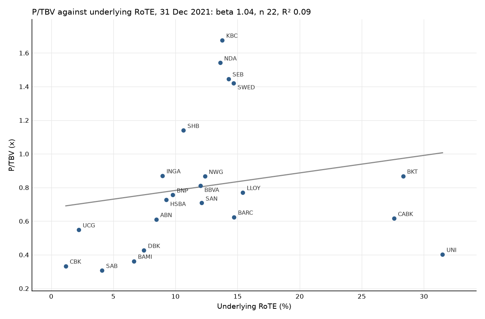
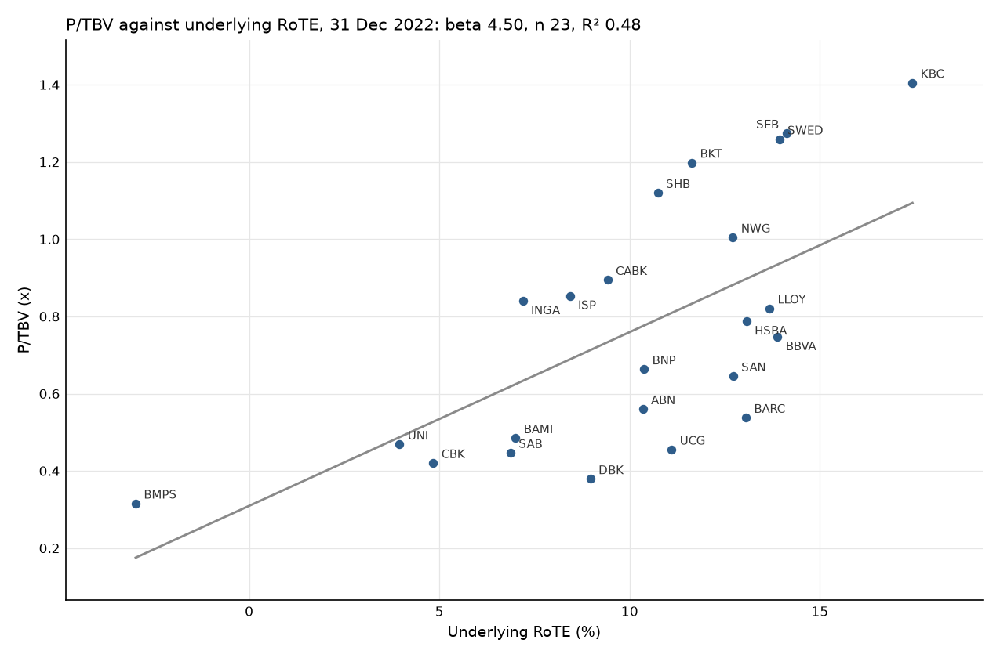
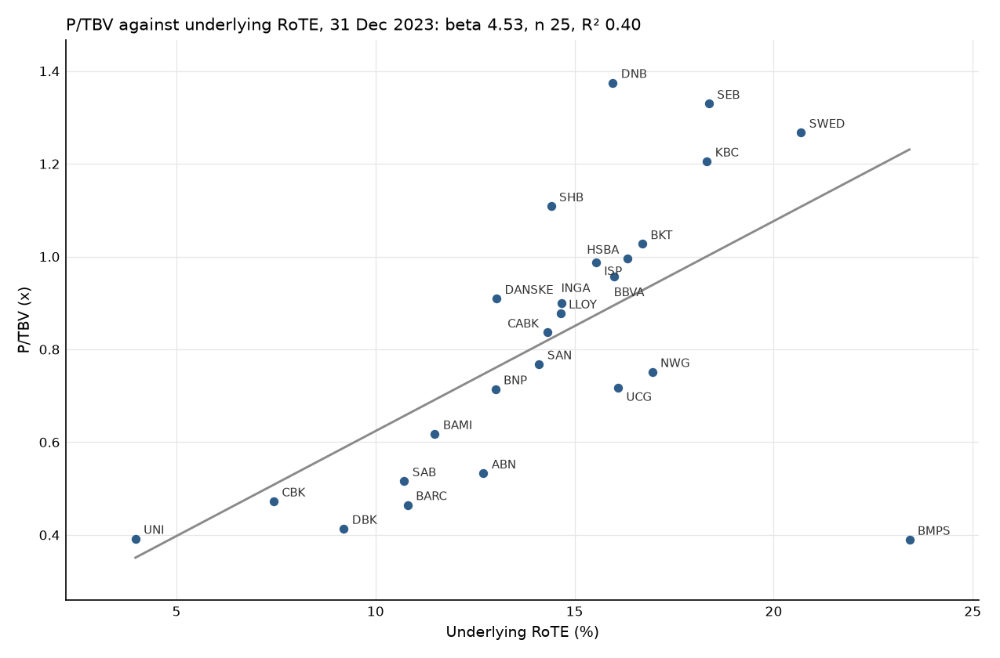
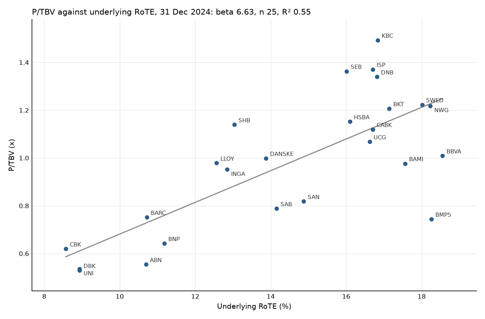
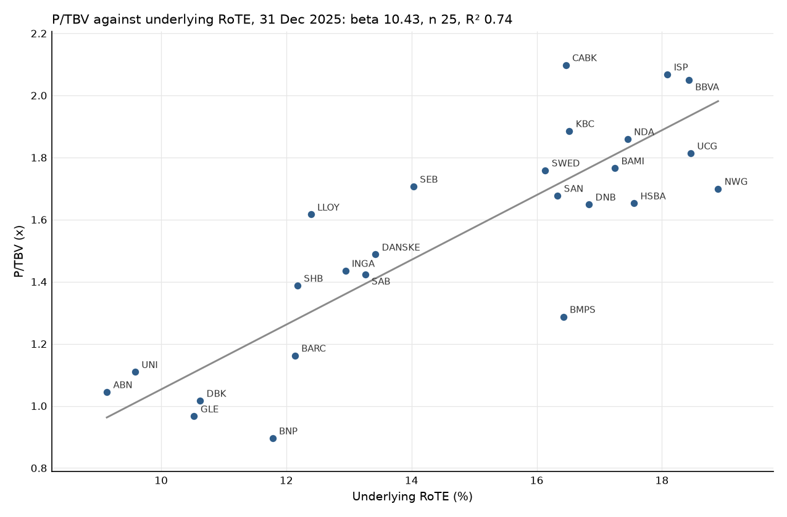
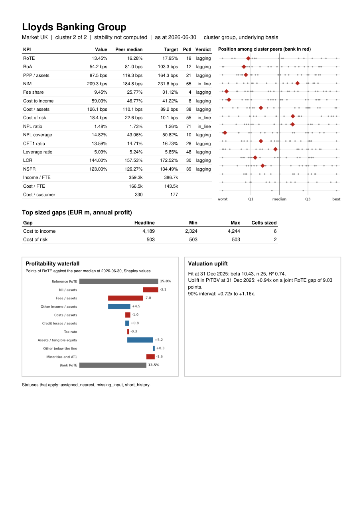
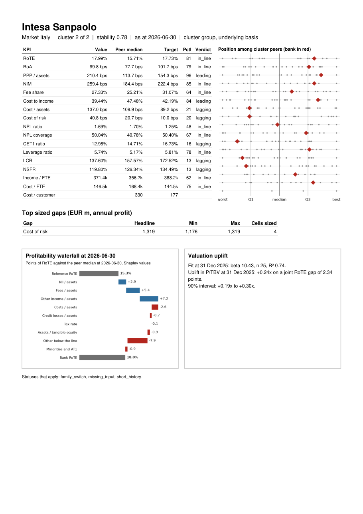
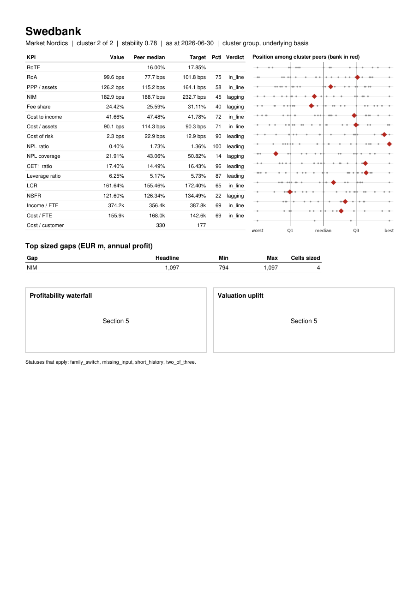

# Section 5

Section 5 is complete: step 4.5 and steps 5.1 to 5.3 are done. 4 findings need the reviewer (Open questions 1 to 4), and OPEN-39, OPEN-40 and OPEN-41 need a decision.

## Steps completed

4.5 section 4 review decisions (2412466)
5.1 driver decomposition (f92173b)
5.2 year on year changes (4349b91)
5.3 valuation and the 2 profile panels (34e49f1)

## Evidence

### E4.5a GAPS at 2026-06-30, every bank, cluster group, underlying basis

```
          date bank_id    group       basis           gap   delta_pi_lc  delta_pi_eur  delta_rote_pts  tax_rate    tax_status                               status
0   2026-06-30     ABN  cluster  underlying   cost_income  1.776465e+09  1.776465e+09        5.587176  0.265554            ok                                   ok
1   2026-06-30     ABN  cluster  underlying  cost_of_risk           NaN           NaN             NaN       NaN           NaN                            not_sized
2   2026-06-30     ABN  cluster  underlying           nim  3.360800e+09  3.360800e+09       10.570079  0.265554            ok                                   ok
3   2026-06-30    BAMI  cluster  underlying   cost_income  4.272003e+08  4.272003e+08        2.899107  0.264869            ok                                   ok
4   2026-06-30    BAMI  cluster  underlying  cost_of_risk  2.509604e+08  2.509604e+08        1.703091  0.264869            ok                                   ok
5   2026-06-30    BAMI  cluster  underlying           nim           NaN           NaN             NaN       NaN           NaN                            not_sized
6   2026-06-30    BARC  cluster  underlying   cost_income           NaN           NaN             NaN       NaN           NaN                            not_sized
7   2026-06-30    BARC  cluster  underlying  cost_of_risk  6.785959e+08  7.808896e+08        0.972447  0.199754            ok                                   ok
8   2026-06-30    BARC  cluster  underlying           nim  3.717512e+09  4.277902e+09        5.327298  0.199754            ok                                   ok
9   2026-06-30    BBVA  cluster  underlying   cost_income           NaN           NaN             NaN       NaN           NaN                            not_sized
10  2026-06-30    BBVA  cluster  underlying  cost_of_risk  6.326275e+09  6.326275e+09        7.718634  0.315297            ok                                   ok
11  2026-06-30    BBVA  cluster  underlying           nim           NaN           NaN             NaN       NaN           NaN                            not_sized
12  2026-06-30     BKT  cluster  underlying   cost_income           NaN           NaN             NaN       NaN           NaN                            not_sized
13  2026-06-30     BKT  cluster  underlying  cost_of_risk           NaN           NaN             NaN       NaN           NaN                            not_sized
14  2026-06-30     BKT  cluster  underlying           nim           NaN           NaN             NaN       NaN           NaN                            not_sized
15  2026-06-30    BMPS  cluster  underlying   cost_income  1.124785e+09  1.124785e+09        5.150494  0.280000  tax_fallback                                   ok
16  2026-06-30    BMPS  cluster  underlying  cost_of_risk  8.466319e+08  8.466319e+08        3.876807  0.280000  tax_fallback                                   ok
17  2026-06-30    BMPS  cluster  underlying           nim           NaN           NaN             NaN       NaN           NaN                            not_sized
18  2026-06-30     BNP  cluster  underlying   cost_income           NaN           NaN             NaN       NaN           NaN                            not_sized
19  2026-06-30     BNP  cluster  underlying  cost_of_risk  9.048898e+08  9.048898e+08        0.684664  0.226875            ok                                   ok
20  2026-06-30     BNP  cluster  underlying           nim           NaN           NaN             NaN       NaN           NaN                            not_sized
21  2026-06-30     BPE  cluster  underlying   cost_income  9.908023e+08  9.908023e+08        5.825974  0.281457            ok                                   ok
22  2026-06-30     BPE  cluster  underlying  cost_of_risk  3.616681e+08  3.616681e+08        2.126629  0.281457            ok                                   ok
23  2026-06-30     BPE  cluster  underlying           nim           NaN           NaN             NaN       NaN           NaN                            not_sized
24  2026-06-30    CABK  cluster  underlying   cost_income           NaN           NaN             NaN       NaN           NaN                            not_sized
25  2026-06-30    CABK  cluster  underlying  cost_of_risk  5.608240e+08  5.608240e+08        1.172643  0.280049            ok                                   ok
26  2026-06-30    CABK  cluster  underlying           nim  1.963080e+09  1.963080e+09        4.104660  0.280049            ok                                   ok
27  2026-06-30     CAG  cluster  underlying   cost_income  7.154022e+09  7.154022e+09             NaN  0.214807            ok        missing_input:at1_instruments
28  2026-06-30     CAG  cluster  underlying  cost_of_risk  2.458412e+09  2.458412e+09             NaN  0.214807            ok        missing_input:at1_instruments
29  2026-06-30     CAG  cluster  underlying           nim  1.741872e+10  1.741872e+10             NaN  0.214807            ok        missing_input:at1_instruments
30  2026-06-30     CBK  cluster  underlying   cost_income  1.801113e+09  1.801113e+09             NaN  0.280402            ok        missing_input:at1_instruments
31  2026-06-30     CBK  cluster  underlying  cost_of_risk           NaN           NaN             NaN       NaN           NaN                            not_sized
32  2026-06-30     CBK  cluster  underlying           nim           NaN           NaN             NaN       NaN           NaN                            not_sized
33  2026-06-30  DANSKE  cluster  underlying   cost_income           NaN           NaN             NaN       NaN           NaN                            not_sized
34  2026-06-30  DANSKE  cluster  underlying  cost_of_risk           NaN           NaN             NaN       NaN           NaN                            not_sized
35  2026-06-30  DANSKE  cluster  underlying           nim  2.364913e+10  3.166321e+09       11.044551  0.236756            ok                                   ok
36  2026-06-30     DBK  cluster  underlying   cost_income  3.657854e+09  3.657854e+09        4.716132  0.219570            ok                                   ok
37  2026-06-30     DBK  cluster  underlying  cost_of_risk           NaN           NaN             NaN       NaN           NaN                            not_sized
38  2026-06-30     DBK  cluster  underlying           nim           NaN           NaN             NaN       NaN           NaN                            not_sized
39  2026-06-30     DNB  cluster  underlying   cost_income           NaN           NaN             NaN       NaN           NaN                            not_sized
40  2026-06-30     DNB  cluster  underlying  cost_of_risk           NaN           NaN             NaN       NaN           NaN                            not_sized
41  2026-06-30     DNB  cluster  underlying           nim           NaN           NaN             NaN       NaN           NaN                            not_sized
42  2026-06-30     GLE  cluster  underlying   cost_income  2.339489e+09  2.339489e+09        3.434473  0.215228            ok                                   ok
43  2026-06-30     GLE  cluster  underlying  cost_of_risk           NaN           NaN             NaN       NaN           NaN                            not_sized
44  2026-06-30     GLE  cluster  underlying           nim  2.123864e+09  2.123864e+09        3.117925  0.215228            ok                                   ok
45  2026-06-30    HSBA  cluster  underlying   cost_income           NaN           NaN             NaN       NaN           NaN                            not_sized
46  2026-06-30    HSBA  cluster  underlying  cost_of_risk           NaN           NaN             NaN       NaN           NaN                            not_sized
47  2026-06-30    HSBA  cluster  underlying           nim           NaN           NaN             NaN       NaN           NaN                            not_sized
48  2026-06-30    INGA  cluster  underlying   cost_income  2.844531e+09  2.844531e+09        4.190215  0.284899            ok                                   ok
49  2026-06-30    INGA  cluster  underlying  cost_of_risk           NaN           NaN             NaN       NaN           NaN                            not_sized
50  2026-06-30    INGA  cluster  underlying           nim  8.597075e+09  8.597075e+09       12.664158  0.284899            ok                                   ok
51  2026-06-30     ISP  cluster  underlying   cost_income           NaN           NaN             NaN       NaN           NaN                            not_sized
52  2026-06-30     ISP  cluster  underlying  cost_of_risk  1.318705e+09  1.318705e+09        1.871094  0.270961            ok                                   ok
53  2026-06-30     ISP  cluster  underlying           nim           NaN           NaN             NaN       NaN           NaN                            not_sized
54  2026-06-30     KBC  cluster  underlying   cost_income           NaN           NaN             NaN       NaN           NaN                            not_sized
55  2026-06-30     KBC  cluster  underlying  cost_of_risk           NaN           NaN             NaN       NaN           NaN                            not_sized
56  2026-06-30     KBC  cluster  underlying           nim  1.419091e+09  1.419091e+09        5.252804  0.172649            ok                                   ok
57  2026-06-30    LLOY  cluster  underlying   cost_income  3.640310e+09  4.189062e+09        7.616056  0.262854            ok                                   ok
58  2026-06-30    LLOY  cluster  underlying  cost_of_risk  4.372301e+08  5.031396e+08        0.914749  0.262854            ok                                   ok
59  2026-06-30    LLOY  cluster  underlying           nim           NaN           NaN             NaN       NaN           NaN                            not_sized
60  2026-06-30     NDA  cluster  underlying   cost_income  5.918827e+08  5.918827e+08        1.653024  0.219196            ok                                   ok
61  2026-06-30     NDA  cluster  underlying  cost_of_risk           NaN           NaN             NaN       NaN           NaN                            not_sized
62  2026-06-30     NDA  cluster  underlying           nim  3.531169e+09  3.531169e+09        9.861931  0.219196            ok                                   ok
63  2026-06-30     NWG  cluster  underlying   cost_income  1.219043e+09  1.402806e+09        3.268061  0.230853            ok                                   ok
64  2026-06-30     NWG  cluster  underlying  cost_of_risk           NaN           NaN             NaN       NaN           NaN                            not_sized
65  2026-06-30     NWG  cluster  underlying           nim           NaN           NaN             NaN       NaN           NaN                            not_sized
66  2026-06-30    RABO  cluster  underlying   cost_income  2.139051e+09  2.139051e+09        3.090744  0.263202            ok                                   ok
67  2026-06-30    RABO  cluster  underlying  cost_of_risk  6.962364e+08  6.962364e+08        1.006001  0.263202            ok                                   ok
68  2026-06-30    RABO  cluster  underlying           nim           NaN           NaN             NaN       NaN           NaN                            not_sized
69  2026-06-30     SAB  cluster  underlying   cost_income  3.207011e+08  3.207011e+08        1.995382  0.304726            ok                                   ok
70  2026-06-30     SAB  cluster  underlying  cost_of_risk  3.763407e+08  3.763407e+08        2.341568  0.304726            ok                                   ok
71  2026-06-30     SAB  cluster  underlying           nim  2.038807e+09  2.038807e+09       12.685327  0.304726            ok                                   ok
72  2026-06-30     SAN  cluster  underlying   cost_income           NaN           NaN             NaN       NaN           NaN                            not_sized
73  2026-06-30     SAN  cluster  underlying  cost_of_risk  1.152541e+10  1.152541e+10        9.595212  0.253623            ok                                   ok
74  2026-06-30     SAN  cluster  underlying           nim           NaN           NaN             NaN       NaN           NaN                            not_sized
75  2026-06-30   SANUK  cluster  underlying   cost_income  5.938181e+08  6.833322e+08        3.613709  0.261184            ok                                   ok
76  2026-06-30   SANUK  cluster  underlying  cost_of_risk           NaN           NaN             NaN       NaN           NaN                            not_sized
77  2026-06-30   SANUK  cluster  underlying           nim  2.083966e+09  2.398109e+09       12.682075  0.261184            ok                                   ok
78  2026-06-30     SEB  cluster  underlying   cost_income  3.616728e+09  3.313223e+08        1.330839  0.207860            ok                                   ok
79  2026-06-30     SEB  cluster  underlying  cost_of_risk           NaN           NaN             NaN       NaN           NaN                            not_sized
80  2026-06-30     SEB  cluster  underlying           nim  2.397117e+10  2.195959e+09        8.820619  0.207860            ok                                   ok
81  2026-06-30     SHB  cluster  underlying   cost_income  3.332915e+09  3.053227e+08             NaN  0.230997            ok  missing_input:intangibles_deduction
82  2026-06-30     SHB  cluster  underlying  cost_of_risk           NaN           NaN             NaN       NaN           NaN                            not_sized
83  2026-06-30     SHB  cluster  underlying           nim           NaN           NaN             NaN       NaN           NaN                            not_sized
84  2026-06-30    SWED  cluster  underlying   cost_income           NaN           NaN             NaN       NaN           NaN                            not_sized
85  2026-06-30    SWED  cluster  underlying  cost_of_risk           NaN           NaN             NaN       NaN           NaN                            not_sized
86  2026-06-30    SWED  cluster  underlying           nim  1.197695e+10  1.097189e+09             NaN  0.206907            ok     missing_input:minority_interests
87  2026-06-30     UCG  cluster  underlying   cost_income  1.154656e+09  1.154656e+09             NaN  0.200697            ok        missing_input:at1_instruments
88  2026-06-30     UCG  cluster  underlying  cost_of_risk           NaN           NaN             NaN       NaN           NaN                            not_sized
89  2026-06-30     UCG  cluster  underlying           nim           NaN           NaN             NaN       NaN           NaN                            not_sized
90  2026-06-30     UNI  cluster  underlying   cost_income  1.023976e+08  1.023976e+08             NaN  0.285290            ok                         mixed_family
91  2026-06-30     UNI  cluster  underlying  cost_of_risk  5.718841e+07  5.718841e+07             NaN  0.285290            ok                         mixed_family
92  2026-06-30     UNI  cluster  underlying           nim  5.370236e+08  5.370236e+08             NaN  0.285290            ok                         mixed_family
```

### E4.5b GAPS_JOINT at 2026-06-30, every bank, cluster group, underlying basis

```
          date bank_id    group       basis  sum_standalone_eur     joint_eur   overlap_eur  joint_rote_pts  excess_capital_eur
0   2026-06-30     ABN  cluster  underlying        5.137265e+09  3.752103e+09  1.385162e+09       11.800769        1.080039e+09
1   2026-06-30    BAMI  cluster  underlying        6.781608e+08  6.781608e+08  0.000000e+00        4.602199        0.000000e+00
2   2026-06-30    BARC  cluster  underlying        5.058792e+09  5.058792e+09 -9.536743e-07        6.299745        3.287343e+09
3   2026-06-30    BBVA  cluster  underlying        6.326275e+09  6.326275e+09  0.000000e+00        7.718634        0.000000e+00
4   2026-06-30     BKT  cluster  underlying                 NaN           NaN           NaN             NaN        0.000000e+00
5   2026-06-30    BMPS  cluster  underlying        1.971417e+09  1.971417e+09 -2.384186e-07        9.027301        1.691424e+09
6   2026-06-30     BNP  cluster  underlying        9.048898e+08  9.048898e+08  1.192093e-07        0.684664        0.000000e+00
7   2026-06-30     BPE  cluster  underlying        1.352470e+09  1.352470e+09 -2.384186e-07        7.952603        3.031537e+08
8   2026-06-30    CABK  cluster  underlying        2.523904e+09  2.523904e+09  9.536743e-07        5.277303        0.000000e+00
9   2026-06-30     CAG  cluster  underlying        2.703115e+10  1.985198e+10  7.179170e+09             NaN        1.885054e+10
10  2026-06-30     CBK  cluster  underlying        1.801113e+09  1.801113e+09  0.000000e+00             NaN        0.000000e+00
11  2026-06-30  DANSKE  cluster  underlying        3.166321e+09  3.166321e+09 -4.768372e-07       11.044551        2.873183e+09
12  2026-06-30     DBK  cluster  underlying        3.657854e+09  3.657854e+09  0.000000e+00        4.716132        1.022577e+09
13  2026-06-30     DNB  cluster  underlying                 NaN           NaN           NaN             NaN        3.052336e+09
14  2026-06-30     GLE  cluster  underlying        4.463353e+09  3.367655e+09  1.095698e+09        4.943865        0.000000e+00
15  2026-06-30    HSBA  cluster  underlying                 NaN           NaN           NaN             NaN        4.083849e+09
16  2026-06-30    INGA  cluster  underlying        1.144161e+10  7.898299e+09  3.543307e+09       11.634807        0.000000e+00
17  2026-06-30     ISP  cluster  underlying        1.318705e+09  1.318705e+09  2.384186e-07        1.871094        0.000000e+00
18  2026-06-30     KBC  cluster  underlying        1.419091e+09  1.419091e+09  0.000000e+00        5.252804        0.000000e+00
19  2026-06-30    LLOY  cluster  underlying        4.692202e+09  4.692202e+09  9.536743e-07        8.530805        0.000000e+00
20  2026-06-30     NDA  cluster  underlying        4.123052e+09  2.667457e+09  1.455595e+09        7.449735        1.385956e+09
21  2026-06-30     NWG  cluster  underlying        1.402806e+09  1.402806e+09  0.000000e+00        3.268061        0.000000e+00
22  2026-06-30    RABO  cluster  underlying        2.835288e+09  2.835288e+09  0.000000e+00        4.096745        1.455596e+10
23  2026-06-30     SAB  cluster  underlying        2.735849e+09  1.895548e+09  8.403013e+08       11.793976        0.000000e+00
24  2026-06-30     SAN  cluster  underlying        1.152541e+10  1.152541e+10  0.000000e+00        9.595212        0.000000e+00
25  2026-06-30   SANUK  cluster  underlying        3.081442e+09  2.093055e+09  9.883871e+08       11.068833        0.000000e+00
26  2026-06-30     SEB  cluster  underlying        2.527281e+09  1.621985e+09  9.052968e+08        6.515107        2.532990e+09
27  2026-06-30     SHB  cluster  underlying        3.053227e+08  3.053227e+08 -1.788139e-07             NaN        2.012389e+09
28  2026-06-30    SWED  cluster  underlying        1.097189e+09  1.097189e+09  4.768372e-07             NaN        2.560033e+09
29  2026-06-30     UCG  cluster  underlying        1.154656e+09  1.154656e+09 -2.384186e-07             NaN        0.000000e+00
30  2026-06-30     UNI  cluster  underlying        6.966096e+08  4.752289e+08  2.213808e+08             NaN        3.999388e+08
```

### E4.5c The joint gap before and after step 4.5, 2026-06-30, cluster group, underlying basis

Before is the table at d2d3c5e, with fee_share sized.

```
   bank_id  joint_eur_before  joint_rote_pts_before  joint_eur_after  joint_rote_pts_after
0      ABN      5.051169e+09              15.886475     3.752103e+09             11.800769
1     BAMI      6.781608e+08               4.602199     6.781608e+08              4.602199
2     BARC      5.058792e+09               6.299745     5.058792e+09              6.299745
3     BBVA      1.168087e+10              14.251726     6.326275e+09              7.718634
4      BKT               NaN                    NaN              NaN                   NaN
5     BMPS      1.971417e+09               9.027301     1.971417e+09              9.027301
6      BNP      9.048898e+08               0.684664     9.048898e+08              0.684664
7      BPE      1.352470e+09                    NaN     1.352470e+09              7.952603
8     CABK      4.952466e+09              10.355251     2.523904e+09              5.277303
9      CAG      1.985198e+10                    NaN     1.985198e+10                   NaN
10     CBK      1.801113e+09                    NaN     1.801113e+09                   NaN
11  DANSKE      3.166321e+09              11.044551     3.166321e+09             11.044551
12     DBK      3.657854e+09               4.716132     3.657854e+09              4.716132
13     DNB               NaN                    NaN              NaN                   NaN
14     GLE      5.770245e+09               8.470973     3.367655e+09              4.943865
15    HSBA      9.903519e+09               5.860256              NaN                   NaN
16    INGA      1.231994e+10              18.148229     7.898299e+09             11.634807
17     ISP      1.318705e+09               1.871094     1.318705e+09              1.871094
18     KBC      3.710930e+09              13.736110     1.419091e+09              5.252804
19    LLOY      9.039739e+09              16.434981     4.692202e+09              8.530805
20     NDA      2.667457e+09               7.449735     2.667457e+09              7.449735
21     NWG      4.086468e+09               9.520080     1.402806e+09              3.268061
22    RABO      5.149849e+09               7.441087     2.835288e+09              4.096745
23     SAB      1.895548e+09              11.793976     1.895548e+09             11.793976
24     SAN      1.919121e+10              15.977198     1.152541e+10              9.595212
25   SANUK      3.895834e+09              20.602587     2.093055e+09             11.068833
26     SEB      1.621985e+09               6.515107     1.621985e+09              6.515107
27     SHB               NaN                    NaN     3.053227e+08                   NaN
28    SWED      2.212927e+09                    NaN     1.097189e+09                   NaN
29     UCG               NaN                    NaN     1.154656e+09                   NaN
30     UNI      7.257879e+08                    NaN     4.752289e+08                   NaN
```

### E4.5d GAPS status counts before (fee_share rows left out) and after

`short_history` is gone (A.1 item 3) and the rote numerator statuses are gone (A.1 item 4).

```
                                     before  after
status                                            
not_sized                              3071   3071
ok                                     1479   2185
short_history                           536      0
missing_input:profit_to_ordinary        201      0
missing_input:tangible_equity           169    267
missing_input:at1_coupons                67      0
missing_input:at1_instruments            34     34
mixed_family                             14     14
missing_input:intangibles_deduction       5      5
missing_input:minority_interests          4      4
```

### E4.5e tax_status counts after

```
tax_status
NaN             3071
ok              1666
tax_fallback     843
```

### E4.5f Hand check workbook, LLOY sheet labels and formulas

Columns A and B. `F` stays as an income input, because NII = I - F - O. The target, gap and F_prime fee lines are gone.

```
bank                         LLOY
date                         2025-12-31
group                        cluster
basis                        underlying
currency                     GBP
                             
input                        value
I                            19350000000
F                            1784000000
O                            4280000000
C                            11834000000
LLP                          795000000
L                            517263000000
IEA                          645456500000
TE                           34796000000
t                            0.2572029241722013
target_cost_income           0.4165507531783846
target_cost_of_risk          0.0006532635021521914
target_nim                   0.02219118619757652
fx_period_mean               0.8567923137254903
                             
formula                      result
NII                          =B8-B9-B10
cost_income                  =B11/B8
cost_of_risk                 =B12/B13
nim                          =B23/B14
delta_pi_lc|cost_income      =(B24-B17)*B8
delta_pi_eur|cost_income     =B27/B20
delta_rote_pts|cost_income   =B27*(1-B16)/B15*100
delta_pi_lc|cost_of_risk     =(B25-B18)*B13
delta_pi_eur|cost_of_risk    =B30/B20
delta_rote_pts|cost_of_risk  =B30*(1-B16)/B15*100
NII_prime                    =B23
I_prime                      =B33+B9+B10
C_prime                      =B17*B34
LLP_prime                    =B18*B13
joint_delta_pi_lc            =(B34-B35-B36)-(B8-B11-B12)
joint_delta_pi_eur           =B37/B20
```

### E5.1a DRIVERS for LLOY, ISP, SWED, BBVA and DBK at 2025-12-31, both runs, underlying basis

```
          date bank_id       basis reference driver    bank_value  ref_value  shapley_pts  other_below_line_pts  minorities_and_at1_pts status
0   2025-12-31    BBVA  underlying    median  NII/A  3.220632e-02   0.015719    19.445379              0.470845               -1.843889     ok
1   2025-12-31    BBVA  underlying    median    F/A  1.006754e-02   0.005482     5.407999              0.470845               -1.843889     ok
2   2025-12-31    BBVA  underlying    median    O/A  2.985334e-03   0.002029     1.128460              0.470845               -1.843889     ok
3   2025-12-31    BBVA  underlying    median    C/A  1.756396e-02   0.011404    -7.265042              0.470845               -1.843889     ok
4   2025-12-31    BBVA  underlying    median  LLP/A  7.442502e-03   0.000962    -7.643010              0.470845               -1.843889     ok
5   2025-12-31    BBVA  underlying    median      t  3.143526e-01   0.253190    -1.512915              0.470845               -1.843889     ok
6   2025-12-31    BBVA  underlying    median   A/TE  1.486752e+01  18.022206    -3.417448              0.470845               -1.843889     ok
7   2025-12-31    BBVA  underlying    median  OTH/A  3.664265e-04   0.000017          NaN              0.470845               -1.843889     ok
8   2025-12-31    BBVA  underlying    target  NII/A  3.220632e-02   0.017664    19.573904              1.139320               -1.843889     ok
9   2025-12-31    BBVA  underlying    target    F/A  1.006754e-02   0.007817     3.028764              1.139320               -1.843889     ok
10  2025-12-31    BBVA  underlying    target    O/A  2.985334e-03   0.003303    -0.427834              1.139320               -1.843889     ok
11  2025-12-31    BBVA  underlying    target    C/A  1.756396e-02   0.009328   -11.085726              1.139320               -1.843889     ok
12  2025-12-31    BBVA  underlying    target  LLP/A  7.442502e-03   0.000361    -9.531288              1.139320               -1.843889     ok
13  2025-12-31    BBVA  underlying    target      t  3.143526e-01   0.213529    -3.538316              1.139320               -1.843889     ok
14  2025-12-31    BBVA  underlying    target   A/TE  1.486752e+01  21.551808    -9.492898              1.139320               -1.843889     ok
15  2025-12-31    BBVA  underlying    target  OTH/A  3.664265e-04  -0.000306          NaN              1.139320               -1.843889     ok
16  2025-12-31     DBK  underlying    median  NII/A  1.111952e-02   0.008643     4.755790              0.582280               -1.575751     ok
17  2025-12-31     DBK  underlying    median    F/A  7.717972e-03   0.004225     6.708593              0.582280               -1.575751     ok
18  2025-12-31     DBK  underlying    median    O/A  3.906112e-03   0.006787    -5.531634              0.582280               -1.575751     ok
19  2025-12-31     DBK  underlying    median    C/A  1.439351e-02   0.011033    -6.452438              0.582280               -1.575751     ok
20  2025-12-31     DBK  underlying    median  LLP/A  1.209676e-03   0.001223     0.026267              0.582280               -1.575751     ok
21  2025-12-31     DBK  underlying    median      t  2.568117e-01   0.201179    -1.008395              0.582280               -1.575751     ok
22  2025-12-31     DBK  underlying    median   A/TE  2.294713e+01  26.820435    -2.174796              0.582280               -1.575751     ok
23  2025-12-31     DBK  underlying    median  OTH/A -1.204715e-05  -0.000284          NaN              0.582280               -1.575751     ok
24  2025-12-31     DBK  underlying    target  NII/A  1.111952e-02   0.010224     1.793152              1.421865               -1.575751     ok
25  2025-12-31     DBK  underlying    target    F/A  7.717972e-03   0.004618     6.209231              1.421865               -1.575751     ok
26  2025-12-31     DBK  underlying    target    O/A  3.906112e-03   0.007449    -7.096830              1.421865               -1.575751     ok
27  2025-12-31     DBK  underlying    target    C/A  1.439351e-02   0.010816    -7.164907              1.421865               -1.575751     ok
28  2025-12-31     DBK  underlying    target  LLP/A  1.209676e-03   0.001067    -0.285319              1.421865               -1.575751     ok
29  2025-12-31     DBK  underlying    target      t  2.568117e-01   0.189789    -1.526488              1.421865               -1.575751     ok
30  2025-12-31     DBK  underlying    target   A/TE  2.294713e+01  28.550211    -3.833887              1.421865               -1.575751     ok
31  2025-12-31     DBK  underlying    target  OTH/A -1.204715e-05  -0.000627          NaN              1.421865               -1.575751     ok
32  2025-12-31     ISP  underlying    median  NII/A  1.828677e-02   0.015720     3.507846              3.908938               -0.855775     ok
33  2025-12-31     ISP  underlying    median    F/A  9.499401e-03   0.005482     5.488866              3.908938               -0.855775     ok
34  2025-12-31     ISP  underlying    median    O/A  4.405305e-03   0.002027     3.249711              3.908938               -0.855775     ok
35  2025-12-31     ISP  underlying    median    C/A  1.389731e-02   0.011406    -3.404056              3.908938               -0.855775     ok
36  2025-12-31     ISP  underlying    median  LLP/A  1.946997e-03   0.000963    -1.345028              3.908938               -0.855775     ok
37  2025-12-31     ISP  underlying    median      t  2.612890e-01   0.254096    -0.141072              3.908938               -0.855775     ok
38  2025-12-31     ISP  underlying    median   A/TE  1.919585e+01  17.621663     1.239890              3.908938               -0.855775     ok
39  2025-12-31     ISP  underlying    median  OTH/A  2.988635e-03   0.000015          NaN              3.908938               -0.855775     ok
40  2025-12-31     ISP  underlying    target  NII/A  1.828677e-02   0.018000     0.444700              5.569550               -0.855775     ok
41  2025-12-31     ISP  underlying    target    F/A  9.499401e-03   0.007877     2.518653              5.569550               -0.855775     ok
42  2025-12-31     ISP  underlying    target    O/A  4.405305e-03   0.003063     2.083180              5.569550               -0.855775     ok
43  2025-12-31     ISP  underlying    target    C/A  1.389731e-02   0.009328    -7.094369              5.569550               -0.855775     ok
44  2025-12-31     ISP  underlying    target  LLP/A  1.946997e-03   0.000361    -2.462129              5.569550               -0.855775     ok
45  2025-12-31     ISP  underlying    target      t  2.612890e-01   0.213532    -1.441803              5.569550               -0.855775     ok
46  2025-12-31     ISP  underlying    target   A/TE  1.919585e+01  21.496391    -2.601053              5.569550               -0.855775     ok
47  2025-12-31     ISP  underlying    target  OTH/A  2.988635e-03  -0.000306          NaN              5.569550               -0.855775     ok
48  2025-12-31    LLOY  underlying    median  NII/A  1.435728e-02   0.016046    -2.728317             -0.126999               -1.612254     ok
49  2025-12-31    LLOY  underlying    median    F/A  1.927847e-03   0.005766    -6.200052             -0.126999               -1.612254     ok
50  2025-12-31    LLOY  underlying    median    O/A  4.625104e-03   0.002027     4.197364             -0.126999               -1.612254     ok
51  2025-12-31    LLOY  underlying    median    C/A  1.278820e-02   0.011490    -2.096598             -0.126999               -1.612254     ok
52  2025-12-31    LLOY  underlying    median  LLP/A  8.591024e-04   0.001049     0.307363             -0.126999               -1.612254     ok
53  2025-12-31    LLOY  underlying    median      t  2.809503e-01   0.253228    -0.563145             -0.126999               -1.612254     ok
54  2025-12-31    LLOY  underlying    median   A/TE  2.659457e+01  17.548293     6.201892             -0.126999               -1.612254     ok
55  2025-12-31    LLOY  underlying    median  OTH/A -6.051539e-05   0.000036          NaN             -0.126999               -1.612254     ok
56  2025-12-31    LLOY  underlying    target  NII/A  1.435728e-02   0.018277    -6.981754              0.382227               -1.612254     ok
57  2025-12-31    LLOY  underlying    target    F/A  1.927847e-03   0.008426   -11.575211              0.382227               -1.612254     ok
58  2025-12-31    LLOY  underlying    target    O/A  4.625104e-03   0.003048     2.809602              0.382227               -1.612254     ok
59  2025-12-31    LLOY  underlying    target    C/A  1.278820e-02   0.009328    -6.163632              0.382227               -1.612254     ok
60  2025-12-31    LLOY  underlying    target  LLP/A  8.591024e-04   0.000363    -0.883003              0.382227               -1.612254     ok
61  2025-12-31    LLOY  underlying    target      t  2.809503e-01   0.213529    -2.151580              0.382227               -1.612254     ok
62  2025-12-31    LLOY  underlying    target   A/TE  2.659457e+01  20.816578     6.009794              0.382227               -1.612254     ok
63  2025-12-31    LLOY  underlying    target  OTH/A -6.051539e-05  -0.000294          NaN              0.382227               -1.612254     ok
64  2025-12-31    SWED  underlying    median  NII/A  1.449161e-02   0.016043    -1.962370             -0.047832                0.001478     ok
65  2025-12-31    SWED  underlying    median    F/A  5.375070e-03   0.005696    -0.406038             -0.047832                0.001478     ok
66  2025-12-31    SWED  underlying    median    O/A  2.771850e-03   0.002032     0.936491             -0.047832                0.001478     ok
67  2025-12-31    SWED  underlying    median    C/A  9.061867e-03   0.011944     3.647025             -0.047832                0.001478     ok
68  2025-12-31    SWED  underlying    median  LLP/A -1.119806e-05   0.001073     1.371526             -0.047832                0.001478     ok
69  2025-12-31    SWED  underlying    median      t  2.059387e-01   0.257718     1.035261             -0.047832                0.001478     ok
70  2025-12-31    SWED  underlying    median   A/TE  1.495423e+01  18.021753    -2.871509             -0.047832                0.001478     ok
71  2025-12-31    SWED  underlying    median  OTH/A  3.293548e-07   0.000036          NaN             -0.047832                0.001478     ok
72  2025-12-31    SWED  underlying    target  NII/A  1.449161e-02   0.018277    -5.435217              0.514498                0.001478     ok
73  2025-12-31    SWED  underlying    target    F/A  5.375070e-03   0.008426    -4.380824              0.514498                0.001478     ok
74  2025-12-31    SWED  underlying    target    O/A  2.771850e-03   0.003342    -0.819019              0.514498                0.001478     ok
75  2025-12-31    SWED  underlying    target    C/A  9.061867e-03   0.009498     0.626575              0.514498                0.001478     ok
76  2025-12-31    SWED  underlying    target  LLP/A -1.119806e-05   0.000496     0.727929              0.514498                0.001478     ok
77  2025-12-31    SWED  underlying    target      t  2.059387e-01   0.219926     0.434391              0.514498                0.001478     ok
78  2025-12-31    SWED  underlying    target   A/TE  1.495423e+01  21.551808    -8.728814              0.514498                0.001478     ok
79  2025-12-31    SWED  underlying    target  OTH/A  3.293548e-07  -0.000306          NaN              0.514498                0.001478     ok
```

### E5.1b DRIVERS status counts (1 per date, bank, basis and run)

```
   reference       basis         status    n
0     median    reported      loss_year    2
1     median    reported   merger_break   10
2     median    reported  missing_input   47
3     median    reported             ok  206
4     median    reported     rote_blank   13
5     median    reported  too_few_peers   32
6     median  underlying      loss_year    2
7     median  underlying   merger_break   10
8     median  underlying  missing_input   47
9     median  underlying             ok  206
10    median  underlying     rote_blank   13
11    median  underlying  too_few_peers   32
12    target    reported      loss_year    2
13    target    reported   merger_break   10
14    target    reported  missing_input   47
15    target    reported             ok  206
16    target    reported     rote_blank   13
17    target    reported  too_few_peers   32
18    target  underlying      loss_year    2
19    target  underlying   merger_break   10
20    target  underlying  missing_input   47
21    target  underlying             ok  206
22    target  underlying     rote_blank   13
23    target  underlying  too_few_peers   32
```

### E5.1c Largest difference between the sum of Shapley values and the tree gap, in points

[drivers] tol_pts = 0.01, over 884 cells of the table as written to CSV.

```
3.842e-08
```

### E5.1d Material mergers

`scripts/merger_materiality.py`, against `merger_breaks` in `bpb/drivers.py`: {'CABK': ['2021-03-26'], 'UNI': ['2021-07-30'], 'BPE': ['2022-06-03', '2025-07-18'], 'BMPS': ['2025-09-15'], 'SANUK': ['2026-04-30']}

```
  acquirer_id                       target_name completion_date     ratio
0        CABK                       Bankia S.A.      2021-03-26  0.545488
1         UNI                    Liberbank S.A.      2021-07-30  0.723163
2         BPE               Banca Carige S.p.A.      2022-06-03  0.164258
3         BPE  Banca Popolare di Sondrio S.p.A.      2025-07-18  0.391817
4        BMPS                 Mediobanca S.p.A.      2025-09-15  0.795574
5       SANUK             TSB Banking Group plc      2026-04-30  0.165309
```

### E5.1e `too_few_peers` by bank and date (cells over the 2 bases, median run)

```
date     2021-12-31  2022-06-30  2022-12-31  2023-06-30  2023-12-31  2024-06-30  2024-12-31  2025-06-30
bank_id                                                                                                
BARC              2           2           2           2           2           2           2           2
BNP               2           2           2           2           2           2           2           2
DBK               2           2           2           2           2           2           2           2
HSBA              2           2           2           2           2           2           2           2
```

### E5.1f `missing_input` by bank and date (cells over the 2 bases, median run)

```
date     2021-12-31  2022-06-30  2022-12-31  2023-06-30  2023-12-31  2024-06-30  2024-12-31  2025-06-30  2025-12-31  2026-06-30
bank_id                                                                                                                        
BKT               0           2           0           2           0           2           0           2           2           2
BPE               2           0           0           0           0           0           0           0           0           0
CAG               2           2           2           2           2           2           2           2           2           2
CBK               0           0           0           0           0           0           0           0           2           2
DANSKE            2           2           2           0           0           0           0           0           0           0
DNB               2           2           2           0           0           0           0           0           0           2
GLE               2           2           2           2           2           2           2           2           0           0
KBC               0           2           0           0           0           0           0           0           0           0
NDA               0           2           2           2           2           2           2           0           0           0
SHB               0           0           0           0           0           0           0           0           0           2
SWED              0           0           0           0           0           2           0           2           0           2
UCG               0           0           0           0           0           0           0           0           0           2
UNI               0           0           0           0           0           0           0           0           0           2
```

### E5.1g `loss_year` and `rote_blank` cells, median run

```
          date bank_id       basis      status
0   2021-12-31     ISP    reported  rote_blank
1   2021-12-31     ISP  underlying  rote_blank
2   2022-06-30     ISP    reported  rote_blank
3   2022-06-30     ISP  underlying  rote_blank
4   2022-06-30     SAN    reported  rote_blank
5   2022-06-30     SAN  underlying  rote_blank
6   2022-12-31    BMPS    reported   loss_year
7   2022-12-31    BMPS  underlying   loss_year
8   2023-06-30    BMPS    reported   loss_year
9   2023-06-30    BMPS  underlying   loss_year
10  2023-06-30     BPE    reported  rote_blank
11  2023-06-30     BPE  underlying  rote_blank
12  2023-06-30     ISP    reported  rote_blank
13  2023-06-30     ISP  underlying  rote_blank
14  2023-06-30     SAN    reported  rote_blank
15  2023-06-30     SAN  underlying  rote_blank
16  2023-06-30     UNI    reported  rote_blank
17  2023-06-30     UNI  underlying  rote_blank
18  2023-12-31     BPE    reported  rote_blank
19  2023-12-31     BPE  underlying  rote_blank
20  2024-06-30     BPE    reported  rote_blank
21  2024-06-30     BPE  underlying  rote_blank
22  2024-06-30    RABO    reported  rote_blank
23  2024-06-30    RABO  underlying  rote_blank
24  2024-12-31     BPE    reported  rote_blank
25  2024-12-31     BPE  underlying  rote_blank
26  2025-06-30     BPE    reported  rote_blank
27  2025-06-30     BPE  underlying  rote_blank
28  2025-06-30    RABO    reported  rote_blank
29  2025-06-30    RABO  underlying  rote_blank
```

### E5.1h Largest minorities_and_at1_pts, median run

```
         date bank_id       basis  minorities_and_at1_pts     status
0  2021-12-31     BKT  underlying               19.739384         ok
1  2021-12-31     BKT    reported               19.739384         ok
2  2026-06-30     SAB    reported                6.396123         ok
3  2026-06-30     SAB  underlying                6.396123         ok
4  2023-06-30    BMPS  underlying                5.865357  loss_year
5  2023-06-30    BMPS    reported                5.863986  loss_year
6  2022-12-31    BMPS  underlying                4.266568  loss_year
7  2022-12-31    BMPS    reported                4.197832  loss_year
8  2026-06-30     GLE  underlying               -3.266177         ok
9  2026-06-30     GLE    reported               -3.266177         ok
```

### E5.1i Why SWED has no decomposition at 2026-06-30: the rote KPI row and its minority_interests rows

```
      bank_id        date   kpi  value                            status
10983    SWED  2026-06-30  rote    NaN  missing_input:minority_interests

         ref_date               field       value  family status
25246  2024-12-31  minority_interests  28000000.0  report     ok
25419  2025-12-31  minority_interests  25000000.0  report     ok
```

### E5.2a yoy.csv for LLOY, ISP, SWED, BBVA and DBK, ci rows

```
          date bank_id       basis  cost_effect_pts  income_effect_pts         status
0   2022-12-31    BBVA    reported         6.007771          -7.803331             ok
1   2022-12-31    BBVA  underlying         6.007771          -7.803331             ok
2   2022-12-31     DBK    reported        -1.643019          -5.288760             ok
3   2022-12-31     DBK  underlying         3.824734          -3.903260             ok
4   2022-12-31     ISP    reported        -1.502649           0.010731             ok
5   2022-12-31     ISP  underlying        -1.502649           0.010731             ok
6   2022-12-31    LLOY    reported        -6.047033          -6.518845             ok
7   2022-12-31    LLOY  underlying        -0.954987          -7.190594             ok
8   2022-12-31    SWED    reported        -0.341819          -1.734827             ok
9   2022-12-31    SWED  underlying        -0.341819          -1.734827             ok
10  2023-06-30    BBVA    reported         6.997281          -9.998539             ok
11  2023-06-30    BBVA  underlying         6.997281          -9.998539             ok
12  2023-06-30     DBK    reported        -0.822591          -5.634779             ok
13  2023-06-30     DBK  underlying         0.616545          -4.289021             ok
14  2023-06-30     ISP    reported        -0.085328          -6.092712             ok
15  2023-06-30     ISP  underlying        -0.085328          -6.092712             ok
16  2023-06-30    LLOY    reported        -4.104639          -5.845034             ok
17  2023-06-30    LLOY  underlying        -0.232672          -6.333341             ok
18  2023-06-30    SWED    reported        -0.387480         -10.091624             ok
19  2023-06-30    SWED  underlying        -1.998672          -9.912320             ok
20  2023-12-31    BBVA    reported         6.089968          -7.723287             ok
21  2023-12-31    BBVA  underlying         6.089968          -7.723287             ok
22  2023-12-31     DBK    reported         3.033438          -5.050088             ok
23  2023-12-31     DBK  underlying         1.824165          -6.312285             ok
24  2023-12-31     ISP    reported         2.705631         -10.514204             ok
25  2023-12-31     ISP  underlying         2.705631         -10.514204             ok
26  2023-12-31    LLOY    reported         5.777395          -1.274181             ok
27  2023-12-31    LLOY  underlying         5.289503          -0.391293             ok
28  2023-12-31    SWED    reported         7.164297         -13.334271             ok
29  2023-12-31    SWED  underlying         5.735385         -13.114805             ok
30  2024-06-30    BBVA    reported         5.179376          -7.333185             ok
31  2024-06-30    BBVA  underlying         5.179376          -7.333185             ok
32  2024-06-30     DBK    reported         1.361193          -3.613084             ok
33  2024-06-30     DBK  underlying        -1.987108          -4.554270             ok
34  2024-06-30     ISP    reported         2.637361          -7.043353             ok
35  2024-06-30     ISP  underlying         2.637361          -7.043353             ok
36  2024-06-30    LLOY    reported         8.917974           1.851241             ok
37  2024-06-30    LLOY  underlying         8.291642           3.043616             ok
38  2024-06-30    SWED    reported         9.790043          -8.110404             ok
39  2024-06-30    SWED  underlying        11.110876          -7.984398             ok
40  2024-12-31    BBVA    reported         4.780443          -7.713213             ok
41  2024-12-31    BBVA  underlying         4.780443          -7.713213             ok
42  2024-12-31     DBK    reported        -0.156470          -3.532977             ok
43  2024-12-31     DBK  underlying        -5.910798          -3.221630             ok
44  2024-12-31     ISP    reported         2.119675          -4.308550             ok
45  2024-12-31     ISP  underlying         2.119675          -4.308550             ok
46  2024-12-31    LLOY    reported         4.248893           2.092777             ok
47  2024-12-31    LLOY  underlying         4.850885           1.461782             ok
48  2024-12-31    SWED    reported         2.445659           0.266799             ok
49  2024-12-31    SWED  underlying         3.659041           0.262863             ok
50  2025-06-30    BBVA    reported         2.031379          -4.011908             ok
51  2025-06-30    BBVA  underlying         2.031379          -4.011908             ok
52  2025-06-30     DBK    reported         0.179662          -4.244503             ok
53  2025-06-30     DBK  underlying         4.720184          -3.871990             ok
54  2025-06-30     ISP    reported         0.661785          -2.977216             ok
55  2025-06-30     ISP  underlying         0.661785          -2.977216             ok
56  2025-06-30    LLOY    reported         0.479442          -1.075968             ok
57  2025-06-30    LLOY  underlying         1.110909          -1.345531             ok
58  2025-06-30    SWED    reported        -2.122062           2.851418             ok
59  2025-06-30    SWED  underlying        -2.137536           2.851941             ok
60  2025-12-31    BBVA    reported         0.384068          -1.578253             ok
61  2025-12-31    BBVA  underlying         0.384068          -1.578253             ok
62  2025-12-31     DBK    reported        -7.408057          -4.523906             ok
63  2025-12-31     DBK  underlying        -0.318528          -4.137542             ok
64  2025-12-31     ISP    reported        -1.961932           0.317933             ok
65  2025-12-31     ISP  underlying        -1.961932           0.317933             ok
66  2025-12-31    LLOY    reported         1.953376          -4.782091             ok
67  2025-12-31    LLOY  underlying         1.890097          -3.993619             ok
68  2025-12-31    SWED    reported        -2.636039           2.998679             ok
69  2025-12-31    SWED  underlying        -2.636039           2.998679             ok
70  2026-06-30    BBVA    reported              NaN                NaN  family_switch
71  2026-06-30    BBVA  underlying              NaN                NaN  family_switch
72  2026-06-30     DBK    reported              NaN                NaN  family_switch
73  2026-06-30     DBK  underlying              NaN                NaN  family_switch
74  2026-06-30     ISP    reported              NaN                NaN  family_switch
75  2026-06-30     ISP  underlying              NaN                NaN  family_switch
76  2026-06-30    LLOY    reported         3.348942          -6.694494             ok
77  2026-06-30    LLOY  underlying         3.012334          -5.789349             ok
78  2026-06-30    SWED    reported              NaN                NaN  family_switch
79  2026-06-30    SWED  underlying              NaN                NaN  family_switch
```

### E5.2b yoy.csv for LLOY, ISP, SWED, BBVA and DBK, nii rows

```
          date bank_id       basis     volume_lc       rate_lc      cross_lc    volume_eur      rate_eur     cross_eur         status
0   2022-12-31    BBVA    reported  8.064814e+08  3.381397e+09  1.899074e+08  8.064814e+08  3.381397e+09  1.899074e+08             ok
1   2022-12-31    BBVA  underlying  8.064814e+08  3.381397e+09  1.899074e+08  8.064814e+08  3.381397e+09  1.899074e+08             ok
2   2022-12-31     DBK    reported  4.684927e+08  1.977120e+09  8.459030e+07  4.684927e+08  1.977120e+09  8.459030e+07             ok
3   2022-12-31     DBK  underlying  4.684927e+08  1.977120e+09  8.459030e+07  4.684927e+08  1.977120e+09  8.459030e+07             ok
4   2022-12-31     ISP    reported  2.069212e+07  1.653405e+09  4.327009e+06  2.069212e+07  1.653405e+09  4.327009e+06             ok
5   2022-12-31     ISP  underlying  2.069212e+07  1.653405e+09  4.327009e+06  2.069212e+07  1.653405e+09  4.327009e+06             ok
6   2022-12-31    LLOY    reported  1.248888e+08  4.407342e+09  5.876872e+07  1.464523e+08  5.168322e+09  6.891583e+07             ok
7   2022-12-31    LLOY  underlying  1.275424e+08  4.324790e+09  5.766794e+07  1.495640e+08  5.071515e+09  6.762499e+07             ok
8   2022-12-31    SWED    reported  1.616841e+07  3.666245e+08  2.074624e+06  1.616841e+07  3.666245e+08  2.074624e+06             ok
9   2022-12-31    SWED  underlying  1.616841e+07  3.666245e+08  2.074624e+06  1.616841e+07  3.666245e+08  2.074624e+06             ok
10  2023-06-30    BBVA    reported  1.092658e+09  4.248491e+09  2.915632e+08  1.092658e+09  4.248491e+09  2.915632e+08             ok
11  2023-06-30    BBVA  underlying  1.092658e+09  4.248491e+09  2.915632e+08  1.092658e+09  4.248491e+09  2.915632e+08             ok
12  2023-06-30     DBK    reported  7.565017e+06  2.414526e+09  1.550264e+06  7.565017e+06  2.414526e+09  1.550264e+06             ok
13  2023-06-30     DBK  underlying  7.565017e+06  2.414526e+09  1.550264e+06  7.565017e+06  2.414526e+09  1.550264e+06             ok
14  2023-06-30     ISP    reported -3.776946e+08  5.061488e+09 -2.402028e+08 -3.776946e+08  5.061488e+09 -2.402028e+08             ok
15  2023-06-30     ISP  underlying -3.776946e+08  5.061488e+09 -2.402028e+08 -3.776946e+08  5.061488e+09 -2.402028e+08             ok
16  2023-06-30    LLOY    reported  7.447412e+07  1.279709e+09  7.816390e+06  8.564653e+07  1.471688e+09  8.988984e+06             ok
17  2023-06-30    LLOY  underlying  7.546361e+07  1.211139e+09  7.397564e+06  8.678446e+07  1.392831e+09  8.507327e+06             ok
18  2023-06-30    SWED    reported -1.697718e+08  1.343170e+09 -7.999504e+07 -1.697718e+08  1.343170e+09 -7.999504e+07             ok
19  2023-06-30    SWED  underlying -1.697718e+08  1.343170e+09 -7.999504e+07 -1.697718e+08  1.343170e+09 -7.999504e+07             ok
20  2023-12-31    BBVA    reported  1.565069e+09  2.144924e+09  1.791561e+08  1.565069e+09  2.144924e+09  1.791561e+08             ok
21  2023-12-31    BBVA  underlying  1.565069e+09  2.144924e+09  1.791561e+08  1.565069e+09  2.144924e+09  1.791561e+08             ok
22  2023-12-31     DBK    reported  7.117007e+07 -1.241115e+08 -6.552577e+05  7.117007e+07 -1.241115e+08 -6.552577e+05             ok
23  2023-12-31     DBK  underlying  7.117007e+07 -1.241115e+08 -6.552577e+05  7.117007e+07 -1.241115e+08 -6.552577e+05             ok
24  2023-12-31     ISP    reported -4.989842e+08  5.905172e+09 -3.074119e+08 -4.989842e+08  5.905172e+09 -3.074119e+08             ok
25  2023-12-31     ISP  underlying -4.989842e+08  5.905172e+09 -3.074119e+08 -4.989842e+08  5.905172e+09 -3.074119e+08             ok
26  2023-12-31    LLOY    reported -1.678667e+07 -6.429867e+08  7.733471e+05 -1.929976e+07 -7.392466e+08  8.891229e+05             ok
27  2023-12-31    LLOY  underlying -1.692859e+07 -6.538578e+08  7.864223e+05 -1.946293e+07 -7.517452e+08  9.041555e+05             ok
28  2023-12-31    SWED    reported -1.039718e+08  1.555591e+09 -4.988627e+07 -1.039718e+08  1.555591e+09 -4.988627e+07             ok
29  2023-12-31    SWED  underlying -1.039718e+08  1.555591e+09 -4.988627e+07 -1.039718e+08  1.555591e+09 -4.988627e+07             ok
30  2024-06-30    BBVA    reported  6.660008e+08  1.943202e+09  6.004250e+07  6.660008e+08  1.943202e+09  6.004250e+07             ok
31  2024-06-30    BBVA  underlying  6.660008e+08  1.943202e+09  6.004250e+07  6.660008e+08  1.943202e+09  6.004250e+07             ok
32  2024-06-30     DBK    reported  1.345004e+08 -1.807019e+09 -1.710848e+07  1.345004e+08 -1.807019e+09 -1.710848e+07             ok
33  2024-06-30     DBK  underlying  1.345004e+08 -1.807019e+09 -1.710848e+07  1.345004e+08 -1.807019e+09 -1.710848e+07             ok
34  2024-06-30     ISP    reported -7.777326e+08  4.420433e+09 -2.772005e+08 -7.777326e+08  4.420433e+09 -2.772005e+08             ok
35  2024-06-30     ISP  underlying -7.777326e+08  4.420433e+09 -2.772005e+08 -7.777326e+08  4.420433e+09 -2.772005e+08             ok
36  2024-06-30    LLOY    reported -2.068625e+08 -8.145686e+08  1.243111e+07 -2.408230e+08 -9.482959e+08  1.447192e+07             ok
37  2024-06-30    LLOY  underlying -2.082970e+08 -7.958484e+08  1.214542e+07 -2.424930e+08 -9.265024e+08  1.413933e+07             ok
38  2024-06-30    SWED    reported -1.500325e+08  8.601607e+08 -3.272122e+07 -1.500325e+08  8.601607e+08 -3.272122e+07             ok
39  2024-06-30    SWED  underlying -1.500325e+08  8.601607e+08 -3.272122e+07 -1.500325e+08  8.601607e+08 -3.272122e+07             ok
40  2024-12-31    BBVA    reported  1.057849e+09  9.455297e+08  4.420554e+07  1.057849e+09  9.455297e+08  4.420554e+07             ok
41  2024-12-31    BBVA  underlying  1.057849e+09  9.455297e+08  4.420554e+07  1.057849e+09  9.455297e+08  4.420554e+07             ok
42  2024-12-31     DBK    reported  7.065148e+07 -6.607232e+08 -3.476751e+06  7.065148e+07 -6.607232e+08 -3.476751e+06             ok
43  2024-12-31     DBK  underlying  7.065148e+07 -6.607232e+08 -3.476751e+06  7.065148e+07 -6.607232e+08 -3.476751e+06             ok
44  2024-12-31     ISP    reported -5.759817e+08  1.657469e+09 -6.501477e+07 -5.759817e+08  1.657469e+09 -6.501477e+07             ok
45  2024-12-31     ISP  underlying -5.759817e+08  1.657469e+09 -6.501477e+07 -5.759817e+08  1.657469e+09 -6.501477e+07             ok
46  2024-12-31    LLOY    reported -1.009027e+08 -9.271322e+08  7.034905e+06 -1.191835e+08 -1.095103e+09  8.309434e+06             ok
47  2024-12-31    LLOY  underlying -1.017146e+08 -9.263141e+08  7.028697e+06 -1.201425e+08 -1.094136e+09  8.302102e+06             ok
48  2024-12-31    SWED    reported -1.474849e+08 -2.014782e+08  6.398772e+06 -1.474849e+08 -2.014782e+08  6.398772e+06             ok
49  2024-12-31    SWED  underlying -1.474849e+08 -2.014782e+08  6.398772e+06 -1.474849e+08 -2.014782e+08  6.398772e+06             ok
50  2025-06-30    BBVA    reported  9.705659e+08 -9.363953e+08 -3.751860e+07  9.705659e+08 -9.363953e+08 -3.751860e+07             ok
51  2025-06-30    BBVA  underlying  9.705659e+08 -9.363953e+08 -3.751860e+07  9.705659e+08 -9.363953e+08 -3.751860e+07             ok
52  2025-06-30     DBK    reported  3.023247e+08  1.351016e+09  3.263263e+07  3.023247e+08  1.351016e+09  3.263263e+07             ok
53  2025-06-30     DBK  underlying  3.023247e+08  1.351016e+09  3.263263e+07  3.023247e+08  1.351016e+09  3.263263e+07             ok
54  2025-06-30     ISP    reported -1.987678e+08 -3.448067e+08  4.346618e+06 -1.987678e+08 -3.448067e+08  4.346618e+06             ok
55  2025-06-30     ISP  underlying -1.987678e+08 -3.448067e+08  4.346618e+06 -1.987678e+08 -3.448067e+08  4.346618e+06             ok
56  2025-06-30    LLOY    reported  6.359091e+07  9.890776e+07  5.013259e+05  7.565582e+07  1.176732e+08  5.964409e+05             ok
57  2025-06-30    LLOY  underlying  6.415353e+07  7.745388e+07  3.925844e+05  7.632518e+07  9.214896e+07  4.670681e+05             ok
58  2025-06-30    SWED    reported -4.189022e+06 -2.624299e+08  2.378774e+05 -4.189022e+06 -2.624299e+08  2.378774e+05             ok
59  2025-06-30    SWED  underlying -4.189022e+06 -2.624299e+08  2.378774e+05 -4.189022e+06 -2.624299e+08  2.378774e+05             ok
60  2025-12-31    BBVA    reported           NaN           NaN           NaN           NaN           NaN           NaN  family_switch
61  2025-12-31    BBVA  underlying           NaN           NaN           NaN           NaN           NaN           NaN  family_switch
62  2025-12-31     DBK    reported           NaN           NaN           NaN           NaN           NaN           NaN  family_switch
63  2025-12-31     DBK  underlying           NaN           NaN           NaN           NaN           NaN           NaN  family_switch
64  2025-12-31     ISP    reported           NaN           NaN           NaN           NaN           NaN           NaN  family_switch
65  2025-12-31     ISP  underlying           NaN           NaN           NaN           NaN           NaN           NaN  family_switch
66  2025-12-31    LLOY    reported  2.592290e+08  6.794249e+08  1.434607e+07  3.025576e+08  7.929867e+08  1.674392e+07             ok
67  2025-12-31    LLOY  underlying  2.614883e+08  6.272669e+08  1.324475e+07  3.051945e+08  7.321108e+08  1.545853e+07             ok
68  2025-12-31    SWED    reported           NaN           NaN           NaN           NaN           NaN           NaN  family_switch
69  2025-12-31    SWED  underlying           NaN           NaN           NaN           NaN           NaN           NaN  family_switch
70  2026-06-30    BBVA    reported           NaN           NaN           NaN           NaN           NaN           NaN  family_switch
71  2026-06-30    BBVA  underlying           NaN           NaN           NaN           NaN           NaN           NaN  family_switch
72  2026-06-30     DBK    reported           NaN           NaN           NaN           NaN           NaN           NaN  family_switch
73  2026-06-30     DBK  underlying           NaN           NaN           NaN           NaN           NaN           NaN  family_switch
74  2026-06-30     ISP    reported           NaN           NaN           NaN           NaN           NaN           NaN  family_switch
75  2026-06-30     ISP  underlying           NaN           NaN           NaN           NaN           NaN           NaN  family_switch
76  2026-06-30    LLOY    reported  5.165450e+08  6.067925e+08  2.466249e+07  5.944107e+08  6.982624e+08  2.838020e+07             ok
77  2026-06-30    LLOY  underlying  5.202030e+08  5.456208e+08  2.217623e+07  5.986201e+08  6.278695e+08  2.551915e+07             ok
78  2026-06-30    SWED    reported           NaN           NaN           NaN           NaN           NaN           NaN  family_switch
79  2026-06-30    SWED  underlying           NaN           NaN           NaN           NaN           NaN           NaN  family_switch
```

### E5.2c yoy.csv status counts by kind

```
  kind         status    n
0   ci  family_switch   52
1   ci   merger_break    8
2   ci  missing_input    6
3   ci             ok  430
4  nii  family_switch   88
5  nii   merger_break    2
6  nii  missing_input   28
7  nii             ok  378
```

### E5.2d yoy.csv status by date and kind

```
kind                  ci                                          nii                               
status     family_switch merger_break missing_input  ok family_switch merger_break missing_input  ok
date                                                                                                
2022-12-31             0            2             2  58             0            0             6  56
2023-06-30             0            0             4  58             0            0             4  58
2023-12-31             0            0             0  62             0            0             2  60
2024-06-30             0            0             0  62             0            0             0  62
2024-12-31             0            0             0  62             0            0             0  62
2025-06-30             0            0             0  62             0            0             0  62
2025-12-31             0            4             0  58            46            0             6  10
2026-06-30            52            2             0   8            42            2            10   8
```

### E5.2e merger_break rows

```
         date bank_id       basis kind        status
0  2022-12-31     BPE    reported   ci  merger_break
1  2022-12-31     BPE  underlying   ci  merger_break
2  2025-12-31    BMPS    reported   ci  merger_break
3  2025-12-31    BMPS  underlying   ci  merger_break
4  2025-12-31     BPE    reported   ci  merger_break
5  2025-12-31     BPE  underlying   ci  merger_break
6  2026-06-30   SANUK    reported   ci  merger_break
7  2026-06-30   SANUK    reported  nii  merger_break
8  2026-06-30   SANUK  underlying   ci  merger_break
9  2026-06-30   SANUK  underlying  nii  merger_break
```

### E5.3a VALUATION_FITS in full

```
   year   n     alpha       beta   beta_se      gamma   gamma_se        r2  coe_implied  huber_beta cooks_named status
0  2021  22  0.830183   1.041093  1.541212 -21.646776  17.858749  0.089965     0.980529    1.050727     CBK;UNI     ok
1  2022  23  0.390866   4.499947  1.718445  -8.570542   8.171184  0.478576     0.242225    4.499947        BMPS     ok
2  2023  25  0.292031   4.526150  2.261670 -12.782002   7.746283  0.399721     0.240938    5.872801        BMPS     ok
3  2024  25  0.029649   6.631913  1.230680  -1.367746   4.015531  0.553407     0.170786    6.901687        BMPS     ok
4  2025  25  0.085340  10.433434  1.487395 -11.887845  10.152301  0.740798     0.115846   10.770201        LLOY     ok
```

### E5.3b The pooled fit

The last `fit_pooled` row of `spec_log.csv`.

```
beta             3.451895
beta_se          1.032875
ci_hi            5.150823
ci_lo            1.752966
contains_zero       False
gamma             -7.1629
gamma_se         5.504635
n                     120
n_banks                27
r2               0.581764
```

### E5.3c Cook's distance per bank per year

Blank where the bank is not in that year's fit. Last row: cooks_factor / n.

```
             2021    2022    2023    2024    2025
ABN        0.0349  0.0339  0.0453  0.0380  0.0016
BAMI       0.0364  0.0016  0.0006  0.0315  0.0007
BARC       0.0025  0.0655  0.0101  0.0086  0.0004
BBVA       0.0001  0.0184  0.0015  0.0702  0.0136
BKT        0.0060  0.0430  0.0040  0.0018     NaN
BMPS          NaN  0.6247  1.5759  0.2292  0.0999
BNP        0.0011  0.0080  0.0034  0.0124  0.1048
CABK       0.0802  0.0076  0.0002  0.0000  0.0831
CBK        0.2188  0.0753  0.0476  0.0013     NaN
DANSKE        NaN     NaN  0.0021  0.0027  0.0001
DBK        0.1163  0.1651  0.1195  0.0205  0.0544
DNB           NaN     NaN  0.0839  0.0363  0.0014
GLE           NaN     NaN     NaN     NaN  0.0264
HSBA       0.0014  0.0032  0.0271  0.0164  0.0113
INGA       0.0006  0.0184  0.0001  0.0036  0.0003
ISP           NaN  0.0902  0.0306  0.0365  0.0353
KBC        0.0984  0.1131  0.0179  0.0850  0.0123
LLOY       0.0006  0.0031  0.0160  0.0675  0.7807
NDA        0.0799     NaN     NaN     NaN  0.0000
NWG        0.0084  0.0158  0.0054  0.0003  0.0815
SAB        0.0436  0.0126  0.0087  0.0111  0.0000
SAN        0.0006  0.0214  0.0003  0.0136  0.0022
SEB        0.0433  0.0635  0.0663  0.0942  0.0258
SHB        0.0123  0.0552  0.0245  0.0605  0.0013
SWED       0.0401  0.0589  0.0066  0.0000  0.0001
UCG        0.0000  0.0915  0.0048  0.0013  0.0146
UNI        0.4934  0.0002  0.0099  0.0123  0.0127
threshold  0.1818  0.1739  0.1600  0.1600  0.1600
```

### E5.3d VALUATION at 2025-12-31

```
          date bank_id       price price_ccy       tbvps      ptbv  rote_gap_pts  uplift_ptbv  uplift_lo  uplift_hi        status
0   2025-12-31    LLOY    0.982400       GBP    0.607578  1.616911      9.031645     0.942311   0.721328   1.163294            ok
1   2025-12-31     NWG    6.518000       GBP    3.834647  1.699765      4.441717     0.463424   0.354745   0.572102            ok
2   2025-12-31    BARC    4.759500       GBP    4.093964  1.162565      4.254460     0.443886   0.339790   0.547983            ok
3   2025-12-31    HSBA   11.738000       GBP    7.100688  1.653079           NaN          NaN        NaN        NaN  no_joint_gap
4   2025-12-31     NDA   16.084999       EUR    8.648830  1.859789      5.857146     0.611101   0.467791   0.754412            ok
5   2025-12-31     DNB  281.500000       NOK  170.670059  1.649381           NaN          NaN        NaN        NaN  no_joint_gap
6   2025-12-31  DANSKE  318.600006       DKK  214.103542  1.488065      6.418799     0.669701   0.512648   0.826754            ok
7   2025-12-31     SEB  195.100006       SEK  114.301438  1.706890      4.190799     0.437244   0.334705   0.539783            ok
8   2025-12-31     SHB  134.350006       SEK   96.812121  1.387740      6.499964     0.678169   0.519131   0.837208            ok
9   2025-12-31    SWED  321.100006       SEK  182.547005  1.758999      3.116400     0.325148   0.248897   0.401399            ok
10  2025-12-31    INGA   24.010000       EUR   16.723639  1.435692     11.320586     1.181126   0.904138   1.458114            ok
11  2025-12-31     ABN   29.790001       EUR   28.506683  1.045018     10.694187     1.115771   0.854109   1.377432            ok
12  2025-12-31     KBC  111.250000       EUR   58.993101  1.885814      5.605954     0.584894   0.447729   0.722058            ok
13  2025-12-31     BNP   80.790001       EUR   90.147316  0.896200      0.598234     0.062416   0.047779   0.077054            ok
14  2025-12-31     GLE   68.720001       EUR   71.063616  0.967021      5.321122     0.555176   0.424980   0.685371            ok
15  2025-12-31     DBK   33.110001       EUR   32.554979  1.017049      4.440835     0.463332   0.354675   0.571988            ok
16  2025-12-31     CBK   36.099998       EUR         NaN       NaN           NaN          NaN        NaN        NaN  no_joint_gap
17  2025-12-31     SAN   10.070000       EUR    6.004428  1.677095      9.886008     1.031450   0.789563   1.273338            ok
18  2025-12-31    BBVA   20.049999       EUR    9.780790  2.049937      7.223611     0.753671   0.576926   0.930415            ok
19  2025-12-31    CABK   10.445000       EUR    4.978168  2.098161      1.456417     0.151954   0.116319   0.187589            ok
20  2025-12-31     SAB    3.365000       EUR    2.363176  1.423931      6.893061     0.719183   0.550526   0.887840            ok
21  2025-12-31     BKT   14.155000       EUR         NaN       NaN           NaN          NaN        NaN        NaN  no_joint_gap
22  2025-12-31     UNI    2.778000       EUR    2.503192  1.109783      1.957372     0.204221   0.156329   0.252113            ok
23  2025-12-31     UCG   70.919998       EUR   39.096497  1.813973      2.015900     0.210328   0.161003   0.259652            ok
24  2025-12-31     ISP    5.921000       EUR    2.862823  2.068238      2.339241     0.244063   0.186827   0.301299            ok
25  2025-12-31    BAMI   13.020000       EUR    7.373201  1.765855      5.337461     0.556880   0.426285   0.687476            ok
26  2025-12-31     BPE   11.600000       EUR    6.823677  1.699963      9.000751     0.939087   0.718860   1.159315            ok
27  2025-12-31    BMPS    9.130000       EUR    7.091533  1.287451      9.022351     0.941341   0.720585   1.162097            ok
```

### E5.3e P/TBV by bank and year

```
year      2021   2022   2023   2024   2025
bank_id                                   
ABN      0.611  0.560  0.533  0.554  1.045
BAMI     0.363  0.485  0.618  0.977  1.766
BARC     0.625  0.538  0.465  0.752  1.163
BBVA     0.812  0.746  0.957  1.009  2.050
BKT      0.868  1.198  1.027  1.207    NaN
BMPS       NaN  0.316  0.390  0.744  1.287
BNP      0.756  0.663  0.714  0.642  0.896
BPE      0.413  0.368  0.493  0.890  1.700
CABK     0.617  0.895  0.837  1.120  2.098
CBK      0.333  0.420  0.473  0.620    NaN
DANSKE     NaN  0.753  0.909  0.999  1.488
DBK      0.427  0.379  0.413  0.529  1.017
DNB        NaN  1.345  1.375  1.340  1.649
GLE        NaN    NaN    NaN  0.415  0.967
HSBA     0.728  0.787  0.996  1.152  1.653
INGA     0.870  0.840  0.899  0.951  1.436
ISP      0.888  0.853  0.988  1.371  2.068
KBC      1.677  1.405  1.205  1.493  1.886
LLOY     0.771  0.821  0.878  0.978  1.617
NDA      1.541    NaN    NaN  1.433  1.860
NWG      0.867  1.005  0.752  1.218  1.700
SAB      0.308  0.447  0.516  0.788  1.424
SAN      0.708  0.645  0.768  0.818  1.677
SEB      1.446  1.274  1.330  1.363  1.707
SHB      1.140  1.120  1.109  1.139  1.388
SWED     1.422  1.259  1.267  1.223  1.759
UCG      0.549  0.455  0.717  1.068  1.814
UNI      0.403  0.468  0.392  0.535  1.110
```

### E5.3f Banks left out of each fit

Every listed bank with P/TBV, rote or spread missing, and which is missing.

```
    year bank_id    missing
0   2021    BMPS       ptbv
1   2021     BPE       rote
2   2021  DANSKE  ptbv,rote
3   2021     DNB  ptbv,rote
4   2021     GLE  ptbv,rote
5   2021     ISP       rote
6   2022     BPE       rote
7   2022  DANSKE       rote
8   2022     DNB       rote
9   2022     GLE  ptbv,rote
10  2022     NDA  ptbv,rote
11  2023     BPE       rote
12  2023     GLE  ptbv,rote
13  2023     NDA  ptbv,rote
14  2024     BPE       rote
15  2024     GLE       rote
16  2024     NDA       rote
17  2025     BKT  ptbv,rote
18  2025     BPE       rote
19  2025     CBK  ptbv,rote
```

### E5.3g The waterfall closes at 2026-06-30

Median run, underlying basis, in points.

```
                                  0          1
bank                           LLOY        ISP
reference_rote            15.817435  15.342909
NII / assets              -3.073287   2.947918
Fees / assets              -6.97415   5.380012
Other income / assets      4.465921   7.222049
Costs / assets            -1.038402  -2.578236
Credit losses / assets     0.754506  -0.674232
Tax rate                  -0.338699  -0.057352
Assets / tangible equity   5.152172  -0.880654
Other below the line       0.325043  -7.854981
Minorities and AT1        -1.640461  -0.856348
bank_rote_from_steps      13.450077  17.991086
kpi_rote                  13.450077  17.991086
difference                      0.0       -0.0
```

### E5.3h The 5 valuation figures

Review figures. The line is the OLS fit at the sample's mean spread, since the fit has 2 regressors.

#### 2021



#### 2022



#### 2023



#### 2024



#### 2025



### E5.3i The 3 profile renders

The LLOY render also serves as the step 4.5 evidence. Its gap table is the one step 4.5 produced, with the fee line gone. The render with the placeholder panels is in commit 2412466.

SWED's waterfall panel states its blank: see E5.1i and Open question 3.

#### LLOY



#### ISP



#### SWED



## Tests run

```
$ pytest -p socket --disable-socket -q
....................................................                     [100%]
============================== warnings summary ===============================
.venv\Lib\site-packages\_pytest\config\__init__.py:894
  C:\Utkarsh\10. Quant Projects\15) Bank Benchmarking Project\Bank-Performance-Benchmarking\.venv\Lib\site-packages\_pytest\config\__init__.py:894: PytestAssertRewriteWarning: Module already imported so cannot be rewritten; socket
    self.import_plugin(arg, consider_entry_points=True)

tests/test_gaps.py: 65 warnings
  C:\Utkarsh\10. Quant Projects\15) Bank Benchmarking Project\Bank-Performance-Benchmarking\.venv\Lib\site-packages\pycel\excelformula.py:995: DeprecationWarning: ast.Str is deprecated and will be removed in Python 3.14; use ast.Constant instead
    op = ast.Str(s=type(node_op).__name__)

tests/test_gaps.py: 64 warnings
  C:\Users\astha\AppData\Roaming\uv\python\cpython-3.12-windows-x86_64-none\Lib\ast.py:587: DeprecationWarning: Attribute s is deprecated and will be removed in Python 3.14; use value instead
    return Constant(*args, **kwargs)

-- Docs: https://docs.pytest.org/en/stable/how-to/capture-warnings.html
52 passed, 130 warnings in 284.57s (0:04:44)
```

```
$ ruff check .
All checks passed!
```

Before any change, the suite stood at 41 passed. It now has 52: 8 in `tests/test_drivers.py` and 3 in `tests/test_valuation.py`.

Running `scripts/run_all.py` twice left 23 output files and `facts.parquet` byte identical, by sha256. `spec_log.csv` is left out (OPEN-41).

## Fresh-clone check

Clone path `C:/bpbs5`, at 34e49f1.

```
$ git clone https://github.com/uty101/Bank-Performance-Benchmarking.git C:/bpbs5
$ uv venv --python 3.12
$ uv pip install -r requirements-lock.txt
$ uv pip install -e . --no-deps
$ pytest -p socket --disable-socket -q
34e49f1 step 5.3: valuation and the 2 profile panels
....................................................                     [100%]
============================== warnings summary ===============================
.venv\Lib\site-packages\_pytest\config\__init__.py:894
  C:\bpbs5\.venv\Lib\site-packages\_pytest\config\__init__.py:894: PytestAssertRewriteWarning: Module already imported so cannot be rewritten; socket
    self.import_plugin(arg, consider_entry_points=True)

tests/test_gaps.py: 65 warnings
  C:\bpbs5\.venv\Lib\site-packages\pycel\excelformula.py:995: DeprecationWarning: ast.Str is deprecated and will be removed in Python 3.14; use ast.Constant instead
    op = ast.Str(s=type(node_op).__name__)

tests/test_gaps.py: 64 warnings
  C:\Users\astha\AppData\Roaming\uv\python\cpython-3.12-windows-x86_64-none\Lib\ast.py:587: DeprecationWarning: Attribute s is deprecated and will be removed in Python 3.14; use value instead
    return Constant(*args, **kwargs)

-- Docs: https://docs.pytest.org/en/stable/how-to/capture-warnings.html
52 passed, 130 warnings in 335.18s (0:05:35)
exit 0 340s
```

## Runtime per step

- 4.5: `run_all.py` 4 min 52 s. `build_hand_check.py` over 5 min.
- 5.1: `decompose` 73 s. `tests/test_drivers.py` 3 min 19 s.
- 5.2: `year_on_year` 25 s.
- 5.3: `tests/test_valuation.py` 19 s.
- Full `run_all.py`: 5 to 8 min. Full suite: 4 min 45 s.

## Deviations from PLAN.md

1. **DRIVERS gains `basis`, after `bank_id` (OPEN-40).** B.1 asks for both bases, and the kickoff schema cannot hold them.
2. **`too_few_peers` in DRIVERS (OPEN-39).** It is not in the B.1 blanks table. It affects 64 cells per run, and no required evidence.
3. **`spec_log.csv` is not byte identical from run to run (OPEN-41).** It holds 18 rows from this session's 3 full runs.
4. **DRIVERS has an 8th row per cell, `OTH/A`,** with blank `shapley_pts`. `test_shapley_sums` and the waterfall need its bank and reference values.
5. **Statuses added,** because Convention 4.9 wants a status on every blank and B.1 and B.2 name none for these cases:
   - DRIVERS: `mixed_family` (no cell has it) and `rote_blank` (the Shapley values stand, and minorities_and_at1_pts is blank because the KPI is).
   - VALUATION_FITS: `beta_not_positive` (no year has it).
   - VALUATION: `no_joint_gap` and `uplift_2025_only`.
6. **VALUATION holds every date,** with the uplift columns blank before 2025-12-31, so the inputs to each fit stay in a table.
7. **Signatures outside kickoff 6.1:** `joint_table` gains `facts`, and `bank_inputs` gains `te`, for A.1 item 4. New helpers are `average_te`, `merger_breaks`, `year_on_year`, `fit_frame`, `append_spec_log` and `figure`.
8. **`joint_gap` and `_standalone` keep their fee branches.** `[gaps] sized` means production never reaches them, so F′ = F always, but the fixed test `test_joint_single_synthetic[fee_share]` calls the first (rule 5).
9. **`F` stays in the hand check workbook** as an income input, because NII = I − F − O. Its fee target, fee gap and F_prime lines are gone.
10. **The 2 profile panels are 196 points high, up from 92,** to hold 11 bars.

### Readings the instruction leaves open

- `median` in the B.1 reference table is Harrell Davis at p = 0.5, the kickoff 5.5 definition and what BENCH calls the median.
- OTH/A is not in the reference table. Its reference is the median in the `median` run and Harrell Davis p = 0.25 in the `target` run, following "direction by its effect on RoTE" in `PLAN.md` 5.1.
- A peer in a loss year has a blank t, so it is left out of the t reference only.
- A bank in a loss year has t at the reference in the tree, so minorities_and_at1_pts also carries the difference from its real pat / T̄E (E5.1h, BMPS).
- "Fiscal year containing a break" at 30 Jun is the rolling period holding the completion date.
- A year on year pair spans a break when d0 < completion ≤ d1. A break in the earlier period, which still affects the change, does not blank the pair.
- `family_switch` is tested before `merger_break`, in the order B.1 lists them.
- `volume_lc`, `rate_lc` and `cross_lc` are in the currency of their rows, as `delta_pi_lc` is in GAPS. For the 5 non EUR banks on eba rows that is EUR, not the reporting currency.
- `missing_input` is written without the `:<field>` suffix, as in the B.1 table.
- A.1 item 2 (the README sentence on cluster 2) waits for step 6.4, where the README is written. It is recorded in `decisions/section_4_review.md`.

## Not verified

- **Split adjustment of prices.** yfinance `Close` with `auto_adjust=False` is still adjusted for splits, while `shares_out` is as printed at each date. A consolidation after a date therefore understates P/TBV at that date. NWG's 2022 share consolidation is the likely case, for 2021-12-31. BMPS has no 2021 P/TBV. No price was checked against a primary source.
- **The cause of the largest minorities_and_at1_pts values** (BKT 2021 at 19.7 points, SAB 2026-06-30 at 6.4, E5.1h). The tree uses pat from continuing operations and the KPI uses profit_owners, so discontinued operations are the likely cause. That was not traced to the reports.
- **Which lines make up ISP's and KBC's OTH/A** (Open question 2). The figures in that question are as entered, and the entries match their cited pages.

## Open questions

1. **The uplift rests on the highest β of the 5 years.** The 2025 fit gives β = 10.43, and the pooled fit 3.45 (90% interval 1.75 to 5.15). β rises from 1.04 in 2021, and implied CoE falls from 98% to 11.6%. B.2 uses the 2025 β, so every uplift is about 3 times what the pooled β would give: LLOY is +0.94x, and would be about +0.31x. The pooled test passes, so nothing is blanked. In 2021 β itself is within 1 standard error of 0 (E5.3a). LLOY is the bank Cook's distance names in 2025. Should the README state the pooled figure beside the uplift?
2. **Bank insurers distort OTH/A.** ISP's OTH/A is 0.55% of assets and KBC's 0.70%, against a peer median of 0.01%, giving other_below_line bars of −7.9 and −10.1 points at 2026-06-30. Line 120 of ISP's income statement holds the investment result on insurance assets (6,157 in H1 2026, against 316 in H1 2025), and the charges against it appear to sit below that line. This is the insurance treatment of amendment 21. It also lifts I, so it flatters ISP's cost_income (39.44%, `leading`), and it shows in O/A at +7.2 points. Is a README caveat enough, or should the income line change?
3. **SWED has no waterfall.** minority_interests has no row at 2024-06-30, 2025-06-30 or 2026-06-30 (E5.1i shows the last 2), so T̄E and rote are blank at those dates, and the panel says so. Should Section 6 enter these rows? UNI, UCG, SHB, DNB, CBK, CAG and BKT are also blank from a missing input at 2026-06-30 (E5.1f). With the 3 merger breaks (BPE, BMPS, SANUK), 11 of 31 banks have no decomposition at the latest date.
4. **A.1 item 1's logic also reaches the Shapley drivers.** F/A stays a driver, as B.1 says, and LLOY's largest bar is still F/A at −7.0 points. A.1 calls that gap business mix. The bar is labelled as a RoTE difference, not as profit left on the table, but a reader may take it that way.
5. **`nii` rows are mostly `family_switch` from FY2025.** At 2025-12-31 only 10 of 62 rows are filled, because ĪEA at 2024-12-31 needs a 2023-12-31 balance in the report family. `ci` rows are filled there (FY2024 against FY2025, report against report) but not at 2026-06-30 (E5.2d), where the 2025-06-30 rolling period needs H1 2024 report rows. This follows amendment 17.
6. **OPEN-39, OPEN-40 and OPEN-41** need a decision. The code applies the first option of the first 2 for now.

## Files changed

```
 CLAUDE.md                           |    6 +
 bpb/drivers.py                      |  278 ++
 bpb/gaps.py                         |   51 +-
 bpb/report.py                       |  116 +-
 bpb/valuation.py                    |  228 ++
 config.toml                         |    2 +-
 decisions/OPEN.md                   |   21 +
 decisions/section_4_review.md       |   49 +
 outputs/figures/ISP_2026-06-30.png  |  Bin 109214 -> 136111 bytes
 outputs/figures/LLOY_2026-06-30.png |  Bin 115449 -> 140289 bytes
 outputs/figures/SWED_2026-06-30.png |  Bin 110635 -> 120867 bytes
 outputs/figures/valuation_2021.png  |  Bin 0 -> 53952 bytes
 outputs/figures/valuation_2022.png  |  Bin 0 -> 61509 bytes
 outputs/figures/valuation_2023.png  |  Bin 0 -> 64723 bytes
 outputs/figures/valuation_2024.png  |  Bin 0 -> 62112 bytes
 outputs/figures/valuation_2025.png  |  Bin 0 -> 66119 bytes
 outputs/reports/ISP_2026-06-30.pdf  |  Bin 25199 -> 54158 bytes
 outputs/reports/LLOY_2026-06-30.pdf |  Bin 25197 -> 54355 bytes
 outputs/reports/SWED_2026-06-30.pdf |  Bin 25229 -> 25383 bytes
 outputs/tables/drivers.csv          | 9921 +++++++++++++++++++++++++++++++++++++++++++++++++++++++
 outputs/tables/gaps.csv             | 3582 +++++---------------
 outputs/tables/gaps_joint.csv       | 2172 ++++++------
 outputs/tables/gaps_range.csv       |  310 --
 outputs/tables/spec_log.csv         |   19 +
 outputs/tables/valuation.csv        |  141 +
 outputs/tables/valuation_fits.csv   |    6 +
 outputs/tables/yoy.csv              |  993 ++++++
 scripts/build_hand_check.py         |   19 +-
 scripts/run_all.py                  |   42 +-
 tests/fixtures/hand_check.xlsx      |  Bin 18894 -> 17645 bytes
 tests/test_drivers.py               |   78 +
 tests/test_valuation.py             |   52 +
 32 files changed, 13930 insertions(+), 4156 deletions(-)
```

`CLAUDE.md` is staged in step 4.5 only, as A says (rule 14 lifted for that step). This file and the status file are the only commits after 34e49f1.

## Reviewer reads

1. Open questions, above.
2. E5.3a to E5.3d, and the profile renders in E5.3i.
3. E5.1a, E5.1b and E5.3g.
4. E4.5a to E4.5c.
5. `bpb/drivers.py`, then `bpb/valuation.py`.
6. Deviations, and OPEN-39 to OPEN-41 in `decisions/OPEN.md`.
